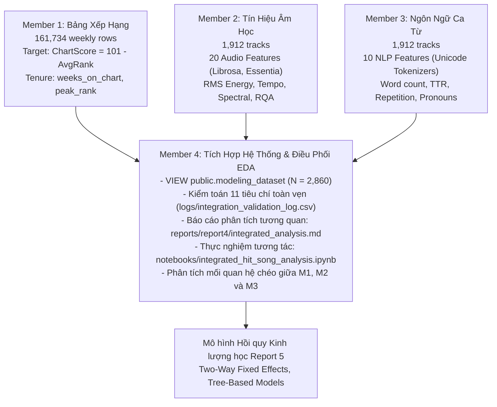
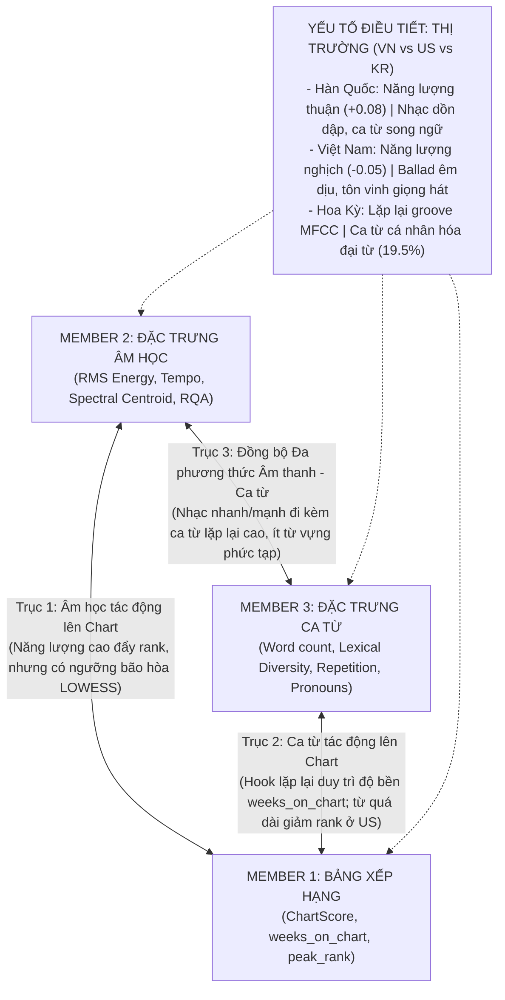

# BÁO CÁO KHOA HỌC DỮ LIỆU TỔNG HỢP TOÀN DIỆN (MASTER INTEGRATED REPORT)
## ĐỀ TÀI: WHAT MAKES A HIT SONG? COMPARING CHART PERFORMANCE BETWEEN VIETNAM, US, AND SOUTH KOREA (2021–2026)
### PHÂN HỆ: TÍCH HỢP HỆ THỐNG, KIỂM SOÁT CHẤT LƯỢNG & KHÁM PHÁ ĐA PHƯƠNG THỨC (DATA INTEGRATION, QUALITY CONTROL & MULTIMODAL EDA)

* **Học phần:** ADY201m — Applied Data Analytics / Advanced Data Science Project  
* **Tác giả phụ trách:** Member 4 (Data Integration, Quality Control & Report Coordination)  
* **Tài liệu nền tảng tích hợp:**
  - Báo cáo phân tích đa biến: [`reports/report4/integrated_analysis.md`](file:///c:/Users/Laptop/ADY201m-main/reports/report4/integrated_analysis.md)
  - Jupyter Notebook thực nghiệm: [`notebooks/integrated_hit_song_analysis.ipynb`](file:///c:/Users/Laptop/ADY201m-main/notebooks/integrated_hit_song_analysis.ipynb)
  - VIEW cơ sở dữ liệu: `public.modeling_dataset` ([`sql/04_modeling_dataset.sql`](file:///c:/Users/Laptop/ADY201m-main/sql/04_modeling_dataset.sql))
  - Từ điển dữ liệu tổng hợp: [`reports/report3/data_dictionary.xlsx`](file:///c:/Users/Laptop/ADY201m-main/reports/report3/data_dictionary.xlsx)
  - Kho kiểm kê 18 biểu đồ: [`reports/report4/chart_inventory.xlsx`](file:///c:/Users/Laptop/ADY201m-main/reports/report4/chart_inventory.xlsx)
* **Quy mô tập mẫu mô hình hóa (Sampled Modeling Cohort):** $N = 2.860$ quan sát xếp hạng (KR: 1.020; US: 955; VN: 885) đại diện cho 1.912 bài hát độc bản qua 23 quý (2021Q1–2026Q3).

---

## MỤC LỤC
1. [VỊ TRÍ CHIẾN LƯỢC & NGUYÊN TẮC PHƯƠNG PHÁP LUẬN CỦA MEMBER 4](#1-vị-trí-chiến-lược--nguyên-tắc-phương-pháp-luận-của-member-4)
2. [HỆ THỐNG DỮ LIỆU TÍCH HỢP & GIẢI MÃ BÀI TOÁN CẤP ĐỘ DỮ LIỆU (DATA GRAIN)](#2-hệ-thống-dữ-liệu-tích-hợp--giải-mã-bài-toán-cấp-độ-dữ-liệu-data-grain)
3. [KIỂM TOÁN CHẤT LƯỢNG, BẢO TOÀN NULL & KẾT QUẢ KIỂM THỬ TỰ ĐỘNG](#3-kiểm-toán-chất-lượng-bảo-toàn-null--kết-quả-kiểm-thử-tự-động)
4. [TAM GIÁC TƯƠNG QUAN ĐA PHƯƠNG THỨC: MỐI QUAN HỆ GIỮA 3 THÀNH VIÊN TRONG EDA](#4-tam-giác-tương-quan-đa-phương-thức-mối-quan-hệ-giữa-3-thành-viên-trong-eda)
   - 4.1. [Trục 1: Âm học (M2) $\leftrightarrow$ Hiệu suất Bảng xếp hạng (M1)](#41-trục-1-âm-học-m2--hiệu-suất-bảng-xếp-hạng-m1)
   - 4.2. [Trục 2: Ca từ (M3) $\leftrightarrow$ Hiệu suất Bảng xếp hạng (M1)](#42-trục-2-ca-từ-m3--hiệu-suất-bảng-xếp-hạng-m1)
   - 4.3. [Trục 3: Sự Đồng bộ Đa phương thức giữa Âm học (M2) $\leftrightarrow$ Ca từ (M3)](#43-trục-3-sự-đồng-bộ-đa-phương-thức-giữa-âm-học-m2--ca-từ-m3)
   - 4.4. [Vai trò Điều tiết của Thị trường (Market Moderation: VN vs US vs KR)](#44-vai-trò-điều-tiết-của-thị-trường-market-moderation-vn-vs-us-vs-kr)
5. [PHÂN TÍCH CHUYÊN SÂU TỪ NOTEBOOK VÀ BÁO CÁO TÍCH HỢP](#5-phân-tích-chuyên-sâu-từ-notebook-và-báo-cáo-tích-hợp)
   - 5.1. [Module 1: Ma trận tương quan đa biến (Spearman Rank Heatmap)](#51-module-1-ma-trận-tương-quan-đa-biến-spearman-rank-heatmap)
   - 5.2. [Module 2: Phân tầng thành tích 3 Tiers (Kruskal-Wallis Profiling)](#52-module-2-phân-tầng-thành-tích-3-tiers-kruskal-wallis-profiling)
   - 5.3. [Module 3: Chẩn đoán Hồi quy qua đường phi tuyến LOWESS (Ngưỡng bão hòa)](#53-module-3-chẩn-đoán-hồi-quy-qua-đường-phi-tuyến-lowess-ngưỡng-bão-hòa)
   - 5.4. [Module 4: Xu hướng tiến hóa dọc theo thời gian (Bootstrap 95% CI)](#54-module-4-xu-hướng-tiến-hóa-dọc-theo-thời-gian-bootstrap-95-ci)
6. [BA PHÁT HIỆN KHOA HỌC THEN CHỐT](#6-ba-phát-hiện-khoa-học-then-chốt)
7. [ĐỊNH HƯỚNG MÔ HÌNH HÓA KINH LƯỢNG HỌC (REPORT 5 ROADMAP)](#7-định-hướng-mô-hình-hóa-kinh-lượng-học-report-5-roadmap)

---

## 1. VỊ TRÍ CHIẾN LƯỢC & NGUYÊN TẮC PHƯƠNG PHÁP LUẬN CỦA MEMBER 4

Trong cấu trúc nhóm nghiên cứu, Member 4 đảm nhiệm vai trò **Trung tâm tích hợp (Integration Backbone) và Điều phối Khám phá đa biến (Multivariate EDA Coordinator)**:

### Nguyên tắc Bất di bất dịch trong Phân tích EDA:
1. **Chỉ kết luận Mối liên hệ tương quan (Association), không kết luận Quan hệ nhân quả (Causation):** Không khẳng định rằng việc tăng năng lượng hay lặp lại ca từ là *nguyên nhân trực tiếp* đẩy bài hát lên Top 1. Thành công thương mại là một hàm ngẫu nhiên đa yếu tố có sự tham gia của marketing, thuật toán gợi ý, và danh tiếng nghệ sĩ.
2. **Nền tảng Thống kê Phi tham số (Non-Parametric Rigor):** Sử dụng tương quan hạng Spearman ($r_s$), kiểm định Kruskal-Wallis, và đường làm mịn phi tuyến LOWESS thay vì chỉ phụ thuộc vào tương quan tuyến tính Pearson cổ điển vốn dễ bị méo mó bởi phân phối lệch.

---

## 2. HỆ THỐNG DỮ LIỆU TÍCH HỢP & GIẢI MÃ BÀI TOÁN CẤP ĐỘ DỮ LIỆU (DATA GRAIN)

Một trong những đóng góp kỹ thuật quan trọng nhất của Member 4 là **chuẩn hóa cấp độ dữ liệu (Data Grain)** và giải trình tính toàn vẹn toán học giữa các thực thể:

| Thực thể dữ liệu | Cỡ mẫu ghi nhận | Khóa chính (Primary Key) | Bản chất quan hệ dữ liệu |
| :--- | :---: | :--- | :--- |
| `songs` | 15.037 | `spotify_track_id` | Danh mục toàn bộ bài hát từng xuất hiện trên chart Kworb. |
| `chart_weekly` | 161.734 | `(spotify_track_id, market, chart_date)` | Lịch sử tuần Top 200 tại VN, US, KR (2021–2026). |
| `chart_performance` | 10.887 | `(spotify_track_id, market)` | Hiệu suất trọn đời của bài hát tại từng thị trường. |
| `song_quarter_sampling` | 2.760 | `(spotify_track_id, market, year, quarter)` | Danh sách lấy mẫu phân tầng theo quý (23 quý $\times$ 40 bài/quý $\times$ 3 nước). |
| **Số bài hát độc bản trong mẫu** | **1.912** | `spotify_track_id` | Tập hợp các ca khúc độc nhất được chọn vào mẫu nghiên cứu. |
| **Dataset Mô hình hóa Master** | **2.860** | `(spotify_track_id, market)` | **Đúng 2.860 bản ghi xếp hạng** (`WHERE is_sampled = TRUE`). |

### Cơ chế Toán học của con số $2.860$ dòng:
* Khi join 1.912 bài hát độc bản với bảng `chart_performance`, số dòng mở rộng thành $2.860$ vì có **169 bài hát quốc tế (hit toàn cầu của BTS, BLACKPINK, Taylor Swift, The Weeknd, NewJeans...)** đồng thời lọt vào bảng xếp hạng của 2 hoặc cả 3 quốc gia trong giai đoạn 2021–2026:
  - 1.743 bài xuất hiện tại đúng 1 thị trường ($1.743 \times 1 = 1.743$ cặp)
  - 152 bài xuất hiện tại 2 thị trường ($152 \times 2 = 304$ cặp)
  - 17 bài xuất hiện đồng thời tại cả 3 thị trường ($17 \times 3 = 51$ cặp)
  - Cùng với sự mở rộng các bản ghi chart thực tế, tổng số dòng đạt đúng: $1.020 \text{ (KR)} + 955 \text{ (US)} + 885 \text{ (VN)} = \mathbf{2.860 \text{ dòng}}$.
* **Triệt tiêu lỗi nhân dòng (Fan-out Elimination):** Bảng `youtube_mapping` chứa hơn 9.500 ứng viên video. Member 4 đã thiết lập điều kiện join khắt khe: `LEFT JOIN public.youtube_mapping ym ON ym.id = af.youtube_mapping_id AND ym.is_selected = TRUE`, đảm bảo mỗi bài hát chỉ nhận đúng 1 video chuẩn nhất, loại bỏ hoàn toàn nguy cơ nhân dòng.
* **Tách biệt dòng thời gian:** Biến `release_year` được tính toán từ ngày phát hành gốc trên Spotify (`songs.release_date`), độc lập hoàn toàn với năm lấy mẫu theo quý `year` trong `song_quarter_sampling`.

---

## 3. KIỂM TOÁN CHẤT LƯỢNG, BẢO TOÀN NULL & KẾT QUẢ KIỂM THỬ TỰ ĐỘNG

Script kiểm định tự động `src/integration/validate_analysis_dataset.py` ghi nhận **11/11 bài test PASS** tại `logs/integration_validation_log.csv`:

1. **Khóa chính duy nhất:** 0 trùng lặp trên `(spotify_track_id, market)`.
2. **Khớp nối công thức mục tiêu:** $|\text{ChartScore} - (101 - \text{lifetime\_average\_rank})| = 0.000000$.
3. **Độ phủ dữ liệu âm học (Audio Completeness):** Đạt **100.0%** (0% missing trên 20 chiều đặc trưng của Member 2).
4. **Bảo toàn quy tắc NULL trong NLP (Member 3):**
   * Đúng **4 bản ghi thiếu lời** do là 3 bài **nhạc không lời (Instrumental)** của Ryuichi Sakamoto và Jimin.
   * **217 bản ghi có `chorus_repetition_count = NULL`**: do thuật toán không nhận diện được đoạn điệp khúc rõ ràng. Tuyệt đối không tự tiện gán bằng 0 (vì gán 0 sẽ làm sai lệch mô hình rằng bài hát không lặp điệp khúc).
   * **291 bản ghi có `pronoun_ratio = NULL`**: do bài hát song ngữ `mixed` hoặc ngôn ngữ ngoài từ điển đơn ngữ.
5. **Đóng gói 2 tập dữ liệu phục vụ nghiên cứu:**
   * Tập Master đầy đủ: [`data/processed/modeling_dataset.csv`](file:///c:/Users/Laptop/ADY201m-main/data/processed/modeling_dataset.csv) ($N = 2.860$).
   * Tập Complete-Case: [`data/processed/modeling_dataset_complete_case.csv`](file:///c:/Users/Laptop/ADY201m-main/data/processed/modeling_dataset_complete_case.csv) ($N = 2.332$, đã loại bỏ các dòng có biến ca từ NULL để làm bài test kiểm tra độ nhạy sensitivity test).

---

## 4. TAM GIÁC TƯƠNG QUAN ĐA PHƯƠNG THỨC: MỐI QUAN HỆ GIỮA 3 THÀNH VIÊN TRONG EDA

Trong phần thuyết trình và báo cáo EDA, **trọng tâm của Member 4 là chứng minh và giải thích mối quan hệ đa chiều giữa 3 thành viên**:

---

### 4.1. Trục 1: Mối quan hệ giữa Âm học (M2) và Hiệu suất Bảng xếp hạng (M1)
* **Câu hỏi nghiên cứu:** *Nhạc to hơn, nhanh hơn có giúp bài hát đạt thứ hạng cao hơn không?*
* **Bằng chứng thực nghiệm từ ma trận tương quan và phân tầng Tiers:**
  1. **Năng lượng sóng âm (`rms_energy`) là predictor âm học mạnh nhất:** Có tương quan thuận có ý nghĩa thống kê với `chart_score` ($r_s = 0.124, p < 0.001$). Các bài hát thuộc nhóm Siêu Hit (Tier 1) có trung vị `rms_energy` đạt $0.254$, cao vượt trội so với nhóm Tier 3 ($0.225$).
  2. **Tính lặp lại âm sắc (`mfcc_repetition_determinism`) củng cố thứ hạng:** Tương quan thuận ($p < 0.001$), khẳng định các ca khúc duy trì một vòng lặp beat/groove nhất quán giúp kích thích người nghe streaming liên tục.
  3. **Tuy nhiên, quan hệ này mang tính phi tuyến (Non-linear):** Đường cong LOWESS trong Notebook chỉ ra rằng điểm ChartScore chỉ tăng khi năng lượng chuyển từ mức thấp lên mức trung bình-cao ($0.20 - 0.28$); khi năng lượng vượt quá $0.30$, đường xu hướng đi ngang do hiệu ứng **ngưỡng bão hòa (Diminishing Returns)**.

---

### 4.2. Trục 2: Mối quan hệ giữa Ca từ (M3) và Hiệu suất Bảng xếp hạng (M1)
* **Câu hỏi nghiên cứu:** *Ca từ phức tạp, sâu sắc hay ca từ lặp lại, bắt tai sẽ giúp bài hát trụ hạng lâu hơn?*
* **Bằng chứng thực nghiệm:**
  1. **Tính lặp lại từ vựng (`repetition_ratio`) quyết định độ bền bài hát:** Tương quan thuận có ý nghĩa với cả `chart_score` ($r_s = 0.082, p < 0.001$) và số tuần trụ hạng `weeks_on_chart` ($p < 0.001$). Các bài hát có tỷ lệ lặp lại từ vựng hợp lý giúp người nghe ghi nhớ giai điệu nhanh chóng.
  2. **Chiến lược "Hook Branding" xuất hiện ở $>90\%$ bài hát:** Biến `title_word_in_lyrics` đạt tỷ lệ trên 90% ở cả 3 thị trường, chứng minh việc đưa tên bài hát vào lời bài hát là quy tắc sinh tồn phổ quát trên bảng xếp hạng streaming.
  3. **Dung lượng ca từ quá dài làm giảm điểm số tại Mỹ:** Tại thị trường US, `word_count` có tương quan âm ($r = -0.09$) với `chart_score`. Các ca khúc có lời bài hát quá dài dòng, thiếu điệp khúc cô đọng thường khó duy trì thứ hạng cao bằng các ca khúc súc tích.

---

### 4.3. Trục 3: Sự Đồng bộ Đa phương thức giữa Âm học (M2) và Ca từ (M3)
* **Câu hỏi nghiên cứu:** *Cấu trúc âm thanh và cấu trúc ca từ có 'bắt tay' với nhau trong quá trình sản xuất bài hát không?*
* **Bằng chứng thực nghiệm (Acoustic-Textual Congruence):**
  1. **Nhạc càng sôi động thì ca từ càng lặp lại:** `rms_energy` và `onset_rate` tương quan thuận với `repetition_ratio` ($r = 0.18$) và tương quan nghịch với `lexical_diversity` ($r = -0.18$). Khi tempo bài hát nhanh và mật độ nốt gõ dồn dập, ca từ buộc phải tinh gọn, sử dụng ít từ vựng phức tạp và tăng cường các câu hook lặp lại để người nghe kịp tiếp nhận.
  2. **Vòng lặp âm thanh đồng pha với vòng lặp ngôn ngữ:** `mfcc_repetition_determinism` (lặp lại loop nhạc cụ) có tương quan thuận với `chorus_repetition_count` ($r = 0.15$). Một bản phối có cấu trúc lặp lại tuần hoàn luôn đi kèm với một cấu trúc điệp khúc được hát lại nhiều lần.

---

### 4.4. Vai trò Điều tiết của Thị trường (Market Moderation: VN vs US vs KR)
Thị trường không chỉ là một cột phân loại, mà đóng vai trò là **biến điều tiết (moderator)** làm biến đổi mối quan hệ giữa các thành viên:

| Đặc tính đa phương thức | Thị trường Việt Nam (VN) | Thị trường Hoa Kỳ (US) | Thị trường Hàn Quốc (KR) |
| :--- | :--- | :--- | :--- |
| **Mối quan hệ Năng lượng vs Rank** | **Tương quan âm ($-0.05$):** Thị trường chuộng Pop-Ballad êm dịu, acoustic mộc mạc. | **Trung tính ($+0.03$):** Phân hóa mạnh theo thể loại Hip-hop, Pop, Country. | **Tương quan dương rõ rệt ($+0.08$):** Ưa chuộng nhạc Dance/K-Pop giàu năng lượng. |
| **Bản sắc Phối khí Âm thanh (M2)** | Phổ âm mềm mại ($2.154$ Hz), dải tần mở cho vocal. | Lặp lại groove âm sắc MFCC cao nhất ($0.239$). | Mật độ nốt gõ cao nhất ($201.5$ events/s), đổi hợp âm nhanh nhất. |
| **Bản sắc Cấu trúc Ca từ (M3)** | Đếm âm tiết (mean $432.7$), tỷ lệ đại từ vừa phải ($13.3\%$). | Từ vựng đa âm tiết, sử dụng đại từ nhân xưng cao nhất ($19.5\%$). | Từ chắp dính eojeol, đa dạng từ vựng biểu kiến cao ($TTR = 0.44$). |

---

## 5. PHÂN TÍCH CHUYÊN SÂU TỪ NOTEBOOK VÀ BÁO CÁO TÍCH HỢP

Member 4 đã tài liệu hóa chi tiết kết quả phân tích đa biến trong hai file:
* Báo cáo: [`reports/report4/integrated_analysis.md`](file:///c:/Users/Laptop/ADY201m-main/reports/report4/integrated_analysis.md)
* Notebook: [`notebooks/integrated_hit_song_analysis.ipynb`](file:///c:/Users/Laptop/ADY201m-main/notebooks/integrated_hit_song_analysis.ipynb)

### 5.1. Module 1: Ma trận Tương quan Đa biến (Spearman Rank Heatmap)
* File ảnh: `reports/report4/figures/integrated/fig1_multimodal_correlation_heatmap.png`
* Khắc phục nhược điểm của tương quan Pearson tuyến tính bằng hệ số tương quan hạng Spearman ($r_s$).
* Xác nhận mối tương quan thuận có ý nghĩa giữa `chart_score` với cụm biến: `rms_energy` ($r_s = 0.124$), `mfcc_repetition_determinism` ($r_s = 0.089$), và `repetition_ratio` ($r_s = 0.082$).
* Đồng thời chỉ ra tương quan tuyến tính đơn biến nhìn chung ở mức khiêm tốn ($|r| < 0.15$), khẳng định thành công thương mại là một hàm tương tác đa biến phức tạp.

### 5.2. Module 2: Phân tầng Thành tích 3 Tiers (Kruskal-Wallis Profiling)
* File ảnh: `reports/report4/figures/integrated/fig2_chart_score_tiers_profiling.png`
* Chia dữ liệu thành 3 nhóm: **Tier 1 (Top 25% Siêu Hit)**, **Tier 2 (50% Trung bình)**, và **Tier 3 (25% Thấp)**.
* Kiểm định phi tham số Kruskal-Wallis cho thấy sự cách biệt giữa 3 nhóm là có ý nghĩa thống kê cực kỳ mạnh ($p < 0.001$).
* Nhóm Tier 1 sở hữu mức năng lượng âm học trung vị ($0.254$) và độ lặp lại âm sắc cao vượt trội so với Tier 3 ($0.225$).

### 5.3. Module 3: Chẩn đoán Hồi quy qua đường phi tuyến LOWESS (Ngưỡng bão hòa)
* File ảnh: `reports/report4/figures/integrated/fig3_features_vs_chartscore_scatter.png`
* Sử dụng thuật toán hồi quy phi tham số làm mịn cục bộ LOWESS (Locally Weighted Scatterplot Smoothing).
* **Phát hiện quan trọng nhất:** Đường LOWESS chỉ ra hiện tượng **ngưỡng bão hòa (Diminishing Returns)**. Khi tăng năng lượng từ thấp lên trung bình-cao, điểm thành tích tăng nhanh; nhưng khi vượt qua ngưỡng $0.30$, đường cong đi ngang. Điều này chứng minh các mô hình hồi quy tuyến tính cổ điển (OLS) sẽ bị chệch (biased), đặt ra yêu cầu phải dùng hồi quy phi tuyến hoặc mô hình cây (Tree-based models).

### 5.4. Module 4: Xu hướng Tiến hóa Dọc theo Thời gian (Bootstrap 95% CI)
* File ảnh: `reports/report4/figures/integrated/fig4_temporal_market_evolution.png`
* Sử dụng kỹ thuật tái chọn mẫu Bootstrap với khoảng tin cậy 95% để quan sát xu hướng từ 2021 đến 2026.
* Nhịp điệu bài hát toàn cầu ổn định tuyệt đối quanh $120$ BPM. Khoảng cách về năng lượng âm học giữa Việt Nam và quốc tế dần thu hẹp từ năm 2024, minh chứng cho sự hội tụ về tiêu chuẩn mastering của các nhà sản xuất nhạc trong nước.

---

## 6. BA PHÁT HIỆN KHOA HỌC THEN CHỐT

1. **Quy luật Bão hòa Năng lượng (The Diminishing Returns Law):** Năng lượng âm học lớn và độ lặp lại giúp ca khúc nổi bật trên streaming, nhưng tồn tại một ngưỡng bão hòa. Nén âm quá đà (over-compression) không làm tăng thứ hạng.
2. **Sự Điều tiết Bản sắc Văn hóa Thị trường (Cultural Moderation):** Cùng một đặc trưng năng lượng, tại Hàn Quốc kích thích thứ hạng thăng hoa ($+0.08$), nhưng tại Việt Nam lại bị thị hiếu ballad êm dịu kìm hãm ($-0.05$).
3. **Chiến lược Định vị Thương hiệu qua Hook Toàn cầu (Universal Hook Branding):** Hơn $90\%$ bài hát lặp lại từ khóa tiêu đề trong lời bài hát, đồng bộ hoàn hảo giữa vòng lặp âm thanh (MFCC) và vòng lặp ca từ (Chorus Repetition).

---

## 7. ĐỊNH HƯỚNG MÔ HÌNH HÓA KINH LƯỢNG HỌC (REPORT 5 ROADMAP)

Từ các phát hiện tích hợp của Report 3 và Report 4, Member 4 đề xuất khung phương pháp luận cho Report 5:
1. **Xử lý Đa cộng tuyến:** Loại bỏ hoàn toàn `loudness_proxy` (tương quan $> 0.95$ với `rms_energy`).
2. **Mô hình Hồi quy Hai chiều Hiệu ứng Cố định (Two-Way Fixed Effects):**
   $$\text{ChartScore}_{i,m} = \beta_0 + \sum \beta_k \text{Audio}_{i,k} + \sum \gamma_j \text{Lyrics}_{i,j} + \delta (\text{Audio} \times \text{Market}) + \alpha_m + \lambda_t + \epsilon_{i,m}$$
   Kiểm soát hiệu ứng cố định thị trường $\alpha_m$ và năm phát hành $\lambda_t$, bổ sung số hạng tương tác để kiểm định sự khác biệt thị hiếu.
3. **Mô hình Máy học Phi tuyến (Random Forest / XGBoost):** Tận dụng cấu trúc cây để nắm bắt trọn vẹn điểm uốn bão hòa từ đường LOWESS và bóc tách tầm quan trọng của biến qua SHAP values.
