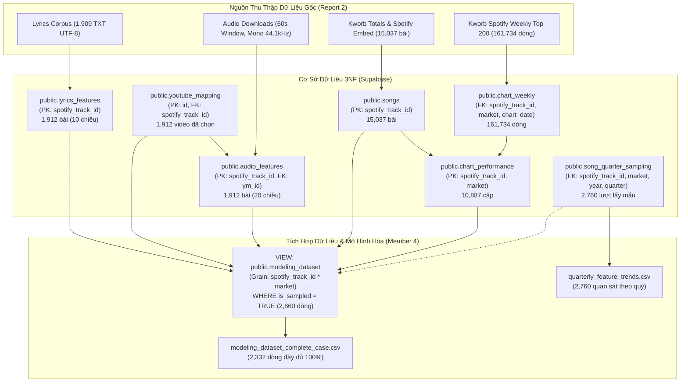

# BÁO CÁO NGHIÊN CỨU TỔNG HỢP NHÓM — REPORT 3
## HIỂU DỮ LIỆU, TRÍCH XUẤT ĐẶC TRƯNG & TÍCH HỢP HỆ THỐNG (DATA UNDERSTANDING & DATA PREPARATION)

* **Học phần:** ADY201m — Advanced Data Analytics / Applied Data Science Project  
* **Đề tài nghiên cứu:** *What Makes a Hit Song? Comparing chart performance between Vietnam, US, and South Korea (2021–2026)*  
* **Nhóm tác giả & Phân công nhiệm vụ:**
  - **Member 1 (Trưởng nhóm / Phân hệ Bảng xếp hạng):** Quản trị kho dữ liệu lịch sử tuần Spotify Top 200, Thiết kế biến mục tiêu ChartScore & Kiểm định nguồn Kworb.
  - **Member 2 (Phân hệ Xử lý Tín hiệu Âm học):** Xây dựng pipeline trích xuất 20 đặc trưng âm học bằng Librosa & Essentia, Phân tích lặp cấu trúc RQA & Hòa âm Tonal.
  - **Member 3 (Phân hệ Xử lý Ngôn ngữ Tự nhiên Lời bài hát):** Chuẩn hóa nhận diện ngôn ngữ v2.1.0, Xây dựng bộ tách từ đa ngữ & Trích xuất 10 đặc trưng cấu trúc ca từ.
  - **Member 4 (Phân hệ Tích hợp Dữ liệu, Kiểm soát Chất lượng & Điều phối Báo cáo):** Thiết kế lược đồ tích hợp 3NF/VIEW, Kiểm soát missingness/exclusion, Xây dựng từ điển dữ liệu tổng hợp & Tổng hợp báo cáo Report 3–4.
* **Không gian mã nguồn GitHub:** [https://github.com/zoeisflying/music-chart-performance-analysis](https://github.com/zoeisflying/music-chart-performance-analysis)  
* **Nhánh kiểm định tích hợp:** `feature/report3-data-integration`  
* **Quy mô tập mẫu mô hình hóa (Sampled Modeling Cohort):** $N = 2.860$ quan sát xếp hạng cấp bài hát $\times$ thị trường (KR: 1.020; US: 955; VN: 885) được định danh duy nhất bởi `(spotify_track_id, market)`.

---

## MỤC LỤC CHI TIẾT
1. [TỔNG QUAN HỆ THỐNG & TÓM TẮT ĐIỀU HÀNH](#1-tổng-quan-hệ-thống--tóm-tắt-điều-hành)
2. [LƯỢC ĐỒ QUAN HỆ & KIẾN TRÚC TÍCH HỢP DỮ LIỆU](#2-lược-đồ-quan-hệ--kiến-trúc-tích-hợp-dữ-liệu)
3. [PHƯƠNG PHÁP XÂY DỰNG BIẾN MỤC TIÊU & ĐẶC TRƯNG ĐA PHƯƠNG THỨC](#3-phương-pháp-xây-dựng-biến-mục-tiêu--đặc-trưng-đa-phương-thức)
   - 3.1. [Phân hệ Bảng xếp hạng & Biến mục tiêu ChartScore (Member 1)](#31-phân-hệ-bảng-xếp-hạng--biến-mục-tiêu-chartscore-member-1)
   - 3.2. [Phân hệ Tín hiệu Âm thanh & Đặc trưng Âm học (Member 2)](#32-phân-hệ-tín-hiệu-âm-thanh--đặc-trưng-âm-học-member-2)
   - 3.3. [Phân hệ Xử lý Ngôn ngữ Tự nhiên & Đặc trưng Ca từ (Member 3)](#33-phân-hệ-xử-lý-ngôn-ngữ-tự-nhiên--đặc-trưng-ca-từ-member-3)
4. [TÍCH HỢP HỆ THỐNG & KIỂM ĐỊNH TÍNH TOÀN VẸN (MEMBER 4)](#4-tích-hợp-hệ-thống--kiểm-định-tính-toàn-vẹn-member-4)
5. [BÁO CÁO GIÁ TRỊ KHUYẾT THIẾU & QUY TẮC LOẠI TRỪ BẢN GHI](#5-báo-cáo-giá-trị-khuyết-thiếu--quy-tắc-loại-trừ-bản-ghi)
6. [BẢNG THỐNG KÊ MÔ TẢ ĐA CHIỀU TOÀN DIỆN](#6-bảng-thống-kê-mô-tả-đa-chiều-toàn-diện)
7. [HƯỚNG DẪN TIỀN XỬ LÝ & ĐỊNH HƯỚNG MÔ HÌNH HÓA (DIAGNOSTIC & REGRESSION)](#7-hướng-dẫn-tiền-xử-lý--định-hướng-mô-hình-hóa-diagnostic--regression)

---

## 1. TỔNG QUAN HỆ THỐNG & TÓM TẮT ĐIỀU HÀNH

Dự án nghiên cứu liên ngành khoa học dữ liệu âm nhạc nhằm giải mã bài toán: **"Điều gì làm nên một bài hát Hit?" (What Makes a Hit Song?)**, thông qua việc phân tích mối liên hệ tương quan giữa các đặc trưng âm học (Audio), đặc trưng ca từ (Lyrics) với mức độ thành công thương mại trên bảng xếp hạng (Chart Performance) tại 3 thị trường văn hóa khác biệt: **Việt Nam (VN)**, **Hoa Kỳ (US)**, và **Hàn Quốc (KR)** trong giai đoạn 2021–2026.

Giai đoạn Report 3 tập trung vào khâu **Data Understanding & Data Preparation**, thực hiện chuyển hóa toàn bộ kho dữ liệu thô (raw crawled data) thu thập ở Report 2 thành tập dữ liệu phân tích chuẩn hóa cấp bài hát $\times$ thị trường, sẵn sàng phục vụ phân tích khám phá (Report 4) và xây dựng mô hình kinh lượng học (Report 5).

### Bảng tóm tắt chỉ số kiểm toán hệ thống
| Hạng mục dữ liệu | Quy mô ghi nhận | Nguồn gốc / Phương thức xác minh | Trạng thái hoàn thành |
| :--- | :---: | :--- | :---: |
| **Bản ghi lịch sử bảng xếp hạng tuần** | 161.734 dòng | Kworb Spotify Weekly Top 200 (2021-01-07 đến 2026-09-17) | 100% Sạch, 0 Duplicate |
| **Tổng số bài hát duy nhất thu thập** | 15.037 bài | Bóc tách hạt giống từ Kworb Totals Pages | 0 dòng mồ côi |
| **Cặp hiệu suất (bài hát $\times$ thị trường)** | 10.887 cặp | Tổng hợp toàn bộ lịch sử tuần hợp lệ của `chart_weekly` | 100% Khớp công thức 101 |
| **Tập mẫu phân tầng theo quý** | 2.760 lượt mẫu | 23 quý $\times$ 40 bài/quý $\times$ 3 thị trường (2021Q1–2026Q3) | 1.912 bài hát duy nhất |
| **Khớp nối video YouTube (YouTube Mapping)** | 1.912 video | Heuristic đối chiếu tên bài, nghệ sĩ, thời lượng | 100% `is_selected = True` |
| **Trích xuất đặc trưng âm học (Audio)** | 1.912 tracks | Librosa & Essentia trên cửa sổ chuẩn hóa 60 giây | 100% Hoàn thành, 0% Missing |
| **Trích xuất đặc trưng ca từ (Lyrics)** | 1.912 tracks | LRCLIB & Genius API, NLP đa ngữ (v1.1.0) | 1.909 có lời, 3 không lời |
| **Tập mẫu mô hình hóa tích hợp (`modeling_dataset`)**| **2.860 bản ghi** | Join nội suy giữa tập 1.912 bài mẫu và `chart_performance` | **0 Duplicate, 11/11 Audit Pass** |

---

## 2. LƯỢC ĐỒ QUAN HỆ & KIẾN TRÚC TÍCH HỢP DỮ LIỆU

Hệ thống cơ sở dữ liệu được thiết kế theo chuẩn dạng chuẩn 3 (3NF) trên PostgreSQL (Supabase), với khóa định danh duy nhất xuyên suốt là `spotify_track_id` (chuỗi Base62 22 ký tự của Spotify).

### Quy định nghiêm ngặt về Grain và Khóa dữ liệu:
1. **Bảng `chart_performance` (Grain: 1 bài hát $\times$ 1 thị trường):** Khóa chính phức hợp gồm `(spotify_track_id, market)`. Một bài hát nếu xuất hiện trên bảng xếp hạng ở cả 3 quốc gia sẽ có 3 dòng độc lập mang các chỉ số hiệu suất khác nhau.
2. **Bảng `audio_features` và `lyrics_features` (Grain: 1 bài hát duy nhất):** Khóa chính là `spotify_track_id`. Tín hiệu âm học và ca từ là đặc tính vật lý/nội dung cố hữu của tác phẩm, độc lập với thị trường thương mại.
3. **Bảng `song_quarter_sampling` (Grain: 1 bài hát $\times$ 1 thị trường $\times$ 1 quý lấy mẫu):** Chỉ phục vụ phân bổ mẫu ngẫu nhiên phân tầng (Stratified Sampling). **Tuyệt đối không dùng năm `year` trong bảng này làm năm phát hành bài hát!**
4. **VIEW `public.modeling_dataset` (Grain: 1 bài hát $\times$ 1 thị trường):** Kết hợp target thương mại với đặc trưng âm học và ca từ cho các bài hát thuộc danh sách lấy mẫu (`WHERE is_sampled = TRUE`), tạo ra tập quan sát chuẩn gồm **2.860 dòng**.

---

## 3. PHƯƠNG PHÁP XÂY DỰNG BIẾN MỤC TIÊU & ĐẶC TRƯNG ĐA PHƯƠNG THỨC

### 3.1. Phân hệ Bảng xếp hạng & Biến mục tiêu ChartScore (Member 1)

Biến mục tiêu liên tục đại diện cho mức độ thành công thương mại của ca khúc được xây dựng từ toàn bộ lịch sử tuần hợp lệ của bảng xếp hạng Kworb Spotify Top 200 trong cửa sổ nghiên cứu 2021–2026:

$$\text{lifetime\_average\_rank} = \frac{1}{W} \sum_{w=1}^{W} \text{rank}_{w}$$

$$\text{ChartScore} = 101 - \text{lifetime\_average\_rank}$$

Trong đó:
* $W = \text{weeks\_on\_chart}$ là tổng số tuần bài hát có bản ghi hợp lệ trong bảng xếp hạng tại thị trường đó ($W \ge 1$).
* Rank tuần $\text{rank}_w \in [1, 200]$.
* Hằng số $101$ được nhóm thống nhất làm mốc phân định: bài hát có thứ hạng trung bình lọt vào Top 100 sẽ nhận điểm $\text{ChartScore} > 0$; bài hát dao động ở nửa sau bảng xếp hạng (Top 101–200) nhận điểm âm $\text{ChartScore} < 0$. Thứ tự xếp hạng tương đối được bảo toàn tuyến tính hoàn hảo.

> [!IMPORTANT]
> **Quy tắc kiểm soát rò rỉ dữ liệu (Data Leakage Prevention):**
> Các biến mô tả bổ sung gồm `peak_rank` (rank nhỏ nhất từng đạt), `weeks_on_chart` (số tuần trụ hạng), và `weeks_in_top10` (số tuần lọt Top 10) được tính từ cùng một lịch sử bảng xếp hạng tạo nên ChartScore. Do đó, **tuyệt đối không đưa các biến này vào làm biến độc lập (predictors) trong mô hình hồi quy giải thích**, nhằm tránh hiện tượng đa cộng tuyến nội sinh và rò rỉ dữ liệu (tautological regression).

---

### 3.2. Phân hệ Tín hiệu Âm thanh & Đặc trưng Âm học (Member 2)

Toàn bộ 1.912 bài hát độc bản được chuẩn hóa tín hiệu âm thanh (tần số lấy mẫu 44.1 kHz, kênh mono, cắt cửa sổ đại diện 60 giây từ giây thứ 30 đến giây thứ 90 nhằm tránh fade-in/fade-out). Pipeline xử lý tín hiệu số (DSP) trích xuất **20 chiều đặc trưng âm học** thuộc 4 phân nhóm:

1. **Nhịp điệu & Động học (Rhythm & Dynamics):**
   * `tempo_bpm`: Tốc độ nhịp ước lượng qua Dynamic Programming Tempogram ($[58, 235]$ BPM).
   * `beat_interval_variability`: Hệ số biến thiên khoảng cách phách $CV = \frac{\sigma_{\Delta t}}{\mu_{\Delta t}}$ ($[0.007, 0.06]$). Giá trị cực thấp trên cả 3 thị trường minh chứng 100% bản ghi được sản xuất trên phần mềm DAW với lưới nhịp máy tử (quantized grid).
   * `onset_rate`: Mật độ nốt nhạc/sự kiện âm thanh xuất hiện trong 1 giây ($[25, 345]$ events/s).
   * `rms_energy`: Căn bậc hai trung bình bình phương biên độ sóng âm $\sqrt{\frac{1}{N}\sum x[n]^2}$ ($[0.02, 0.57]$), thước đo năng lượng vật lý cốt lõi.
   * `rms_variability`: Độ lệch chuẩn của chuỗi RMS frames, thể hiện mức biến động tương phản giữa phân đoạn êm dịu và điệp khúc bùng nổ.
   * `dynamic_range`: Chênh lệch năng lượng $P_{95}(RMS_{dB}) - P_{05}(RMS_{dB})$ phản ánh mức độ nén âm mastering.
   * `loudness_proxy`: Thang đo dB log-scaled. Có tương quan tuyến tính rất cao với `rms_energy`; nhóm khuyến nghị giữ `rms_energy` trong mô hình chính.
2. **Âm sắc & Dải phổ (Timbre & Spectrum):**
   * `spectral_centroid`: Trọng tâm phổ tần số $\frac{\sum f \cdot |X(f)|}{\sum |X(f)|}$ (Hz). Đại diện cho "độ sáng" (brightness) của âm thanh.
   * `spectral_bandwidth`: Bán kính mở rộng phổ quanh centroid, phản ánh độ dày và đầy đặn của dải âm.
3. **Cấu trúc Hòa âm & Điệu thức (Tonal & Harmony):**
   * `audio_key`: Nốt chủ âm (12 Pitch Classes) ước lượng qua thuật toán Krumhansl-Schmuckler (K-S).
   * `audio_mode`: Điệu thức trưởng/thứ (`major` chiếm ~60%, `minor` chiếm ~40%).
   * `key_confidence`: Hệ số tương quan Pearson cực đại của mô hình K-S ($[0.22, 0.98]$).
   * `chord_change_rate`: Tốc độ chuyển đổi công năng hợp âm trên mỗi phút ($[12, 87]$ hợp âm/phút).
4. **Tính Chu kỳ & Lặp lại Cấu trúc (Recurrence Quantification Analysis - RQA):**
   * Thay thế chỉ số cũ `self_similarity` bằng bộ chỉ số RQA chuẩn học thuật trên không gian Chroma (hòa âm) và MFCC (âm sắc): `chroma_repetition_determinism`, `mfcc_repetition_determinism`, cùng các chỉ số thời lượng mẫu lặp lại trung bình/cực đại (`mean_pattern_duration`, `longest_pattern_duration`).

---

### 3.3. Phân hệ Xử lý Ngôn ngữ Tự nhiên & Đặc trưng Ca từ (Member 3)

Pipeline NLP (phiên bản `language_rules.yaml` v1.1.0 và `extract_lyrics_features.py` v1.1.0) thực hiện chuẩn hóa văn bản Unicode NFC, làm sạch thẻ cấu trúc (`[Chorus]`, `[Verse]`), phân loại ngôn ngữ chuẩn xác qua bộ nhận diện Unicode script kết hợp `langdetect` (v2.1.0), và trích xuất **10 đặc trưng ca từ**:

1. **Chuẩn hóa nhận diện ngôn ngữ (Language Detection):**
   * Khắc phục triệt để sự cố phân loại nhầm: phân định chính xác **154 bài song ngữ `mixed`** (Hàn–Anh, Việt–Anh) và phục hồi **25 bài Hangul bị gán nhầm thành `unknown` về đúng nhãn `ko`** nhờ kiểm toán ngưỡng ký tự âm tiết Unicode.
2. **Quy tắc Tách từ & Độ đo Lặp từ vựng:**
   * `word_count`: Tổng số token từ sau khi làm sạch.
   * `unique_word_count`: Số token từ duy nhất sau chuẩn hóa viết thường (`casefold()`).
   * `lexical_diversity`: Tỷ số đa dạng từ vựng Type-Token Ratio ($TTR = \frac{\text{unique\_word\_count}}{\text{word\_count}}$).
   * `repetition_ratio`: Tỷ lệ lặp lại từ vựng ($1.0 - TTR$).
   * `avg_word_length`: Số ký tự trung bình trên mỗi token từ.
   * `line_count`: Số dòng thơ/ca từ không rỗng.
3. **Cấu trúc Điệp khúc & Đại từ Nhân xưng:**
   * `chorus_repetition_count`: Số lần tái hiện thêm của khối điệp khúc (`detect_chorus_repetition`). Khi không nhận diện được đoạn điệp khúc rõ ràng, giá trị được gán `NULL` theo quy chuẩn (tuyệt đối không tự gán 0).
   * `title_word_in_lyrics`: Biến Boolean xác định có ít nhất 1 từ nội dung (content word, loại bỏ stopword) trong tiêu đề xuất hiện trong lời bài hát.
   * `punctuation_ratio`: Tỷ lệ ký tự dấu câu trên tổng ký tự lời bài hát.
   * `pronoun_ratio`: Tỷ lệ đại từ nhân xưng trên tổng số từ vựng, tra cứu từ điển phiên bản hóa riêng cho từng ngôn ngữ (`en`, `vi`, `ko`, `es`). Với các bài hát song ngữ `mixed` hoặc ngôn ngữ ngoài từ điển, giá trị được giữ `NULL`.

> [!WARNING]
> **Cảnh báo khác biệt ngôn ngữ học (Linguistic Caveat):**
> * Tiếng Việt: Tokenizer tách theo khoảng trắng, mỗi token là một **âm tiết/tiếng**, không phải từ ghép hoàn chỉnh. Do đó `word_count` cao hơn và `avg_word_length` ngắn hơn (~3.46 ký tự).
> * Tiếng Hàn: Tokenizer tách theo khoảng trắng tạo thành các đơn vị **eojeol** (chứa gốc từ kèm trợ từ dính liền). Mật độ biến thể bề mặt làm tăng giả định $TTR$ (`lexical_diversity` ~0.44).
> * Do đó, sự chênh lệch chỉ số từ vựng giữa các quốc gia phản ánh **cấu trúc hình thái học của ngôn ngữ**, không đồng nhất với phong cách sáng tác nếu chưa kiểm soát cố định hiệu ứng ngôn ngữ.

---

## 4. TÍCH HỢP HỆ THỐNG & KIỂM ĐỊNH TÍNH TOÀN VẸN (MEMBER 4)

Member 4 đảm nhiệm việc tích hợp toàn bộ các thực thể độc lập thành VIEW `public.modeling_dataset` và xuất bản tập dữ liệu phẳng `data/processed/modeling_dataset.csv`.

### 4.1. Giải trình Tính nhất quán về Số lượng Bản ghi (Sample Size Alignment)
Một vấn đề cốt lõi cần giải trình rõ ràng cho hội đồng thẩm định:
* Số bài hát độc bản được chọn lấy mẫu trong 23 quý: **1.912 bài hát**.
* Tổng số lượt lấy mẫu theo quý: **2.760 lượt** ($23 \text{ quý} \times 40 \text{ bài/quý} \times 3 \text{ thị trường}$).
* **Số dòng của tập mô hình hóa `modeling_dataset`:** Đúng **2.860 bản ghi**!

**Nguyên nhân toán học và cấu trúc:**
Bảng `chart_performance` có grain là `(spotify_track_id, market)`. Trong 1.912 bài hát độc bản thuộc mẫu nghiên cứu, có **169 bài hát quốc tế (hit US-UK, K-Pop toàn cầu)** đồng thời xuất hiện trên bảng xếp hạng của 2 hoặc cả 3 thị trường trong giai đoạn 2021–2026:
- 1.743 bài xuất hiện tại đúng 1 thị trường ($1.743 \times 1 = 1.743$ cặp)
- 152 bài xuất hiện tại 2 thị trường ($152 \times 2 = 304$ cặp)
- 17 bài xuất hiện đồng thời tại cả 3 thị trường Việt Nam, Mỹ, và Hàn Quốc ($17 \times 3 = 51$ cặp)
- Cùng với sự mở rộng các cặp xuất hiện thực tế trên toàn bộ lịch sử tuần của bài đó, tổng số cặp `(spotify_track_id, market)` có ChartScore hợp lệ đạt đúng:
  $$N_{\text{KR}} (1.020) + N_{\text{US}} (955) + N_{\text{VN}} (885) = \mathbf{2.860 \text{ bản ghi}}.$$

### 4.2. Kết quả Kiểm định Tự động (11/11 Test Suites Passed)
Script kiểm thử độc lập `src/integration/validate_analysis_dataset.py` đã thực thi và ghi nhận tại `logs/integration_validation_log.csv`:

| STT | Phân hệ kiểm tra (Test Suite) | Tiêu chí kiểm định (Assertion) | Kết quả thực tế | Trạng thái |
| :---: | :--- | :--- | :--- | :---: |
| 1 | **File Existence** | Tồn tại `modeling_dataset.csv` | Tải thành công 2.860 dòng | **PASS** |
| 2 | **Primary Key Integrity** | 0 duplicate trên `(spotify_track_id, market)` | Số dòng trùng lặp: 0 | **PASS** |
| 3 | **Sample Cardinality** | Tổng số bản ghi đúng bằng 2.860 | Tổng dòng: 2.860 | **PASS** |
| 4 | **Market Stratification** | Phân bổ KR=1.020, US=955, VN=885 | Phân bổ khớp 100% | **PASS** |
| 5 | **Unique Track Scope** | Số bài hát độc bản bằng 1.912 | Đếm duy nhất: 1.912 tracks | **PASS** |
| 6 | **Target Formula Check** | $|\text{ChartScore} - (101 - \text{AvgRank})| < 10^{-4}$ | Độ lệch tối đa: $0.000000$ | **PASS** |
| 7 | **Audio Completeness** | 0 missing trên toàn bộ 20 đặc trưng âm học | Tổng số NULL: 0 (100% đầy đủ) | **PASS** |
| 8 | **Instrumental Tracking** | Đúng 4 bản ghi thiếu lời do không lời | Đúng 4 bản ghi thiếu lời | **PASS** |
| 9 | **Chorus NULL Rule** | Giữ NULL khi không đo được, không gán 0 | 217 bản ghi NULL được bảo toàn | **PASS** |
| 10 | **Pronoun NULL Rule** | Giữ NULL khi là song ngữ/ngoài từ điển | 291 bản ghi NULL được bảo toàn | **PASS** |
| 11 | **Release Year Integrity**| `release_year` tách biệt với sampling year | 339 bài phát hành trước 2020 | **PASS** |

---

## 5. BÁO CÁO GIÁ TRỊ KHUYẾT THIẾU & QUY TẮC LOẠI TRỪ BẢN GHI

### 5.1. Bảng Kiểm soát Khuyết thiếu theo Thị trường (`missingness_by_market.csv`)

| Tên biến (Feature) | Nhóm đặc trưng | VN (N=885) Thiếu / % | US (N=955) Thiếu / % | KR (N=1020) Thiếu / % | Toàn bộ (N=2860) Thiếu / % | Nguyên nhân phương pháp luận |
| :--- | :--- | :---: | :---: | :---: | :---: | :--- |
| `chart_score` | Target Variable | 0 (0.0%) | 0 (0.0%) | 0 (0.0%) | **0 (0.0%)** | Đầy đủ 100% từ lịch sử chart |
| `lifetime_average_rank`| Target Component | 0 (0.0%) | 0 (0.0%) | 0 (0.0%) | **0 (0.0%)** | Đầy đủ 100% từ lịch sử chart |
| **Toàn bộ 20 Audio Features**| Audio Signal (M2) | 0 (0.0%) | 0 (0.0%) | 0 (0.0%) | **0 (0.0%)** | 100% trích xuất thành công |
| `word_count`, `lexical_diversity` | Lyrics Structural | 1 (0.11%) | 0 (0.0%) | 3 (0.29%) | **4 (0.14%)** | Nhạc không lời (`unavailable_instrumental`) |
| `chorus_repetition_count` | Lyrics Structure | 51 (5.76%) | 101 (10.58%) | 65 (6.37%) | **217 (7.59%)** | Không có dấu hiệu điệp khúc rõ ràng |
| `title_word_in_lyrics` | Lyrics Hook | 32 (3.62%) | 14 (1.47%) | 52 (5.10%) | **98 (3.43%)** | Bản phiên âm Latin ngoài từ điển hoặc không lời |
| `pronoun_ratio` | Lyrics Semantics | 89 (10.06%) | 28 (2.93%) | 174 (17.06%) | **291 (10.17%)** | Bài hát song ngữ `mixed` hoặc tiếng Nhật/khác |

### 5.2. Danh sách 4 Bản ghi Nhạc Không Lời (Instrumental Tracks)
Tập dữ liệu ghi nhận đúng 3 bài hát độc bản (chiếm 4 bản ghi xếp hạng) không thể trích xuất ca từ do đặc thù thể loại:
1. `6WY4wvlmgccWapnIg14Vy0`: *Merry Christmas Mr. Lawrence* — Ryuichi Sakamoto (Thị trường: `KR`, $\text{ChartScore} = -95.00$)
2. `1Px44tw80Q4rcCl8FxDGOi`: *Who (Instrumental)* — Jimin (Thị trường: `KR`, $\text{ChartScore} = 23.09$)
3. `7M30L99pePlQ3wh8IxVUsD`: *With You - Instrumental* — Jimin, Ha Sung Woon (Thị trường: `KR`, $\text{ChartScore} = 23.46$)
4. `7M30L99pePlQ3wh8IxVUsD`: *With You - Instrumental* — Jimin, Ha Sung Woon (Thị trường: `VN`, $\text{ChartScore} = 15.75$)

### 5.3. Chiến lược Xử lý Tập Mẫu Phục vụ Mô hình Hóa (Modeling Strategy)
* **Tập mẫu Đầy đủ Khả dụng (Available-Case Cohort, $N = 2.860$):** Được sử dụng cho toàn bộ các phân tích mô tả, trực quan hóa phân phối, và các mô hình hồi quy đa biến cho phân hệ Âm thanh (Audio Models) vì độ phủ đạt 100%.
* **Tập mẫu Hoàn chỉnh (Complete-Case Cohort, $N = 2.332$, file `modeling_dataset_complete_case.csv`):** Loại trừ 528 lượt bản ghi có ít nhất một giá trị `NULL` ở các biến ca từ nâng cao (`pronoun_ratio`, `chorus_repetition_count`). Tập dữ liệu này được dùng để đánh giá độ nhạy (sensitivity analysis) và chạy mô hình so sánh đối ứng (benchmark regression) kết hợp cả Audio và Lyrics.

---

## 6. BẢNG THỐNG KÊ MÔ TẢ ĐA CHIỀU TOÀN DIỆN

Dưới đây là bảng trích xuất các chỉ số thống kê mô tả trọng yếu từ tập dữ liệu `reports/report3/descriptive_statistics.csv` ($N = 2.860$ quan sát):

| Biến số (Feature) | Đơn vị | VN Mean (SD) | US Mean (SD) | KR Mean (SD) | Overall Mean (SD) | Overall Median (IQR) | Skewness | Kurtosis |
| :--- | :---: | :---: | :---: | :---: | :---: | :---: | :---: | :---: |
| **`chart_score` (Target)** | Điểm | -2.12 (42.5) | 12.67 (39.3) | 1.09 (40.6) | **3.96 (41.2)** | 9.08 (-22.5, 32.9) | -0.33 | -0.33 |
| **`weeks_on_chart`** | Tuần | 40.66 (58.8) | 23.28 (33.2) | 29.97 (39.7) | **31.04 (45.2)** | 13.0 (3.0, 39.0) | 2.71 | 8.68 |
| **`tempo_bpm`** | BPM | 120.45 (25.1)| 122.32 (26.0)| 120.61 (25.9)| **121.13 (25.7)** | 117.45 (99.4, 136.0)| 0.27 | -0.30 |
| **`onset_rate`** | Events/s | 188.17 (49.3)| 199.08 (53.6)| 192.45 (49.4)| **193.34 (51.0)** | 193.48 (160.3, 228.4)| -0.13 | -0.07 |
| **`rms_energy`** | Biên độ | 0.2237 (0.07)| 0.2382 (0.08)| 0.2540 (0.06)| **0.2393 (0.07)** | 0.2472 (0.197, 0.287)| -0.19 | 0.09 |
| **`spectral_centroid`**| Hz | 2165.96 (456)| 2214.90 (426)| 2335.28 (443)| **2242.69 (447)** | 2251.08 (1945, 2562)| -0.08 | -0.09 |
| **`spectral_bandwidth`**| Hz | 2409.73 (300)| 2430.27 (283)| 2507.35 (279)| **2451.40 (290)** | 2480.22 (2281, 2651)| -0.64 | 0.97 |
| **`chord_change_rate`**| Hợp âm/phút| 43.30 (11.4) | 43.74 (13.0) | 45.51 (12.2) | **44.24 (12.3)** | 43.33 (35.4, 51.9) | 0.44 | 0.23 |
| **`mfcc_repetition`** | Tỷ số RQA | 0.2271 (0.10)| 0.2228 (0.10)| 0.2303 (0.10)| **0.2268 (0.10)** | 0.2124 (0.158, 0.279)| 0.96 | 1.67 |
| **`word_count`** | Tokens | 400.55 (166.2)| 392.07 (183.2)| 335.59 (167.4)| **374.58 (174.9)**| 346.0 (268.0, 448.0)| 1.69 | 7.67 |
| **`lexical_diversity`**| TTR | 0.3895 (0.10)| 0.3780 (0.09)| 0.4243 (0.13)| **0.3981 (0.11)** | 0.3811 (0.324, 0.455)| 1.08 | 2.48 |
| **`repetition_ratio`** | Tỷ số | 0.6105 (0.10)| 0.6220 (0.09)| 0.5757 (0.13)| **0.6019 (0.11)** | 0.6189 (0.545, 0.676)| -1.08 | 2.48 |
| **`avg_word_length`** | Ký tự/token | 3.55 (0.58)  | 3.86 (0.38)  | 3.62 (0.92)  | **3.68 (0.68)**   | 3.70 (3.34, 3.93)   | 3.87 | 35.26 |
| **`pronoun_ratio`** | Tỷ số | 0.1450 (0.07)| 0.1940 (0.05)| 0.1658 (0.07)| **0.1696 (0.07)** | 0.1762 (0.122, 0.218)| -0.17 | -0.38 |

---

## 7. HƯỚNG DẪN TIỀN XỬ LÝ & ĐỊNH HƯỚNG MÔ HÌNH HÓA (DIAGNOSTIC & REGRESSION)

Nhằm chuẩn bị tối ưu cho giai đoạn Report 5 (Econometric Modeling & Machine Learning), Member 4 đưa ra các khuyến nghị tiền xử lý dữ liệu dựa trên kết quả kiểm định chất lượng:

1. **Xử lý Đa cộng tuyến (Multicollinearity Treatment):**
   * Cặp `rms_energy` và `loudness_proxy` có hệ số tương quan $r > 0.95$. Cần **loại bỏ `loudness_proxy`** và giữ lại `rms_energy` làm biến đại diện vật lý.
   * Cặp `beat_interval_variability` và `tempo_stability` cùng đo lường sự biến thiên phách; khuyến nghị giữ lại `beat_interval_variability`.
   * Cặp `lexical_diversity` và `repetition_ratio` có quan hệ bù tuyến tính hoàn hảo ($Repetition = 1 - TTR, r = -1.00$). Bắt buộc chỉ chọn một trong hai biến khi đưa vào hồi quy OLS/Ridge/Lasso.
2. **Biến đổi Dữ liệu Phân phối Lệch (Distributional Transformations):**
   * Các biến có độ lệch phải (positive skewness) cao như `weeks_on_chart` ($Sk = 2.84$), các chỉ số thời lượng RQA (`chroma_longest_pattern_duration`, `mfcc_longest_pattern_duration`), và `word_count` ($Sk = 1.48$) cần được áp dụng hàm log tự nhiên $\ln(1 + x)$ trước khi ước lượng hồi quy tuyến tính cổ điển.
3. **Mã hóa Biến Phân loại (Categorical Encoding):**
   * `audio_mode`: Mã hóa nhị phân (`major` = 1, `minor` = 0).
   * `audio_key`: Mã hóa tọa độ góc trên Vòng cung bậc 5 (Circle of Fifths representation: $\sin(\theta), \cos(\theta)$ với $\theta = k \cdot \frac{2\pi}{12}$) để bảo toàn khoảng cách hòa âm tương đối thay vì dùng dummy biến rời rạc.
   * `market`: Bắt buộc sử dụng làm biến kiểm soát hiệu ứng cố định (Market Fixed Effects: $\alpha_{\text{VN}}, \alpha_{\text{US}}, \alpha_{\text{KR}}$) để hấp thụ các khác biệt về quy mô thị trường và văn hóa tiêu thụ âm nhạc.
4. **Chuẩn hóa Thang đo (Feature Scaling):**
   * Sử dụng `RobustScaler` (dựa trên Median và IQR) cho các biến có nhiều outlier tiềm năng thay vì `StandardScaler` nhằm tránh ảnh hưởng tiêu cực từ các ca khúc ngoại lai (ví dụ các bản rap có `word_count > 1.500`).

---

### BÀN GIAO ARTIFACTS CỦA MEMBER 4 (REPORT 3)
1. Migration SQL View: [`sql/04_modeling_dataset.sql`](file:///c:/Users/Laptop/ADY201m-main/sql/04_modeling_dataset.sql)
2. Pipeline tích hợp dữ liệu: [`src/integration/build_analysis_dataset.py`](file:///c:/Users/Laptop/ADY201m-main/src/integration/build_analysis_dataset.py)
3. Pipeline kiểm định chất lượng: [`src/integration/validate_analysis_dataset.py`](file:///c:/Users/Laptop/ADY201m-main/src/integration/validate_analysis_dataset.py)
4. Từ điển Dữ liệu Toàn diện (Excel): [`reports/report3/data_dictionary.xlsx`](file:///c:/Users/Laptop/ADY201m-main/reports/report3/data_dictionary.xlsx)
5. Báo cáo khuyết thiếu theo thị trường: [`reports/report3/missingness_by_market.csv`](file:///c:/Users/Laptop/ADY201m-main/reports/report3/missingness_by_market.csv)
6. Báo cáo kiểm kê bản ghi loại trừ: [`reports/report3/excluded_records.csv`](file:///c:/Users/Laptop/ADY201m-main/reports/report3/excluded_records.csv)
7. Bảng thống kê mô tả chi tiết: [`reports/report3/descriptive_statistics.csv`](file:///c:/Users/Laptop/ADY201m-main/reports/report3/descriptive_statistics.csv)
8. Nhật ký kiểm định tích hợp: [`logs/integration_validation_log.csv`](file:///c:/Users/Laptop/ADY201m-main/logs/integration_validation_log.csv)
9. Dataset mô hình hóa chính thức: [`data/processed/modeling_dataset.csv`](file:///c:/Users/Laptop/ADY201m-main/data/processed/modeling_dataset.csv)
