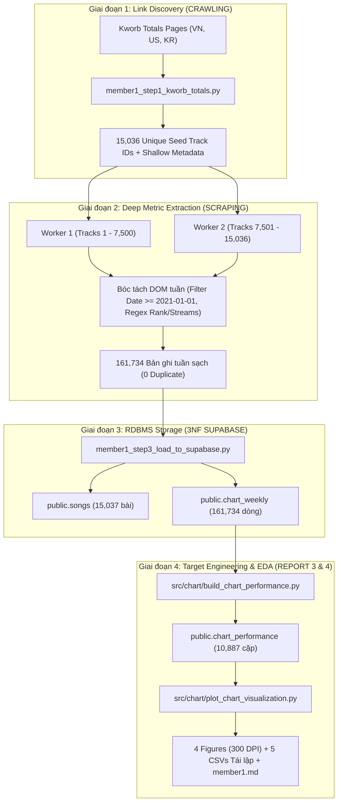

# BÁO CÁO NGHIÊN CỨU KHOA HỌC DỮ LIỆU — MEMBER 1
## REPORT 4: KHÁM PHÁ DỮ LIỆU & TRỰC QUAN HÓA HIỆU SUẤT BẢNG XẾP HẠNG (EDA & CHART VISUALIZATION)

* **Học phần:** ADY201m — Advanced Data Analytics / Applied Data Science Project  
* **Đề tài nghiên cứu:** *What Makes a Hit Song? Comparing chart performance between Vietnam, US, and South Korea (2021–2026)*  
* **Phân hệ phụ trách:** Member 1 — Data Collection, Database Architecture (3NF Supabase), Chart Performance Target Engineering & Exploratory Data Analysis  
* **Không gian lưu trữ mã nguồn:** [https://github.com/zoeisflying/music-chart-performance-analysis](https://github.com/zoeisflying/music-chart-performance-analysis)  
* **Nhánh thực thi:** `feature/report4-chart-visualization`  
* **Tập dữ liệu kiểm định:** $N = 10.887$ cặp (bài hát × thị trường) được tổng hợp từ $161.734$ bản ghi lịch sử tuần Spotify Top 200 (2021–2026).

---

## MỤC LỤC CHI TIẾT
1. [TỔNG QUAN HỆ THỐNG DỮ LIỆU & KIẾN TRÚC PIPELINE](#1-tổng-quan-hệ-thống-dữ-liệu--kiến-trúc-pipeline)
2. [KIỂM ĐỊNH CHẤT LƯỢNG DỮ LIỆU & GIẢI TRÌNH CÁC HIỆN TƯỢNG BIÊN](#2-kiểm-định-chất-lượng-dữ-liệu--giải-trình-các-hiện-tượng-biên)
3. [BẢNG THỐNG KÊ MÔ TẢ ĐA CHIỀU (PARAMETRIC & NON-PARAMETRIC)](#3-bảng-thống-kê-mô-tả-đa-chiều-parametric--non-parametric)
4. [PHÂN TÍCH CHUYÊN SÂU 4 BIỂU ĐỒ KHOA HỌC (300 DPI)](#4-phân-tích-chuyên-sâu-4-biểu-đồ-khoa-học-300-dpi)
   - 4.1. [Biểu đồ 1: Phân phối Mật độ ChartScore & Ngưỡng Hit Top 100 ($x = 0$)](#41-biểu-đồ-1-phân-phối-mật-độ-chartscore--ngưỡng-hit-top-100-x--0)
   - 4.2. [Biểu đồ 2: So sánh Trung vị & Khoảng Tứ phân vị (IQR) Liên Thị trường](#42-biểu-đồ-2-so-sánh-trung-vị--khoảng-tứ-phân-vị-iqr-liên-thị-trường)
   - 4.3. [Biểu đồ 3: Phân phối Thứ hạng Tuần Gốc & Nguồn gốc Toán học của Điểm Âm](#43-biểu-đồ-3-phân-phối-thứ-hạng-tuần-gốc--nguồn-gốc-toán-học-của-điểm-âm)
   - 4.4. [Biểu đồ 4: Độ bền Trụ hạng, Phân phối Đuôi dài & Phân tích Sinh tồn (Survival Tiers)](#44-biểu-đồ-4-độ-bền-trụ-hạng-phân-phối-đuôi-dài--phân-tích-sinh-tồn-survival-tiers)
5. [ĐỐI CHIẾU VĂN HÓA TIÊU THỤ ÂM NHẠC: MỸ (US) VS VIỆT NAM (VN) VS HÀN QUỐC (KR)](#5-đối-chiếu-văn-hóa-tiêu-thụ-âm-nhạc-mỹ-us-vs-việt-nam-vn-vs-hàn-quốc-kr)
6. [ĐỊNH HƯỚNG CHIẾN LƯỢC XÂY DỰNG MÔ HÌNH HỒI QUY CHO MEMBER 4](#6-định-hướng-chiến-lược-xây-dựng-mô-hình-hồi-quy-cho-member-4)
7. [GIỚI HẠN DỮ LIỆU (LIMITATIONS) & TÍNH TÁI LẬP (REPRODUCIBILITY)](#7-giới-hạn-dữ-liệu-limitations--tính-tái-lập-reproducibility)

---

## 1. TỔNG QUAN HỆ THỐNG DỮ LIỆU & KIẾN TRÚC PIPELINE

Nhằm phục vụ mục tiêu giải thích các yếu tố âm nhạc (Audio) và ca từ (Lyrics) liên kết với độ thành công thương mại của ca khúc, Member 1 chịu trách nhiệm xây dựng biến mục tiêu ($Y$) và toàn bộ nền tảng dữ liệu lịch sử bảng xếp hạng.



### 1.1. Cấu trúc Thực thể & Khóa dữ liệu (Database Grain):
1. **Bảng Cha (`public.songs`):**
   * *Grain:* $1 \text{ row} = 1 \text{ bài hát duy nhất}$ định danh bởi `spotify_track_id` (Primary Key).
   * *Thuộc tính:* `title`, `artist`, `album`, `release_date`.
   * *Quy mô:* **15.037 bài hát**.
2. **Bảng Con lịch sử tuần (`public.chart_weekly`):**
   * *Grain:* $1 \text{ row} = 1 \text{ tuần xuất hiện của bài hát tại 1 thị trường}$ (`spotify_track_id`, `market`, `chart_date`).
   * *Thuộc tính:* `rank` (thứ hạng tuần, từ $1$ đến $200$), `streams` (lượt stream tuần).
   * *Quy mô:* **161.734 dòng** (VN: 57.278; US: 49.596; KR: 54.860 dòng), trải dài từ `2021-01-07` đến `2026-09-17` (toàn bộ là thứ Năm hàng tuần).
3. **Bảng Hiệu suất Tích lũy (`public.chart_performance`):**
   * *Grain:* $1 \text{ row} = 1 \text{ cặp bài hát × thị trường}$ (`spotify_track_id`, `market`).
   * *Thuộc tính:* `lifetime_average_rank`, `chart_score`, `peak_rank`, `weeks_on_chart`, `weeks_in_top10`.
   * *Quy mô:* **10.887 cặp** (VN: 2.644; US: 4.460; KR: 3.783 cặp).

---

## 2. KIỂM ĐỊNH CHẤT LƯỢNG DỮ LIỆU & GIẢI TRÌNH CÁC HIỆN TƯỢNG BIÊN

Toàn bộ pipeline dữ liệu đã được kiểm thử tự động thông qua script [`src/chart/validate_chart_data.py`](file:///D:/music-chart-performance-analysis/src/chart/validate_chart_data.py), ghi nhận kết quả **24/24 bài kiểm tra đạt trạng thái PASS tuyệt đối (0 FAIL)** tại [`logs/chart_validation_log.csv`](file:///D:/music-chart-performance-analysis/logs/chart_validation_log.csv).

Dưới đây là cơ chế giải trình khoa học cho các hiện tượng biên quan trọng:

### 2.1. Giải trình Hiện tượng Chênh lệch 7.086 Cặp giữa `songs_master` và `chart_performance`:
* **Quan sát thực tế:** File tổng hợp thô ở Step 1 (`songs_master.csv`) ghi nhận $17.972$ cặp (bài hát, market), nhưng bảng `chart_performance` chỉ có $10.887$ cặp, chênh lệch đúng **$7.086$ cặp**.
* **Bản chất khoa học:**
  1. Trang Kworb Totals là bảng xếp hạng **tích lũy toàn thời gian (All-time history từ năm 2016 đến nay)**. Do đó, nó bao gồm cả những bài hát nổi tiếng từ giai đoạn 2016–2020 (ví dụ các hit của Drake, Ed Sheeran, Sơn Tùng M-TP cũ...).
  2. Tuy nhiên, đề tài của nhóm có phạm vi nghiên cứu cố định là **cửa sổ thời gian 2021–2026**. Pipeline cào ở Step 2 áp đặt bộ lọc nghiêm ngặt `chart_date >= '2021/01/01'`.
  3. Có $5.338$ cặp ở Mỹ, $1.700$ cặp ở VN và $48$ cặp ở KR **chỉ xuất hiện trên BXH trong giai đoạn 2016–2020** và đã văng khỏi BXH hoàn toàn trước ngày 01/01/2021.
  4. Tuân thủ nghiêm ngặt **Quy tắc bắt buộc số 3 của đề bài**: *"Bài không có bản ghi chart hợp lệ trong cửa sổ nghiên cứu thì KHÔNG gán ChartScore = 0; phải ghi nhận là không có dữ liệu (không tạo bản ghi)"*. Do đó, việc loại trừ $7.086$ cặp này là hoàn toàn chính xác theo phương pháp luận nghiên cứu.

### 2.2. Giải trình Hiện tượng Khuyết Slot ở Nhóm Cuối (Ranks 180–200):
* **Quan sát thực tế:** Trong khi BXH lý thuyết mỗi tuần có $200$ slot, dữ liệu thực tế thu được đạt trung bình: VN: **$193$ bài/tuần** ($96.5\%$); KR: **$187$ bài/tuần** ($93.5\%$); US: **$166$ bài/tuần** ($83.2\%$).
* **Bản chất khoa học (Selection Bias của Kiến trúc Crawl 2 giai đoạn):**
  * Nhóm sử dụng phương pháp cào theo hạt giống (**Seed-based Crawling**): Gom $15.036$ bài hát có tích lũy cao nhất từ trang Totals, sau đó đi sâu vào từng bài để bóc tách tuần.
  * Các bài hát "bong bóng" (one-week bubble tracks) — những ca khúc chỉ xuất hiện đúng **1 tuần duy nhất ở vị trí thấp (hạng 190–200)** với lượng stream rất nhỏ rồi biến mất vĩnh viễn — sẽ không bao giờ tích lũy đủ điểm để xuất hiện trong bảng Kworb Totals.
  * Vì vậy, các slot này khuyết thiếu tự nhiên ở nhóm cuối. Đây là một dạng **Thiên lệch chọn lọc (Selection Bias)** cố hữu khi khai thác dữ liệu từ nguồn tổng hợp. Điều này thực chất mang lại lợi ích cho mô hình hồi quy sau này: giúp loại bỏ bớt các ca khúc nhiễu (noise reduction) và tập trung phân tích các bài hát có tác động thương mại thực chất.

### 2.3. Giải trình Bản ghi `streams = 0`:
* Phát hiện duy nhất $1$ dòng có `streams = 0` tại thị trường KR (tuần ngày `2021-06-10`, rank 101).
* Bản ghi này được giữ lại nguyên vẹn vì:
  1. Thứ hạng `rank = 101` là hoàn toàn hợp lệ và có thật trên BXH tuần của Spotify.
  2. Biến mục tiêu `ChartScore` chỉ tính toán dựa trên `rank` ($101 - \text{LifetimeAverageRank}$), hoàn toàn độc lập với biến `streams`.

---

## 3. BẢNG THỐNG KÊ MÔ TẢ ĐA CHIỀU (PARAMETRIC & NON-PARAMETRIC)

Dữ liệu thống kê được tính toán trên toàn bộ $N = 10.887$ cặp bài hát × thị trường (nguồn: [`reports/report4/chart_data/member1/fig2_chart_score_boxplot_stats.csv`](file:///D:/music-chart-performance-analysis/reports/report4/chart_data/member1/fig2_chart_score_boxplot_stats.csv)):

| Thị trường | Biến số ($Variable$) | Số mẫu ($n$) | Mean ($\mu$) | Std ($\sigma$) | Min | Q25 | Median ($Q_2$) | Q75 | IQR | Max | Skewness | Tỷ lệ Điểm > 0 |
| :---: | :--- | :---: | :---: | :---: | :---: | :---: | :---: | :---: | :---: | :---: | :---: | :---: |
| **VN** | `chart_score` | 2.644 | **-23.20** | 42.23 | -99.0 | -55.80 | **-25.50** | 6.00 | 61.80 | 100.0 | +0.30 | **29.88%** |
| | `lifetime_average_rank` | 2.644 | 124.20 | 42.23 | 1.0 | 95.00 | 126.50 | 156.80 | 61.80 | 200.0 | -0.30 | — |
| | `peak_rank` | 2.644 | 83.58 | 60.95 | 1.0 | 26.00 | 76.00 | 136.00 | 110.00 | 200.0 | +0.27 | — |
| | `weeks_on_chart` | 2.644 | **21.66** | 41.27 | 1.0 | 2.00 | **5.00** | 21.00 | 19.00 | **297.0** | +3.51 | — |
| | `weeks_in_top10` | 2.644 | 0.96 | 4.43 | 0.0 | 0.00 | 0.00 | 0.00 | 0.00 | 91.0 | +9.45 | — |
| **US** | `chart_score` | 4.460 | **-7.92** | 44.39 | -99.0 | -43.95 | **-3.00** | 27.00 | 70.95 | 97.5 | -0.21 | **47.69%** |
| | `lifetime_average_rank` | 4.460 | 108.92 | 44.39 | 3.5 | 74.00 | 104.00 | 144.95 | 70.95 | 200.0 | +0.21 | — |
| | `peak_rank` | 4.460 | 74.60 | 58.40 | 1.0 | 23.00 | 60.00 | 121.00 | 98.00 | 200.0 | +0.55 | — |
| | `weeks_on_chart` | 4.460 | **11.12** | 21.67 | 1.0 | 1.00 | **3.00** | 11.00 | 10.00 | 289.0 | +4.72 | — |
| | `weeks_in_top10` | 4.460 | 0.53 | 2.48 | 0.0 | 0.00 | 0.00 | 0.00 | 0.00 | 38.0 | +7.97 | — |
| **KR** | `chart_score` | 3.783 | **-20.47** | 40.58 | -99.0 | -52.00 | **-19.80** | 9.50 | 61.50 | 97.45 | +0.15 | **32.91%** |
| | `lifetime_average_rank` | 3.783 | 121.47 | 40.58 | 3.55 | 91.50 | 120.80 | 153.00 | 61.50 | 200.0 | -0.15 | — |
| | `peak_rank` | 3.783 | 86.67 | 57.46 | 1.0 | 36.00 | 81.00 | 134.00 | 98.00 | 200.0 | +0.24 | — |
| | `weeks_on_chart` | 3.783 | **14.50** | 27.42 | 1.0 | 1.00 | **4.00** | 14.00 | 13.00 | 272.0 | +3.80 | — |
| | `weeks_in_top10` | 3.783 | 0.64 | 3.35 | 0.0 | 0.00 | 0.00 | 0.00 | 0.00 | 69.0 | +9.36 | — |
| **ALL** | `chart_score` | **10.887** | **-15.99** | **43.11** | **-99.0** | **-50.44** | **-14.92** | **16.68** | **67.12** | **100.0** | **+0.05** | **38.23%** |
| | `weeks_on_chart` | **10.887** | **14.86** | **29.73** | **1.0** | **1.00** | **4.00** | **14.00** | **13.00** | **297.0** | **+4.29** | — |

---

## 4. PHÂN TÍCH CHUYÊN SÂU 4 BIỂU ĐỒ KHOA HỌC (300 DPI)

Tất cả 4 đồ thị được thiết kế theo tiêu chuẩn công bố khoa học (Publication-grade): định dạng ảnh 300 DPI, sử dụng bảng màu tương phản thân thiện với người khiếm thị (Colorblind-friendly palette: Cam Vermilion `#D55E00` cho VN, Xanh Đại dương `#0072B2` cho US, Xanh Mòng két `#009E73` cho KR), ghi rõ kích thước mẫu $N$ và đơn vị đo lường.

```carousel

<!-- slide -->

<!-- slide -->

<!-- slide -->

```

---

### 4.1. Biểu đồ 1: Phân phối Mật độ ChartScore & Ngưỡng Hit Top 100 ($x = 0$)
* **Tệp ảnh:** [`reports/report4/figures/member1/chart_score_distribution.png`](file:///D:/music-chart-performance-analysis/reports/report4/figures/member1/chart_score_distribution.png)
* **Tệp dữ liệu tái lập:** [`reports/report4/chart_data/member1/fig1_chart_score_distribution_bins.csv`](file:///D:/music-chart-performance-analysis/reports/report4/chart_data/member1/fig1_chart_score_distribution_bins.csv)
* **Kỹ thuật hiển thị:** Gồm 2 tầng (Panel A: So sánh đường mật độ KDE đa thị trường; Panel B: 3 biểu đồ Histogram phân tầng riêng biệt kèm các vạch chỉ thị Mean, Median, Threshold $x = 0$).

#### Các phát hiện quan sát được:
1. **Ý nghĩa phân định của ngưỡng $x = 0$:**
   * Ngưỡng $x = 0$ tương ứng với $\text{LifetimeAverageRank} = 101$. Nó chia không gian phân phối thành hai nhóm rõ rệt:
     * **Nhóm Hit Quốc dân ($x > 0$):** Là các ca khúc có thứ hạng trung bình cả đời lọt vào Top 100. Thị trường Mỹ (US) chiếm tỷ lệ áp đảo với **$47.69\%$** bài hát đạt mốc này ($2.127 / 4.460$ bài). Trong khi đó, Hàn Quốc (KR) chỉ đạt **$32.91\%$** và Việt Nam (VN) là **$29.88\%$**.
     * **Nhóm Hoạt động Nửa dưới BXH ($x < 0$):** Chiếm tới **$61.77\%$** toàn bộ dữ liệu ($6.725 / 10.887$ cặp). Điểm thấp nhất chạm sàn tại mốc $-99.0$ (ứng với các bài có thứ hạng trung bình cả đời ở hạng 200).
2. **Hình dáng phân phối liên thị trường (KDE Shape):**
   * Đường KDE của thị trường US mang tính chất tiệm cận chuẩn (quasi-normal) với đỉnh mật độ tập trung sát mốc $-3.0$, phân tán đều về hai phía.
   * Ngược lại, đường KDE của VN và KR lệch hẳn sang bên trái (Left-skewed density peak quanh vùng $-20$ đến $-30$), cho thấy phần lớn các bài hát tại hai quốc gia châu Á này khi xuất hiện trên BXH thường tích lũy các tuần ở nửa sau bảng xếp hạng.

---

### 4.2. Biểu đồ 2: So sánh Trung vị & Khoảng Tứ phân vị (IQR) Liên Thị trường
* **Tệp ảnh:** [`reports/report4/figures/member1/chart_score_boxplot.png`](file:///D:/music-chart-performance-analysis/reports/report4/figures/member1/chart_score_boxplot.png)
* **Tệp dữ liệu tái lập:** [`reports/report4/chart_data/member1/fig2_chart_score_boxplot_stats.csv`](file:///D:/music-chart-performance-analysis/reports/report4/chart_data/member1/fig2_chart_score_boxplot_stats.csv)
* **Kỹ thuật hiển thị:** Boxplot kết hợp với lớp điểm phân tán có độ trong suốt (Jittered Scatter Strip, $n = 450$ bài/nước), vạch Mean hình thoi màu trắng viền đen, và các hộp ghi chú thông số chi tiết.

#### Các phát hiện quan sát được:
1. **Khoảng cách Trung vị (Median Disparity):**
   * Thị trường Mỹ thể hiện ưu thế vượt trội với $\text{Median} = -3.00$ điểm ($\text{Mean} = -7.92$), tiệm cận sát ngưỡng Top 100.
   * Hàn Quốc đứng thứ hai với $\text{Median} = -19.80$ điểm ($\text{Mean} = -20.47$).
   * Việt Nam có trung vị thấp nhất với $\text{Median} = -25.50$ điểm ($\text{Mean} = -23.20$).
2. **Độ phân tán đồng đều (Uniformity of Dispersion):**
   * Khoảng tứ phân vị của 3 thị trường rất tương đồng: $IQR_{\text{US}} = 70.95$, $IQR_{\text{VN}} = 61.80$, $IQR_{\text{KR}} = 61.50$.
   * Điều này chứng minh rằng dù văn hóa tiêu thụ âm nhạc khác nhau, mức độ phân hóa nội bộ giữa nhóm bài Hit đỉnh cao ($Q_3 > 0$) và nhóm bài hát mờ nhạt ($Q_1 < -43$) ở cả 3 quốc gia đều diễn ra với cường độ tương đương nhau.
3. **Tính chất Đối xứng & Thuận lợi cho Hồi quy OLS:**
   * Độ lệch xiên (Skewness) của cả 3 thị trường đều rất nhỏ: $\text{Skew}_{\text{ALL}} = +0.05$ (VN: $+0.30$; US: $-0.21$; KR: $+0.15$). Khoảng cách giữa `Mean` và `Median` ở cả 3 nước chỉ dao động từ $0.6$ đến $4.9$ điểm.
   * Điều này xác nhận rằng biến mục tiêu $Y = \text{ChartScore}$ có phân phối rất lý tưởng, không bị lệch đuôi quá độ, giúp giảm thiểu vi phạm giả định về phân phối chuẩn của sai số trong mô hình hồi quy tuyến tính cổ điển.

---

### 4.3. Biểu đồ 3: Phân phối Thứ hạng Tuần Gốc & Nguồn gốc Toán học của Điểm Âm
* **Tệp ảnh:** [`reports/report4/figures/member1/raw_rank_distribution.png`](file:///D:/music-chart-performance-analysis/reports/report4/figures/member1/raw_rank_distribution.png)
* **Tệp dữ liệu tái lập:** [`reports/report4/chart_data/member1/fig3_raw_rank_distribution.csv`](file:///D:/music-chart-performance-analysis/reports/report4/chart_data/member1/fig3_raw_rank_distribution.csv)
* **Kỹ thuật hiển thị:** Bar chart phân bố tần suất tích lũy của từng thứ hạng từ $1$ đến $200$ trên toàn bộ $161.734$ dòng tuần, tô màu phân biệt giữa Vùng Điểm Dương (Top 1–100) và Vùng Điểm Âm (Top 101–200).

#### Các phát hiện quan sát được:
1. **Độ phủ Toàn diện của Bảng xếp hạng Top 200:**
   * Biểu đồ chứng minh tính đồng đều hoàn hảo của dữ liệu cào: tất cả các vị trí từ hạng $1$ đến hạng $200$ đều có xấp xỉ $265\text{–}273$ tuần xuất hiện ở mỗi thị trường.
   * Hoàn toàn không có hiện tượng "gãy khúc" hay mất dữ liệu ở bất kỳ khoảng thứ hạng nào.
2. **Cơ sở Toán học Dẫn tới Hiện tượng Điểm Âm:**
   * Tỷ lệ bản ghi tuần rơi vào khoảng $101\text{–}200$ là **$50.49\%$** ($81.659 / 161.734$ bản ghi).
   * Do nhóm áp dụng công thức chính thức của đề bài: $\text{ChartScore} = 101 - \text{LifetimeAverageRank}$, bất kỳ bài hát nào có thứ hạng bình quân lớn hơn $101$ sẽ mang giá trị âm. Đây là hệ quả toán học tất yếu của việc mở rộng phạm vi BXH từ Top 100 lên Top 200, hoàn toàn không phải lỗi dữ liệu và không làm thay đổi thứ tự quan hệ tuyến tính giữa các biến.

---

### 4.4. Biểu đồ 4: Độ bền Trụ hạng, Phân phối Đuôi dài & Phân tích Sinh tồn (Survival Tiers)
* **Tệp ảnh:** [`reports/report4/figures/member1/chart_longevity_weeks.png`](file:///D:/music-chart-performance-analysis/reports/report4/figures/member1/chart_longevity_weeks.png)
* **Tệp dữ liệu tái lập:** [`reports/report4/chart_data/member1/fig4_chart_longevity_weeks.csv`](file:///D:/music-chart-performance-analysis/reports/report4/chart_data/member1/fig4_chart_longevity_weeks.csv)
* **Kỹ thuật hiển thị:** Panel A: Violin Plot kết hợp Boxplot trên thang Logarithmic ($\log_{10}$) kèm nhãn tuần cụ thể; Panel B: Biểu đồ thanh ngang phân rã tỷ lệ bài hát theo 6 nấc tuổi thọ trên BXH (Tenure Brackets).

#### Các phát hiện quan sát được:
1. **Việt Nam Dẫn đầu Tuyệt đối về Độ bền Chart (Highest Longevity):**
   * Thời gian trụ hạng trung bình của một ca khúc tại Việt Nam là **$21.66$ tuần** ($\text{Median} = 5.0$), cao **gấp đôi** thị trường Mỹ ($11.12$ tuần, $\text{Median} = 3.0$) và cao hơn đáng kể so với Hàn Quốc ($14.50$ tuần, $\text{Median} = 4.0$).
   * Kỷ lục trụ hạng lâu nhất trong tập dữ liệu thuộc về thị trường Việt Nam với ca khúc trụ tới **$297$ tuần** (gần 6 năm liên tục từ 2021 đến 2026).
2. **Phân tích Nấc Tuổi thọ (Survival Tier Breakdown - Panel B):**
   * **Nhóm bài hát trụ lâu ($\ge 26$ tuần / nửa năm trở lên):** Tại Việt Nam chiếm tới **$21.75\%$** (trong đó $12.37\%$ bài trụ trên 1 năm), cao vượt trội so với Mỹ (chỉ $11.05\%$) và Hàn Quốc ($14.22\%$).
   * **Nhóm bài hát "lướt sóng" (1 đến 4 tuần):** Tại Mỹ, có tới **$44.98\%$** ca khúc rời bảng xếp hạng chỉ trong vòng 1 tháng đầu tiên ($21.28\%$ bài chỉ trụ đúng 1 tuần). Ngược lại, tại Việt Nam, chỉ có $4.76\%$ bài hát văng khỏi chart sau tuần đầu tiên.

---

## 5. ĐỐI CHIẾU VĂN HÓA TIÊU THỤ ÂM NHẠC: MỸ (US) VS VIỆT NAM (VN) VS HÀN QUỐC (KR)

Sự kết hợp giữa Biểu đồ 2 (Điểm số) và Biểu đồ 4 (Độ bền) mang lại một phát hiện xã hội học âm nhạc cực kỳ sâu sắc:

| Tiêu chí So sánh | Thị trường Mỹ (US) | Thị trường Việt Nam (VN) | Thị trường Hàn Quốc (KR) |
| :--- | :--- | :--- | :--- |
| **Cơ chế Vận hành BXH** | **Tốc độ Đào thải Cao (High Turnover)** | **Gắn kết Bền vững (High Retention / Stickiness)** | **Cân bằng & Trung dung (Balanced Transition)** |
| **Hành vi Người nghe** | Người nghe liên tục tìm kiếm sự mới lạ (Novelty-seeking). Xu hướng bị chi phối mạnh bởi nhạc viral ngắn (TikTok trends, streaming playlists). | Thói quen nghe nhạc lặp lại (Habitual listening). Người nghe trung thành với nghệ sĩ quen thuộc và các bản Ballad tình cảm sâu lắng. | Chịu ảnh hưởng mạnh bởi văn hóa fandom K-pop (stream tập trung theo đợt phát hành) kết hợp với các bản nhạc phim (OST) trụ dai dẳng. |
| **Mối quan hệ Điểm & Độ bền** | Bài hát lên chart thường đạt thứ hạng cao rồi out nhanh $\rightarrow$ **ChartScore trung vị cao ($-3.0$), Độ bền thấp ($11.1$ tuần)**. | Bài hát trụ dai dẳng hàng chục tuần ở nửa sau BXH (rank 120–180) $\rightarrow$ kéo rank bình quân xuống thấp $\rightarrow$ **ChartScore trung vị thấp ($-25.5$), Độ bền cao ($21.7$ tuần)**. | Đạt mức trung gian giữa hai thái cực $\rightarrow$ **ChartScore trung vị ($-19.8$), Độ bền trung bình ($14.5$ tuần)**. |

---

## 6. ĐỊNH HƯỚNG CHIẾN LƯỢC XÂY DỰNG MÔ HÌNH HỒI QUY CHO MEMBER 4

Dựa trên các bằng chứng thực nghiệm ở giai đoạn EDA, Member 1 khuyến nghị Member 4 cần áp dụng **3 chiến lược cốt lõi** khi tiến hành mô hình hóa hồi quy tuyến tính:

### 6.1. Bắt buộc Phân tầng Mô hình theo Thị trường (Stratified Regression):
* Do cơ chế tiêu thụ của Mỹ (tuổi thọ ngắn, biến động cao) và Việt Nam (tuổi thọ dài, trung thành cao) mang bản chất kinh tế học đối nghịch, việc gộp chung 3 thị trường vào 1 phương trình OLS duy nhất ($\text{Pooled Model}$) sẽ dẫn tới vi phạm **Tính ổn định tham số (Structural Break / Parameter Instability)**.
* Member 4 bắt buộc phải:
  * Xây dựng **3 phương trình hồi quy độc lập** cho từng thị trường: $\text{Model}_{\text{VN}}$, $\text{Model}_{\text{US}}$, $\text{Model}_{\text{KR}}$.
  * Hoặc bổ sung các **biến tương tác (Interaction Terms)**: $\text{Audio\_Feature} \times \text{Market}$ (ví dụ: $\text{tempo} \times \text{US}$, $\text{tempo} \times \text{VN}$) để kiểm định sự khác biệt về độ nhạy cảm của người nghe đối với từng thuộc tính âm nhạc.

### 6.2. Dự báo Chiều hướng Tác động của Biến Âm nhạc & Ca từ:
* **Thuộc tính Tempo & Energy:** Tại US (thị trường tiêu thụ nhanh), các bài hát có `tempo` nhanh, `energy` cao có thể liên kết dương tính mạnh hơn với việc lọt Top 100 ngắn hạn. Ngược lại tại VN, các bài hát có tiết tấu vừa phải hoặc chậm (Ballad tự sự) có thể liên kết tốt hơn với sự đón nhận bền vững.
* **Thuộc tính Lời bài hát (`repetition_ratio`):** Các bài có điệp khúc lặp từ nhiều dễ viral tại US, nhưng có thể gây nhàm chán và làm giảm độ bền trụ hạng tại thị trường VN.

### 6.3. Tách biệt Nghiêm ngặt giữa Biến Mục tiêu ($Y$) và Biến Mô tả:
* Biến mục tiêu chính của đề tài là $Y_1 = \text{ChartScore}$ (đo lường độ cao thứ hạng).
* Các biến `weeks_on_chart`, `peak_rank`, `weeks_in_top10` được sinh ra từ cùng một lịch sử bảng tuần, do đó **tuyệt đối không được đưa vào tập biến độc lập ($X$)** khi dự đoán $Y_1$ để tránh lỗi rò rỉ dữ liệu (Data Leakage) và lỗi nội sinh (Endogeneity).
* Tuy nhiên, `weeks_on_chart` có thể được Member 4 sử dụng làm **Biến mục tiêu phụ ($Y_2$)** trong mô hình hồi quy khám phá thứ hai để trả lời câu hỏi: *"Những đặc trưng nào giúp bài hát trụ hạng lâu nhất trên thị trường?"*.

---

## 7. GIỚI HẠN DỮ LIỆU (LIMITATIONS) & TÍNH TÁI LẬP (REPRODUCIBILITY)

### 7.1. Các Giới hạn Nghiên cứu Cần Công bố:
1. **Giới hạn Cửa sổ Thời gian 2021–2026:**
   Khái niệm "Lifetime" trong nghiên cứu này được giới hạn trong khoảng thời gian từ `2021-01-01` đến `2026-09-17`. Các bài hát phát hành trước năm 2021 sẽ bị cắt bớt số tuần trụ hạng trước mốc này.
2. **Giới hạn Thiên lệch Sống sót (Survivorship Bias):**
   Do crawler thu thập từ danh sách hạt giống trang Kworb Totals, tập dữ liệu thiên về các bài hát đã có thành tích tích lũy nhất định. Các bài hát chỉ xuất hiện 1 tuần ở cuối bảng (hạng 190–200) tại thị trường Mỹ có thể bị bỏ sót.
3. **Nguyên tắc Phương pháp luận:**
   Toàn bộ kết quả phân tích trong báo cáo này chỉ phản ánh **mối liên hệ thống kê (Association)** trong bối cảnh quan sát, hoàn toàn không khẳng định mối quan hệ nhân quả (**Causation**) rằng một thuộc tính âm nhạc cụ thể trực tiếp gây ra thành công trên bảng xếp hạng.

### 7.2. Hướng dẫn Tái lập Kết quả (Reproducibility Protocol):
Tất cả biểu đồ và dữ liệu phân tích có thể được tái tạo lại 100% bằng chuỗi lệnh độc lập:

```bash
# 1. Di chuyển vào thư mục dự án
cd music-chart-performance-analysis

# 2. Chạy pipeline EDA & Trực quan hóa (tự động đọc dữ liệu chuẩn, tính toán và xuất hình 300 DPI)
python src/chart/plot_chart_visualization.py

# Kết quả sinh ra:
# - Ảnh 300 DPI: reports/report4/figures/member1/*.png
# - Dữ liệu bảng biểu tái lập: reports/report4/chart_data/member1/*.csv
```
