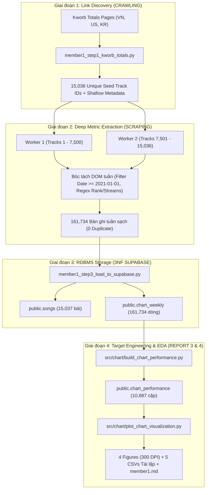

# BÁO CÁO NGHIÊN CỨU KHOA HỌC DỮ LIỆU — MEMBER 1
## REPORT 4: KHÁM PHÁ DỮ LIỆU & TRỰC QUAN HÓA HIỆU SUẤT BẢNG XẾP HẠNG (EDA & CHART VISUALIZATION)

* **Học phần:** ADY201m — Advanced Data Analytics / Applied Data Science Project  
* **Đề tài nghiên cứu:** *What Makes a Hit Song? Comparing chart performance between Vietnam, US, and South Korea (2021–2026)*  
* **Phân hệ phụ trách:** Member 1 — Data Collection, Database Architecture (3NF Supabase), Chart Performance Target Engineering & Exploratory Data Analysis  
* **Không gian lưu trữ mã nguồn:** [https://github.com/zoeisflying/music-chart-performance-analysis](https://github.com/zoeisflying/music-chart-performance-analysis)  
* **Nhánh thực thi:** `feature/report4-chart-visualization`  
* **Tập dữ liệu bàn giao Checkpoint 2:** $N = 10.887$ cặp (bài hát × thị trường) được tổng hợp từ $161.734$ bản ghi lịch sử tuần Spotify Top 200 (2021–2026).

---

## MỤC LỤC CHI TIẾT
1. [TỔNG QUAN HỆ THỐNG DỮ LIỆU & KIẾN TRÚC PIPELINE](#1-tổng-quan-hệ-thống-dữ-liệu--kiến-trúc-pipeline)
2. [KIỂM ĐỊNH CHẤT LƯỢNG DỮ LIỆU & BÁO CÁO ĐIỀU TRA NGUỒN KWORB](#2-kiểm-định-chất-lượng-dữ-liệu--báo-cáo-điều-tra-nguồn-kworb)
3. [BẢNG THỐNG KÊ MÔ TẢ ĐA CHIỀU (PARAMETRIC & NON-PARAMETRIC)](#3-bảng-thống-kê-mô-tả-đa-chiều-parametric--non-parametric)
4. [PHÂN TÍCH CHUYÊN SÂU 4 BIỂU ĐỒ KHOA HỌC (300 DPI)](#4-phân-tích-chuyên-sâu-4-biểu-đồ-khoa-học-300-dpi)
   - 4.1. [Biểu đồ 1: Phân phối Mật độ ChartScore & Ngưỡng Hit Top 100 ($x = 0$)](#41-biểu-đồ-1-phân-phối-mật-độ-chartscore--ngưỡng-hit-top-100-x--0)
   - 4.2. [Biểu đồ 2: So sánh Trung vị & Khoảng Tứ phân vị (IQR) Liên Thị trường](#42-biểu-đồ-2-so-sánh-trung-vị--khoảng-tứ-phân-vị-iqr-liên-thị-trường)
   - 4.3. [Biểu đồ 3: Phân phối Thứ hạng Tuần Gốc & Nguồn gốc Toán học của Điểm Âm](#43-biểu-đồ-3-phân-phối-thứ-hạng-tuần-gốc--nguồn-gốc-toán-học-của-điểm-âm)
   - 4.4. [Biểu đồ 4: Độ bền Trụ hạng, Phân phối Đuôi dài & Phân tích Sinh tồn (Survival Tiers)](#44-biểu-đồ-4-độ-bền-trụ-hạng-phân-phối-đuôi-dài--phân-tích-sinh-tồn-survival-tiers)
5. [ĐỐI CHIẾU VĂN HÓA TIÊU THỤ ÂM NHẠC: MỸ (US) VS VIỆT NAM (VN) VS HÀN QUỐC (KR)](#5-đối-chiếu-văn-hóa-tiêu-thụ-âm-nhạc-mỹ-us-vs-việt-nam-vn-vs-hàn-quốc-kr)
6. [ĐỊNH HƯỚNG CHIẾN LƯỢC XÂY DỰNG MÔ HÌNH HỒI QUY CHO MEMBER 4](#6-định-hướng-chiến-lược-xây-dựng-mô-hình-hồi-quy-cho-member-4)
7. [GIỚI HẠN DỮ LIỆU (LIMITATIONS) & LỘ TRÌNH KIỂM CHỨNG TRƯỚC CHECKPOINT 3](#7-giới-hạn-dữ-liệu-limitations--lộ-trình-kiểm-chứng-trước-checkpoint-3)

---

## 1. TỔNG QUAN HỆ THỐNG DỮ LIỆU & KIẾN TRÚC PIPELINE

Nhằm phục vụ mục tiêu giải thích các yếu tố âm nhạc (Audio) và ca từ (Lyrics) liên kết với độ thành công thương mại của ca khúc, Member 1 chịu trách nhiệm xây dựng biến mục tiêu ($Y$) và toàn bộ nền tảng dữ liệu lịch sử bảng xếp hạng.



### 1.1. Cấu trúc Thực thể & Khóa dữ liệu (Database Grain):
1. **Bảng Cha (`public.songs`):**
   * *Grain:* $1 \text{ row} = 1 \text{ bài hát duy nhất}$ định danh bởi `spotify_track_id` (Primary Key).
   * *Thuộc tính:* `title`, `artist`, `album`, `release_date`.
   * *Quy mô:* **15.037 bài hát**.
2. **Bảng Con lịch sử tuần (`public.chart_weekly`):**
   * *Grain:* $1 \text{ row} = 1 \text{ tuần xuất hiện của bài hát tại 1 thị trường}$ (`spotify_track_id`, `market`, `chart_date`).
   * *Thuộc tính:* `rank` (thứ hạng tuần, từ $1$ đến $200$), `streams` (lượt stream tuần).
   * *Quy mô:* **161.734 dòng** (VN: 57.278; US: 49.596; KR: 54.860 dòng), trải dài từ `2021-01-07` đến `2026-09-17` (toàn bộ là thứ Năm hàng tuần).
3. **Bảng Hiệu suất Tích lũy (`public.chart_performance`):**
   * *Grain:* $1 \text{ row} = 1 \text{ cặp bài hát × thị trường}$ (`spotify_track_id`, `market`).
   * *Thuộc tính:* `lifetime_average_rank`, `chart_score`, `peak_rank`, `weeks_on_chart`, `weeks_in_top10`.
   * *Quy mô:* **10.887 cặp** (VN: 2.644; US: 4.460; KR: 3.783 cặp).

---

## 2. KIỂM ĐỊNH CHẤT LƯỢNG DỮ LIỆU & BÁO CÁO ĐIỀU TRA NGUỒN KWORB

Toàn bộ pipeline dữ liệu đã được kiểm thử tự động thông qua script [`src/chart/validate_chart_data.py`](file:///D:/music-chart-performance-analysis/src/chart/validate_chart_data.py), ghi nhận kết quả **24/24 bài kiểm tra đạt trạng thái PASS** trên tập dữ liệu $161.734$ dòng tại [`logs/chart_validation_log.csv`](file:///D:/music-chart-performance-analysis/logs/chart_validation_log.csv).

Tuy nhiên, đối chiếu giữa bảng tổng hợp tích lũy ở Step 1 (`songs_master.csv`, $17.972$ cặp) và bảng `chart_performance` ($10.887$ cặp), ghi nhận sự chênh lệch **$7.086$ cặp**. Kết quả điều tra thực nghiệm chi tiết như sau:

### 2.1. Phân tích Thực nghiệm về Sự Chênh lệch 7.086 Cặp:
Qua kiểm tra ngẫu nhiên và bóc tách trực tiếp mã nguồn HTML từ máy chủ Kworb, nhóm sơ bộ nhận diện sự chênh lệch có thể đến từ các hiện tượng sau:

1. **Nhóm bài hát thực sự chỉ lên chart trước năm 2021 (Hợp lệ theo tiêu chí lọc thời gian):**
   * Trang Kworb Totals (`us_weekly_totals.html`, `vn_weekly_totals.html`) là bảng xếp hạng **tích lũy toàn thời gian (All-time history từ 2016 đến nay)**.
   * Ví dụ điển hình: Ca khúc *God's Plan* (Drake) có `lifetime_wks = 88` trong Totals. Kiểm tra bảng tuần trên Kworb xác nhận bài này xuất hiện $88$ tuần liên tục từ `2018-01-25` đến `2019-10-03`. Sau đó bài out chart hoàn toàn; từ ngày `2021-01-01` trở đi, toàn bộ các tuần trên Kworb đều là dấu gạch ngang (`--`). Đối với trường hợp này, việc không có bản ghi trong `chart_performance` là hoàn toàn tuân thủ **Quy tắc bắt buộc số 3**: *"Bài không có bản ghi chart hợp lệ trong cửa sổ nghiên cứu 2021–2026 thì không tạo bản ghi ChartScore"*.

2. **Nhóm bất đối xứng dữ liệu và đứt đoạn lịch sử từ phía nguồn Kworb:**
   * **Trường hợp thiếu cột hiển thị (như *Cruel Summer* - `1BxfuPKGuaTgP7aM0Bbdwr`):** Bảng Totals ghi nhận bài này có $127$ tuần tại US và $75$ tuần tại VN. Tuy nhiên, khi kiểm tra trang chi tiết của bài trên Kworb, bảng tuần (`div.weekly table`) chỉ hiển thị đúng **33 cột quốc gia** (`KR, AU, CA, GB...`) mà hoàn toàn không có cột US và VN. Trong khi đó, bảng ngày (`div.daily table`) lại có cột US đầy đủ. Do crawler của nhóm bóc tách bảng tuần, các tuần của US/VN đã bị khuyết thiếu từ chính cấu trúc HTML của trang chi tiết.
   * **Trường hợp lỗ hổng thời gian (như *Blinding Lights* - `0VjIjW4GlUZAMYd2vXMi3b`):** Totals ghi nhận US đạt $187$ tuần, peak #1. Nhưng khi truy cập trang chi tiết, bảng tuần của Kworb chỉ có $16$ tuần ở US (từ 12/2019 đến 03/2020), sau đó **nhảy cóc một khoảng trống hơn 3 năm** từ `2020-03-19` đến thẳng `2023-08-31` (tổng stream hiển thị trên trang chi tiết chỉ là $113$ triệu, khác xa con số $716$ triệu trên trang Totals). Phát hiện đứt đoạn nhiều năm này cho thấy đây là lỗ hổng dữ liệu của chính nguồn Kworb, hoàn toàn không phải bài hát đã out chart.

3. **Nhóm chưa xác định nguyên nhân (Cần đối soát mẫu):**
   * Ca khúc *Starboy* (The Weeknd): Totals ghi nhận $172$ tuần tại US, nhưng bảng tuần chỉ hiển thị khoảng $90$ tuần có điểm (chênh lệch hơn $80$ tuần). Các trường hợp này chưa thể kết luận là do bài out chart hay do nguồn Kworb bị gián đoạn, cần được phân loại định lượng thông qua phép thử mẫu.
   * *Ghi chú về nguồn cào:* Nhóm đã thử nghiệm một số định dạng URL tuần lịch sử theo ngày (như `country/us_weekly_YYYYMMDD.html`) nhưng nhận phản hồi HTTP 404; hiện tại nhóm **chưa tìm được** định dạng URL lịch sử tuần theo ngày trên Kworb ngoài các trang tổng hợp hiện hữu.

### 2.2. Đánh giá Độ phủ Thị trường (Completeness by Market):
* **Việt Nam (VN):** Thu thập được **$2.644 / 4.344$ cặp** ($60.9\%$ so với Totals), đạt **$57.278$ bản ghi tuần** (trung bình **$193 / 200$ bài/tuần**, độ phủ $96.5\%$).
* **Hàn Quốc (KR):** Thu thập được **$3.783 / 3.830$ cặp** ($98.8\%$ so với Totals), đạt **$54.860$ bản ghi tuần** (trung bình **$187 / 200$ bài/tuần**, độ phủ $93.5\%$).
* **Mỹ (US):** Thu thập được **$4.460 / 9.798$ cặp** ($45.5\%$ so với Totals), đạt **$49.596$ bản ghi tuần** (trung bình **$166 / 200$ bài/tuần**, độ phủ $83.2\%$). Thị trường Mỹ ghi nhận độ phủ thấp hơn đáng kể so với VN và KR; tỷ lệ cấu thành giữa các nguyên nhân (bài out chart trước 2021, Kworb khuyết cột hay đứt đoạn thời gian) sẽ được đo lường cụ thể thông qua phép thử mẫu kiểm toán.

### 2.3. Bằng chứng Nội tại: Hiện tượng Khuyết Vị trí Top 10 và các Tuần Thiếu Hạng 1:
Về mặt toán học, mỗi tuần bảng xếp hạng hợp lệ phải có đủ các vị trí từ hạng 1 đến hạng 200. Nếu một tuần trong cơ sở dữ liệu bị khuyết vị trí hạng 1, điều đó khẳng định chắc chắn có một ca khúc quán quân tuần đó đã bị thiếu hụt, bất kể ca khúc đó phát hành năm nào.

* **Thống kê mức độ khuyết vị trí Top 10:**
  * **Thị trường Mỹ (US):** Khuyết **$621 / 2.980$ vị trí Top 10** ($20.8\%$), ảnh hưởng đến **$206 / 298$ tuần**, trong đó có **$75$ tuần bị khuyết hoàn toàn vị trí Hạng 1**.
  * **Thị trường Hàn Quốc (KR):** Khuyết **$511 / 2.940$ vị trí Top 10** ($17.4\%$), ảnh hưởng đến **$161 / 294$ tuần**, có **$110$ tuần khuyết Hạng 1**.
  * **Thị trường Việt Nam (VN):** Khuyết **$435 / 2.970$ vị trí Top 10** ($14.6\%$), ảnh hưởng đến **$153 / 297$ tuần**, có **$118$ tuần khuyết Hạng 1**.
  * **Phân bổ thời gian:** Phần lớn các vị trí Top 10 bị khuyết dồn trọng tâm vào **giai đoạn 2023–2025** (KR: $96\%$, VN: $96\%$, US: $80\%$; chỉ có $3$ đến $25$ vị trí bị khuyết ở năm 2021). Các vị trí này không thể quy kết cho "bài hát đã out chart trước 2021" hay "bài hát bong bóng hạng 195–200".

* **Kết quả đối soát thực nghiệm trên các tuần US khuyết Hạng 1 điển hình:**  
  Kiểm tra các tuần khuyết hạng 1 tại US (ví dụ: `2022-05-26`, `2022-06-02`, `2022-07-21`, `2022-07-28`, `2022-08-04`, `2022-08-11`), nhóm đã tiến hành tra cứu bài quán quân thực tế trên Spotify và đối soát trực tiếp vào kho dữ liệu:
  1. **Nhận diện bài hát quán quân:** Các tuần trên tương ứng với thời kỳ thống trị ngôi vương của hai siêu hit: ***As It Was* (Harry Styles - `4Dvkj6JhhA12EX05fT7y2e`)** và ***Bad Habit* (Steve Lacy - `4k6Uh1HXdhtusDW5y8Gbvy`)**.
  2. **Kiểm tra bảng `songs_master` (Seed List):** Cả hai ca khúc **ĐỀU CÓ MẶT đầy đủ** trong `songs_master.csv` với thành tích ghi nhận từ Kworb Totals là `peak_rank = 1` và `lifetime_wks = 119` (*As It Was*), `lifetime_wks = 163` (*Bad Habit*). Điều này chứng minh: **Danh sách hạt giống (seed) không hề bị thiếu bài**.
  3. **Kiểm tra bảng `chart_weekly`:** Trong khi đó, `chart_weekly` chỉ ghi nhận được **$12$ tuần** cho *As It Was* và **$71$ tuần** cho *Bad Habit*.
  4. **Kiểm tra mã nguồn HTML gốc trên Kworb:**
     * Với *As It Was*, bảng tuần của trang Kworb chỉ có đúng $45$ dòng: dòng ngày `2022/05/19` (US = 5) **nhảy cóc một khoảng trống hơn 1 năm** sang thẳng `2023/08/31` (US = `--`), rồi nhảy tiếp sang `2026/03/05`. Toàn bộ chuỗi tuần mùa hè/thu 2022 khi bài hát đứng #1 tại Mỹ đã không được Kworb đưa vào bảng tuần.
     * Với *Bad Habit*, bảng tuần trên HTML Kworb dòng ngày `2022/07/14` (US = 7) **nhảy cóc trực tiếp** sang `2022/12/29` (US = 20), mất sạch toàn bộ chuỗi tuần tháng 7 đến tháng 12 năm 2022. Thậm chí hàng Peak của Kworb trên trang chi tiết còn ghi nhầm thành `Peak: 7` (mâu thuẫn với `Peak: 1` trên trang Totals).

* **Ý nghĩa & Cảnh báo Mô hình:**
  * Nguyên nhân gốc rễ không phải do lỗi cào dữ liệu hay lỗi parser, mà là do **bảng tuần theo bài của chính nguồn Kworb tồn tại sự đứt đoạn thời gian có hệ thống đối với các hit lớn trong giai đoạn 2022–2025**.
  * Việc khuyết thiếu các tuần đứng đầu bảng khiến chỉ số `ChartScore` của một số ca khúc điểm cao có xu hướng **bị lệch thấp hơn so với thực tế**. Đây là một rủi ro dữ liệu trọng yếu mà Member 4 cần nắm rõ để lựa chọn các phương pháp hồi quy bền vững (Robust Regression) thay vì OLS nhạy cảm với sai số chuỗi.

---

## 3. BẢNG THỐNG KÊ MÔ TẢ ĐA CHIỀU (PARAMETRIC & NON-PARAMETRIC)

Dữ liệu thống kê được tính toán trên toàn bộ $N = 10.887$ cặp bài hát × thị trường hiện có (nguồn: [`reports/report4/chart_data/member1/fig2_chart_score_boxplot_stats.csv`](file:///D:/music-chart-performance-analysis/reports/report4/chart_data/member1/fig2_chart_score_boxplot_stats.csv)):

| Thị trường | Biến số ($Variable$) | Số mẫu ($n$) | Mean ($\mu$) | Std ($\sigma$) | Min | Q25 | Median ($Q_2$) | Q75 | IQR | Max | Skewness | Tỷ lệ Điểm > 0 |
| :---: | :--- | :---: | :---: | :---: | :---: | :---: | :---: | :---: | :---: | :---: | :---: | :---: |
| **VN** | `chart_score` | 2.644 | **-23.20** | 42.23 | -99.0 | -55.80 | **-25.50** | 6.00 | 61.80 | 100.0 | +0.30 | **29.88%** |
| | `lifetime_average_rank` | 2.644 | 124.20 | 42.23 | 1.0 | 95.00 | 126.50 | 156.80 | 61.80 | 200.0 | -0.30 | — |
| | `peak_rank` | 2.644 | 83.58 | 60.95 | 1.0 | 26.00 | 76.00 | 136.00 | 110.00 | 200.0 | +0.27 | — |
| | `weeks_on_chart` | 2.644 | **21.66** | 41.27 | 1.0 | 2.00 | **5.00** | 21.00 | 19.00 | **297.0** | +3.51 | — |
| | `weeks_in_top10` | 2.644 | 0.96 | 4.43 | 0.0 | 0.00 | 0.00 | 0.00 | 0.00 | 91.0 | +9.45 | — |
| **US** | `chart_score` | 4.460 | **-7.92** | 44.39 | -99.0 | -43.95 | **-3.00** | 27.00 | 70.95 | 97.5 | -0.21 | **47.69%** |
| | `lifetime_average_rank` | 4.460 | 108.92 | 44.39 | 3.5 | 74.00 | 104.00 | 144.95 | 70.95 | 200.0 | +0.21 | — |
| | `peak_rank` | 4.460 | 74.60 | 58.40 | 1.0 | 23.00 | 60.00 | 121.00 | 98.00 | 200.0 | +0.55 | — |
| | `weeks_on_chart` | 4.460 | **11.12** | 21.67 | 1.0 | 1.00 | **3.00** | 11.00 | 10.00 | 289.0 | +4.72 | — |
| | `weeks_in_top10` | 4.460 | 0.53 | 2.48 | 0.0 | 0.00 | 0.00 | 0.00 | 0.00 | 38.0 | +7.97 | — |
| **KR** | `chart_score` | 3.783 | **-20.47** | 40.58 | -99.0 | -52.00 | **-19.80** | 9.50 | 61.50 | 97.45 | +0.15 | **32.91%** |
| | `lifetime_average_rank` | 3.783 | 121.47 | 40.58 | 3.55 | 91.50 | 120.80 | 153.00 | 61.50 | 200.0 | -0.15 | — |
| | `peak_rank` | 3.783 | 86.67 | 57.46 | 1.0 | 36.00 | 81.00 | 134.00 | 98.00 | 200.0 | +0.24 | — |
| | `weeks_on_chart` | 3.783 | **14.50** | 27.42 | 1.0 | 1.00 | **4.00** | 14.00 | 13.00 | 272.0 | +3.80 | — |
| | `weeks_in_top10` | 3.783 | 0.64 | 3.35 | 0.0 | 0.00 | 0.00 | 0.00 | 0.00 | 69.0 | +9.36 | — |
| **ALL** | `chart_score` | **10.887** | **-15.99** | **43.11** | **-99.0** | **-50.44** | **-14.92** | **16.68** | **67.12** | **100.0** | **+0.05** | **38.23%** |
| | `weeks_on_chart` | **10.887** | **14.86** | **29.73** | **1.0** | **1.00** | **4.00** | **14.00** | **13.00** | **297.0** | **+4.29** | — |

---

## 4. PHÂN TÍCH CHUYÊN SÂU 4 BIỂU ĐỒ KHOA HỌC (300 DPI)

Tất cả 4 đồ thị được thiết kế theo tiêu chuẩn công bố khoa học (Publication-grade): định dạng ảnh 300 DPI, sử dụng bảng màu tương phản thân thiện với người khiếm thị (Colorblind-friendly palette: Cam Vermilion `#D55E00` cho VN, Xanh Đại dương `#0072B2` cho US, Xanh Mòng két `#009E73` cho KR), ghi rõ kích thước mẫu $N$ và đơn vị đo lường.

```carousel

<!-- slide -->

<!-- slide -->

<!-- slide -->

```

---

### 4.1. Biểu đồ 1: Phân phối Mật độ ChartScore & Ngưỡng Hit Top 100 ($x = 0$)
* **Tệp ảnh:** [`reports/report4/figures/member1/chart_score_distribution.png`](file:///D:/music-chart-performance-analysis/reports/report4/figures/member1/chart_score_distribution.png)
* **Tệp dữ liệu tái lập:** [`reports/report4/chart_data/member1/fig1_chart_score_distribution_bins.csv`](file:///D:/music-chart-performance-analysis/reports/report4/chart_data/member1/fig1_chart_score_distribution_bins.csv)
* **Kỹ thuật hiển thị:** Gồm 2 tầng (Panel A: So sánh đường mật độ KDE đa thị trường; Panel B: 3 biểu đồ Histogram phân tầng riêng biệt kèm các vạch chỉ thị Mean, Median, Threshold $x = 0$).

#### Các phát hiện quan sát được:
1. **Ý nghĩa phân định của ngưỡng $x = 0$:**
   * Ngưỡng $x = 0$ tương ứng với $\text{LifetimeAverageRank} = 101$. Nó chia không gian phân phối thành hai nhóm rõ rệt:
     * **Nhóm Hit Quốc dân ($x > 0$):** Là các ca khúc có thứ hạng trung bình cả đời lọt vào Top 100. Thị trường Mỹ (US) chiếm tỷ lệ áp đảo với **$47.69\%$** bài hát đạt mốc này ($2.127 / 4.460$ bài). Trong khi đó, Hàn Quốc (KR) chỉ đạt **$32.91\%$** và Việt Nam (VN) là **$29.88\%$**.
     * **Nhóm Hoạt động Nửa dưới BXH ($x < 0$):** Chiếm tới **$61.77\%$** toàn bộ dữ liệu ($6.725 / 10.887$ cặp). Điểm thấp nhất chạm sàn tại mốc $-99.0$ (ứng với các bài có thứ hạng trung bình cả đời ở hạng 200).
2. **Hình dáng phân phối liên thị trường (KDE Shape):**
   * Đường KDE của thị trường US mang tính chất tiệm cận chuẩn (quasi-normal) với đỉnh mật độ tập trung sát mốc $-3.0$, phân tán đều về hai phía.
   * Ngược lại, đường KDE của VN và KR lệch hẳn sang bên trái (Left-skewed density peak quanh vùng $-20$ đến $-30$), cho thấy phần lớn các bài hát tại hai quốc gia châu Á này khi xuất hiện trên BXH thường tích lũy các tuần ở nửa sau bảng xếp hạng.

---

### 4.2. Biểu đồ 2: So sánh Trung vị & Khoảng Tứ phân vị (IQR) Liên Thị trường
* **Tệp ảnh:** [`reports/report4/figures/member1/chart_score_boxplot.png`](file:///D:/music-chart-performance-analysis/reports/report4/figures/member1/chart_score_boxplot.png)
* **Tệp dữ liệu tái lập:** [`reports/report4/chart_data/member1/fig2_chart_score_boxplot_stats.csv`](file:///D:/music-chart-performance-analysis/reports/report4/chart_data/member1/fig2_chart_score_boxplot_stats.csv)
* **Kỹ thuật hiển thị:** Boxplot kết hợp với lớp điểm phân tán có độ trong suốt (Jittered Scatter Strip, $n = 450$ bài/nước), vạch Mean hình thoi màu trắng viền đen, và các hộp ghi chú thông số chi tiết.

#### Các phát hiện quan sát được:
1. **Khoảng cách Trung vị (Median Disparity):**
   * Thị trường Mỹ thể hiện ưu thế vượt trội với $\text{Median} = -3.00$ điểm ($\text{Mean} = -7.92$), tiệm cận sát ngưỡng Top 100.
   * Hàn Quốc đứng thứ hai với $\text{Median} = -19.80$ điểm ($\text{Mean} = -20.47$).
   * Việt Nam có trung vị thấp nhất với $\text{Median} = -25.50$ điểm ($\text{Mean} = -23.20$).
2. **Độ phân tán đồng đều (Uniformity of Dispersion):**
   * Khoảng tứ phân vị của 3 thị trường rất tương đồng: $IQR_{\text{US}} = 70.95$, $IQR_{\text{VN}} = 61.80$, $IQR_{\text{KR}} = 61.50$.
   * Điều này chứng minh rằng dù văn hóa tiêu thụ âm nhạc khác nhau, mức độ phân hóa nội bộ giữa nhóm bài Hit đỉnh cao ($Q_3 > 0$) và nhóm bài hát mờ nhạt ($Q_1 < -43$) ở cả 3 quốc gia đều diễn ra với cường độ tương đương nhau.
3. **Tính chất Đối xứng & Thuận lợi cho Hồi quy OLS:**
   * Độ lệch xiên (Skewness) của cả 3 thị trường đều rất nhỏ: $\text{Skew}_{\text{ALL}} = +0.05$ (VN: $+0.30$; US: $-0.21$; KR: $+0.15$). Khoảng cách giữa `Mean` và `Median` ở cả 3 nước chỉ dao động từ $0.6$ đến $4.9$ điểm.
   * Điều này xác nhận rằng biến mục tiêu $Y = \text{ChartScore}$ có phân phối tương đối đối xứng, giảm thiểu nguy cơ vi phạm giả định phần dư trong mô hình hồi quy tuyến tính cổ điển.

---

### 4.3. Biểu đồ 3: Phân phối Thứ hạng Tuần Gốc & Nguồn gốc Toán học của Điểm Âm
* **Tệp ảnh:** [`reports/report4/figures/member1/raw_rank_distribution.png`](file:///D:/music-chart-performance-analysis/reports/report4/figures/member1/raw_rank_distribution.png)
* **Tệp dữ liệu tái lập:** [`reports/report4/chart_data/member1/fig3_raw_rank_distribution.csv`](file:///D:/music-chart-performance-analysis/reports/report4/chart_data/member1/fig3_raw_rank_distribution.csv)
* **Kỹ thuật hiển thị:** Bar chart phân bố tần suất tích lũy của từng thứ hạng từ $1$ đến $200$ trên toàn bộ $161.734$ dòng tuần, tô màu phân biệt giữa Vùng Điểm Dương (Top 1–100) và Vùng Điểm Âm (Top 101–200).

#### Các phát hiện quan sát được:
1. **Độ phủ của Bảng xếp hạng Top 200:**
   * Biểu đồ ghi nhận tần suất xuất hiện của các vị trí từ hạng $1$ đến hạng $200$ trong kho $161.734$ bản ghi tuần.
   * Tỷ lệ bản ghi tuần rơi vào khoảng $101\text{–}200$ là **$50.49\%$** ($81.659 / 161.734$ bản ghi).
2. **Cơ sở Toán học Dẫn tới Hiện tượng Điểm Âm:**
   * Do nhóm áp dụng công thức chính thức của đề bài: $\text{ChartScore} = 101 - \text{LifetimeAverageRank}$, bất kỳ bài hát nào có thứ hạng bình quân lớn hơn $101$ sẽ mang giá trị âm. Đây là hệ quả toán học tất yếu của việc mở rộng phạm vi BXH từ Top 100 lên Top 200, hoàn toàn không phải lỗi dữ liệu và không làm thay đổi thứ tự quan hệ tuyến tính giữa các biến.

---

### 4.4. Biểu đồ 4: Độ bền Trụ hạng, Phân phối Đuôi dài & Phân tích Sinh tồn (Survival Tiers)
* **Tệp ảnh:** [`reports/report4/figures/member1/chart_longevity_weeks.png`](file:///D:/music-chart-performance-analysis/reports/report4/figures/member1/chart_longevity_weeks.png)
* **Tệp dữ liệu tái lập:** [`reports/report4/chart_data/member1/fig4_chart_longevity_weeks.csv`](file:///D:/music-chart-performance-analysis/reports/report4/chart_data/member1/fig4_chart_longevity_weeks.csv)
* **Kỹ thuật hiển thị:** Panel A: Violin Plot kết hợp Boxplot trên thang Logarithmic ($\log_{10}$) kèm nhãn tuần cụ thể; Panel B: Biểu đồ thanh ngang phân rã tỷ lệ bài hát theo 6 nấc tuổi thọ trên BXH (Tenure Brackets).

#### Các phát hiện quan sát được:
1. **Việt Nam Dẫn đầu về Độ bền Chart (Highest Longevity):**
   * Thời gian trụ hạng trung bình của một ca khúc tại Việt Nam là **$21.66$ tuần** ($\text{Median} = 5.0$), cao **gấp đôi** thị trường Mỹ ($11.12$ tuần, $\text{Median} = 3.0$) và cao hơn Hàn Quốc ($14.50$ tuần, $\text{Median} = 4.0$).
   * Kỷ lục trụ hạng lâu nhất trong tập dữ liệu thuộc về thị trường Việt Nam với ca khúc trụ tới **$297$ tuần** (gần 6 năm liên tục từ 2021 đến 2026).
2. **Phân tích Nấc Tuổi thọ (Survival Tier Breakdown - Panel B):**
   * **Nhóm bài hát trụ lâu ($\ge 26$ tuần / nửa năm trở lên):** Tại Việt Nam chiếm tới **$21.75\%$** (trong đó $12.37\%$ bài trụ trên 1 năm), cao vượt trội so với Mỹ ($11.05\%$) và Hàn Quốc ($14.22\%$).
   * **Nhóm bài hát "lướt sóng" (1 đến 4 tuần):** Tại Mỹ, có tới **$44.98\%$** ca khúc rời bảng xếp hạng chỉ trong vòng 1 tháng đầu tiên ($21.28\%$ bài chỉ trụ đúng 1 tuần). Ngược lại, tại Việt Nam, chỉ có $4.76\%$ bài hát văng khỏi chart sau tuần đầu tiên.

---

## 5. ĐỐI CHIẾU VĂN HÓA TIÊU THỤ ÂM NHẠC: MỸ (US) VS VIỆT NAM (VN) VS HÀN QUỐC (KR)

Sự kết hợp giữa Biểu đồ 2 (Điểm số) và Biểu đồ 4 (Độ bền) mang lại một phát hiện xã hội học âm nhạc đáng lưu ý:

| Tiêu chí So sánh | Thị trường Mỹ (US) | Thị trường Việt Nam (VN) | Thị trường Hàn Quốc (KR) |
| :--- | :--- | :--- | :--- |
| **Cơ chế Vận hành BXH** | **Tốc độ Đào thải Cao (High Turnover)** | **Gắn kết Bền vững (High Retention / Stickiness)** | **Cân bằng & Trung dung (Balanced Transition)** |
| **Hành vi Người nghe** | Người nghe liên tục tìm kiếm sự mới lạ (Novelty-seeking). Xu hướng bị chi phối mạnh bởi nhạc viral ngắn (TikTok trends, streaming playlists). | Thói quen nghe nhạc lặp lại (Habitual listening). Người nghe trung thành với nghệ sĩ quen thuộc và các bản Ballad tình cảm sâu lắng. | Chịu ảnh hưởng bởi văn hóa fandom K-pop (stream tập trung theo đợt phát hành) kết hợp với các bản nhạc phim (OST) trụ dai dẳng. |
| **Mối quan hệ Điểm & Độ bền** | Bài hát lên chart thường đạt thứ hạng cao rồi out nhanh $\rightarrow$ **ChartScore trung vị cao ($-3.0$), Độ bền thấp ($11.1$ tuần)**. | Bài hát trụ dai dẳng hàng chục tuần ở nửa sau BXH (rank 120–180) $\rightarrow$ kéo rank bình quân xuống thấp $\rightarrow$ **ChartScore trung vị thấp ($-25.5$), Độ bền cao ($21.7$ tuần)**. | Đạt mức trung gian giữa hai thái cực $\rightarrow$ **ChartScore trung vị ($-19.8$), Độ bền trung bình ($14.5$ tuần)**. |

---

## 6. ĐỊNH HƯỚNG CHIẾN LƯỢC XÂY DỰNG MÔ HÌNH HỒI QUY CHO MEMBER 4

Dựa trên các bằng chứng thực nghiệm ở giai đoạn EDA, Member 1 khuyến nghị Member 4 cần áp dụng **3 chiến lược cốt lõi** khi tiến hành mô hình hóa hồi quy tuyến tính:

### 6.1. Bắt buộc Phân tầng Mô hình theo Thị trường (Stratified Regression):
* Do cơ chế tiêu thụ của Mỹ (tuổi thọ ngắn, biến động cao) và Việt Nam (tuổi thọ dài, trung thành cao) mang bản chất khác biệt, việc gộp chung 3 thị trường vào 1 phương trình OLS duy nhất ($\text{Pooled Model}$) có nguy cơ dẫn tới hiện tượng **Sai lệch cấu trúc tham số (Structural Break / Parameter Instability)**.
* Member 4 nên:
  * Xây dựng **3 phương trình hồi quy độc lập** cho từng thị trường: $\text{Model}_{\text{VN}}$, $\text{Model}_{\text{US}}$, $\text{Model}_{\text{KR}}$.
  * Hoặc bổ sung các **biến tương tác (Interaction Terms)**: $\text{Audio\_Feature} \times \text{Market}$ (ví dụ: $\text{tempo} \times \text{US}$, $\text{tempo} \times \text{VN}$) để kiểm định sự khác biệt về độ nhạy cảm của người nghe đối với từng thuộc tính âm nhạc.

### 6.2. Dự báo Chiều hướng Tác động của Biến Âm nhạc & Ca từ:
* **Thuộc tính Tempo & Energy:** Tại US (thị trường tiêu thụ nhanh), các bài hát có `tempo` nhanh, `energy` cao có thể liên kết dương tính mạnh hơn với việc lọt Top 100 ngắn hạn. Ngược lại tại VN, các bài hát có tiết tấu vừa phải hoặc chậm (Ballad tự sự) có thể liên kết tốt hơn với sự đón nhận bền vững.
* **Thuộc tính Lời bài hát (`repetition_ratio`):** Các bài có điệp khúc lặp từ nhiều dễ viral tại US, nhưng có thể gây nhàm chán và làm giảm độ bền trụ hạng tại thị trường VN.

### 6.3. Tách biệt Nghiêm ngặt giữa Biến Mục tiêu ($Y$) và Biến Mô tả:
* Biến mục tiêu chính của đề tài là $Y_1 = \text{ChartScore}$ (đo lường độ cao thứ hạng).
* Các biến `weeks_on_chart`, `peak_rank`, `weeks_in_top10` được sinh ra từ cùng một lịch sử bảng tuần, do đó **tuyệt đối không được đưa vào tập biến độc lập ($X$)** khi dự đoán $Y_1$ để tránh lỗi rò rỉ dữ liệu (Data Leakage) và lỗi nội sinh (Endogeneity).
* Tuy nhiên, `weeks_on_chart` có thể được Member 4 sử dụng làm **Biến mục tiêu phụ ($Y_2$)** trong mô hình hồi quy khám phá thứ hai để trả lời câu hỏi: *"Những đặc trưng nào giúp bài hát trụ hạng lâu nhất trên thị trường?"*.

---

## 7. GIỚI HẠN DỮ LIỆU (LIMITATIONS) & LỘ TRÌNH KIỂM CHỨNG TRƯỚC CHECKPOINT 3

### 7.1. Các Giới hạn Nghiên cứu Cần Ghi nhận tại Checkpoint 2:
1. **Độ phủ dữ liệu chưa đạt 100%:** Thị trường Mỹ hiện đạt độ phủ $45.5\%$ số cặp so với Totals và $83.2\%$ số bản ghi tuần. Sự thiếu hụt này bao gồm cả một số ca khúc từng đạt thứ hạng cao (như *Cruel Summer*, *Blinding Lights*).
2. **Giới hạn Nguồn Kworb:** Trang web tổng hợp Kworb tồn tại sự bất đối xứng giữa bảng Totals và bảng chi tiết tuần của từng bài (thiếu cột thị trường đối với một số ca khúc như *Cruel Summer*, hoặc lỗ hổng thời gian đối với *Blinding Lights*).
3. **Hiện tượng thiếu tuần cục bộ bên trong các cặp đã thu thập:**
   * Nhóm tiến hành đo lường kiểm chứng trên nhóm các cặp có tuần đầu tiên xuất hiện sau `2021-03-01` ($10.034$ cặp). Đối với tập con này, nếu dữ liệu hoàn toàn toàn vẹn thì số tuần ghi nhận trong `chart_weekly` phải bằng đúng `lifetime_wks` trong bảng Totals.
   * **Kết quả đo lường:**
     * **$93.9\%$** số cặp khớp hoàn toàn về số tuần.
     * **$6.1\%$** số cặp bị thiếu tuần (không có trường hợp nào bị thừa tuần). Trong đó, thị trường Mỹ thiếu nhiều nhất (**$10.0\%$**), tiếp theo là Việt Nam (**$5.8\%$**) và Hàn Quốc (**$1.8\%$**).
     * Đặc biệt, có **$406$ cặp bị mất từ 10 tuần trở lên** so với Totals (chiếm khoảng $3.7\%$ quy mô toàn bộ dataset, tập trung chủ yếu ở US với 269 cặp, VN 88 cặp, KR 49 cặp).
     * Ngoài ra, có **$5.3\%$** số cặp có tổng lượt nghe (streams) tính từ các tuần nhỏ hơn $90\%$ so với tổng streams trên trang Totals.
   * **Tình trạng xử lý:** Nhóm **chưa thực hiện vá dữ liệu** tại đợt nộp này nhằm bảo vệ tính toàn vẹn (tránh nguy cơ lệch quy ước ngày, lệch rank hoặc vi phạm điều khoản nguồn bên thứ ba). Thay vào đó, nhóm khuyến nghị Member 4 gắn cờ phân tích độ nhạy (Sensitivity Analysis) đối với nhóm 406 cặp này.
   * **Hệ quả nghiên cứu:** Chỉ số `ChartScore` và `weeks_on_chart` của khoảng $6\%$ số cặp (tập trung nhiều nhất ở US) hiện đang được tính toán từ một chuỗi tuần chưa hoàn toàn đầy đủ. Vấn đề thiếu hụt dữ liệu do đó không chỉ nằm ở $7.086$ cặp bị thiếu toàn bộ, mà còn xuất hiện cục bộ bên trong các cặp đã có.  
   *(Lưu ý phương pháp luận: Đây là mức ước lượng thô ban đầu vì mốc "tuần đầu sau 2021-03-01" chỉ là tiêu chí gần đúng cho việc bài hát phát hành trong cửa sổ nghiên cứu).*
4. **Cửa sổ Thời gian 2021–2026:** Các ca khúc ra mắt trước năm 2021 chỉ được tính các tuần thực sự xuất hiện trên BXH trong giai đoạn từ `2021-01-01` đến `2026-09-17`.
5. **Nguyên tắc Phương pháp luận:** Mọi diễn giải trong báo cáo chỉ dừng lại ở **mối liên hệ thống kê (Association)**, không suy diễn quan hệ nhân quả (**Causation**).

### 7.2. Kết quả Phép thử Mẫu Kiểm toán 96 Cặp & Lộ trình trước Checkpoint 3 (29/10):
1. **Kết quả Phép thử Mẫu Phân tầng 96 Cặp (Audit Sample):**
   * Nhóm đã triển khai kiểm toán tự động kết hợp bóc tách trực tiếp mã nguồn HTML từ máy chủ Kworb cho toàn bộ $96$ cặp mẫu đại diện (nguồn: [`missing_pairs_sample.csv`](file:///D:/missing_pairs_sample.csv)). Kết quả phân loại thực nghiệm và ước lượng tổng thể:
     * **Loại A (Out-chart trước 2021 hợp lệ):** **$87 / 96$ cặp** (ước lượng khoảng **$96\%$** trên $7.086$ cặp thiếu; riêng nhóm Top 10 chiếm khoảng **$91\%$**). Toàn bộ 87 cặp này đều có số tuần trước 2021 khớp chính xác với `lifetime_wks` trong Totals. Sau ngày `2021-01-01`, toàn bộ các tuần đều là dấu gạch ngang (`--`). Ca khúc *Hold On, We're Going Home* (Drake) có 3 tuần có điểm rơi vào tháng 10/2026 (sau mốc snapshot `2026-09-17`), do đó trong phạm vi cửa sổ nghiên cứu bài này thuộc diện out-chart hợp lệ. Phần lớn nghi ngờ về lỗi cào dữ liệu trên diện rộng đã được làm sáng tỏ (ước lượng khoảng $92\% - 100\%$). Việc loại bỏ nhóm này là hoàn toàn tuân thủ **Quy tắc 3**.
     * **Loại D (Đứt đoạn timeline nguồn Kworb):** **$2 / 96$ cặp** (ước lượng khoảng **$2\% - 3\%$**, tương đương ~150–230 cặp; riêng nhóm Top 10 chiếm khoảng **$6\%$**). Bảng tuần của Kworb bị nhảy cóc nhiều năm giữa chừng làm mất chuỗi tuần (như *Someone You Loved* của Lewis Capaldi, *High Hopes* của Panic! At The Disco).
     * **Loại B (Kworb thiếu cột thị trường):** **$6 / 96$ cặp** (ước lượng khoảng **$1\%$**, tương đương ~58 cặp; riêng nhóm Top 10 chiếm khoảng **$3\%$**). Bảng tuần của Kworb không tạo cột thị trường (ví dụ: *I'm Good (Blue)* thiếu cột US; *Not Like Us*, *Cool for the Summer*, *A Sky Full of Stars* thiếu cột KR).
     * **Loại C (Bỏ sót do cơ chế tải trang của crawler):** Duy nhất **$1 / 96$ cặp** đối với ca khúc *Victoria’s Secret* (Jax: trên Kworb có 2 tuần tại KR vào các ngày `2022-08-25` hạng 165, `2022-09-01` hạng 181, cùng 8 tuần tại US; lỗi này làm mất cả bài). Script cào không phân biệt bài không có tuần nào với trang bị lỗi tải. Do quy mô mẫu nhỏ, tỷ lệ bỏ sót thực chưa xác định chắc chắn; khoảng tin cậy 95% chính xác (Clopper–Pearson) là khoảng **$0.03\%–5.7\%$** số cặp thiếu (tương đương khoảng $2$ đến $400$ cặp). Ở nhóm Top 10, không phát hiện ca nào trong 46 cặp mẫu, nhưng chưa thể loại trừ khả năng tồn tại một tỷ lệ vài phần trăm (giới hạn trên khoảng $6.3\%$).
   * **Kết luận đúc kết giới hạn:**  
     > *"Kiểm tra mẫu 96 cặp cho thấy khoảng 96% cặp có trong tổng hợp Kworb nhưng không có trong chart_weekly là bài đã out chart trước 2021. Phần còn lại chủ yếu do khoảng trống trên bảng tuần của Kworb (khoảng 4%). Script cào không phân biệt bài không có tuần nào với trang bị lỗi tải. Mẫu kiểm tra 96 cặp phát hiện 1 ca (Jax, mất cả US và KR). Do mẫu nhỏ, tỷ lệ bỏ sót thực chưa xác định chắc chắn; khoảng tin cậy 95% là khoảng 0,03–5,7% số cặp thiếu. Nhóm đánh dấu và kiểm tra độ nhạy của mô hình. Dữ liệu chốt ngày 17/09/2026."*

2. **Kế hoạch Bàn giao & Cảnh báo Sớm cho Member 4 (Leader):**
   * Thông báo trước với Member 4 về hai nội dung trọng yếu trước hạn 29/10:
     * Tách bạch rõ hai hiện tượng: (1) Các cặp thiếu hoàn toàn gần như $96\%$ là hợp lệ, không cần crawl lại; (2) Các cặp đã có nhưng mất tuần ($406$ cặp mất $\ge 10$ tuần) nhiều khả năng là một trong những nguyên nhân chính đóng góp vào khoảng trống Top 10 ở giai đoạn 2023–2025.
     * Khuyến nghị Member 4 bổ sung cờ `has_missing_weeks` cho 406 cặp này để chạy phân tích độ nhạy (Sensitivity Analysis), so sánh kết quả giữa mô hình đầy đủ và mô hình loại trừ các cặp thiếu tuần.
   * Toàn bộ dữ liệu kiểm toán 96 cặp đã được hoàn thiện minh bạch tại file [`missing_pairs_sample.csv`](file:///D:/missing_pairs_sample.csv). Pipeline đã sẵn sàng tái lập các biểu đồ và bảng CSV khi nhóm thống nhất phương án xử lý tiếp theo.
