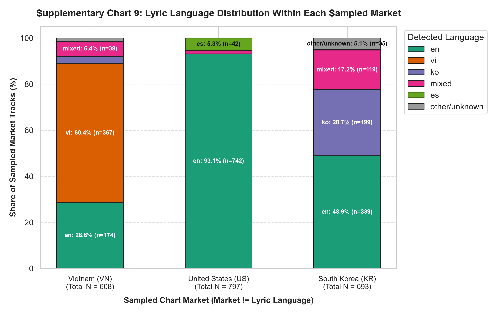
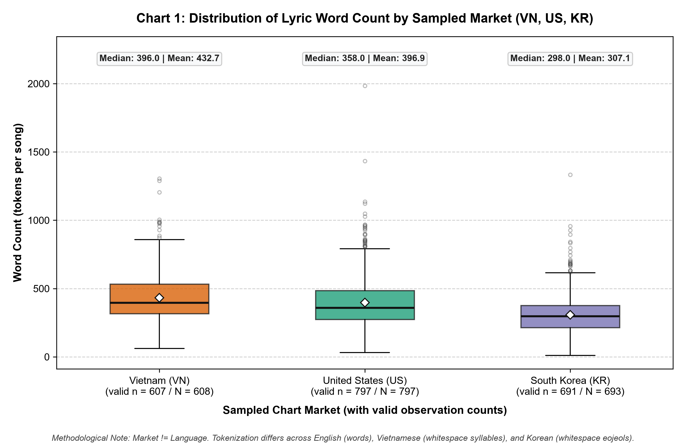
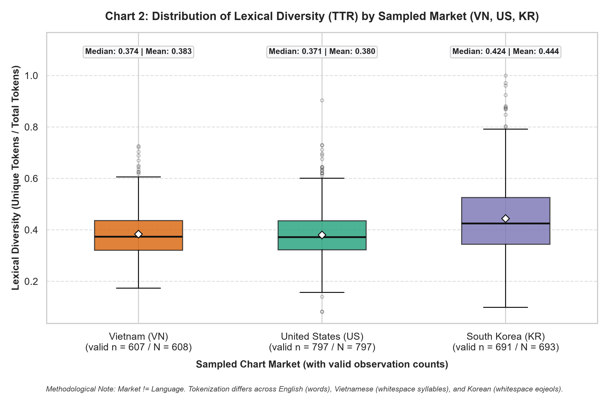
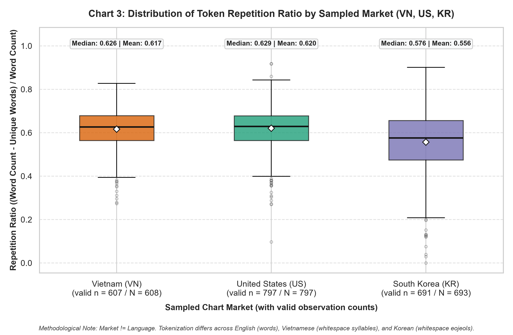
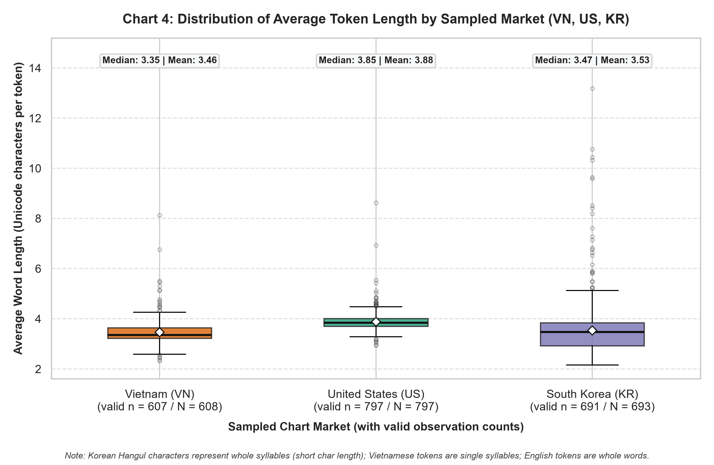
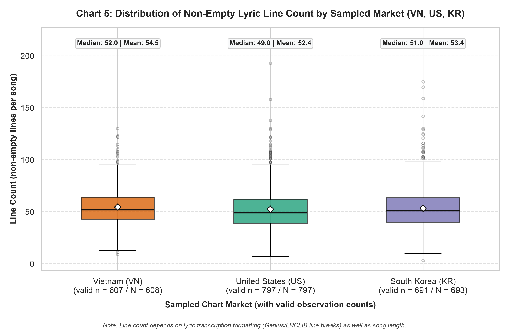
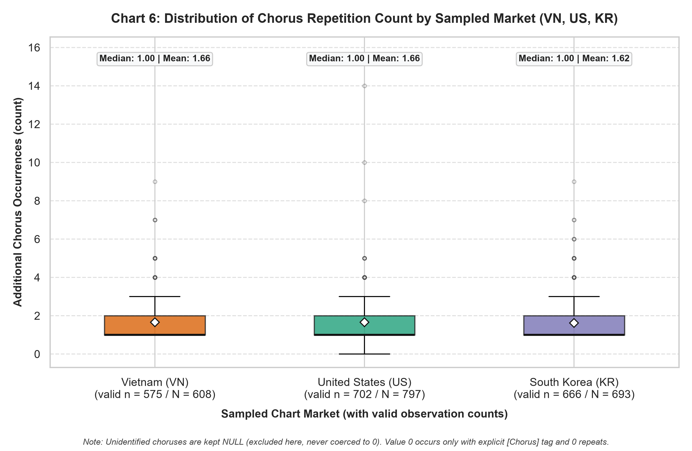
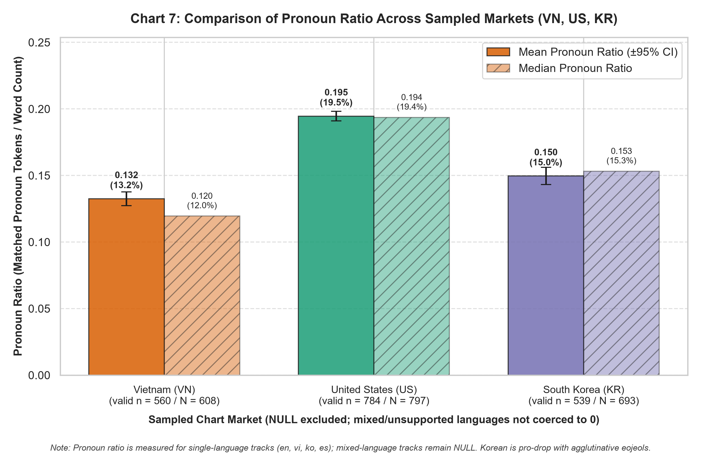
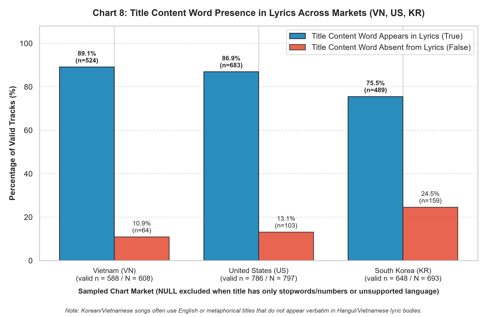

# Báo Cáo Thống Kê Mô Tả và Trực Quan Hóa Đặc Trưng Lyrics Theo Thị Trường (Member 3 — Report 4)

## 1. Mục Tiêu và Quy Ước Phân Tích Đa Thị Trường

Báo cáo này trình bày kết quả thống kê mô tả và trực quan hóa 8 nhóm đặc trưng lời bài hát (**lyrics features**) so sánh giữa 3 thị trường bảng xếp hạng trong tập mẫu (`VN` — Việt Nam, `US` — Hoa Kỳ, `KR` — Hàn Quốc), được trích xuất từ **1,912 bài hát duy nhất (`spotify_track_id`)** tương ứng với **2,098 quan sát cặp `(spotify_track_id, market)`** trong bảng `song_quarter_sampling` (`sampled = true`).

### Lưu ý phương pháp luận quan trọng: Thị trường (`market`) $\neq$ Ngôn ngữ lời bài hát (`language`)

1. **Sự giao thoa bài hát giữa các thị trường (Multi-market overlap):**
   - Trong 1,912 bài hát duy nhất, có **1,743 bài** xuất hiện ở 1 thị trường (`US`: 721, `KR`: 534, `VN`: 488) và **169 bài** xuất hiện ở từ 2 thị trường trở lên (`KR;VN`: 93, `KR;US`: 49, `KR;US;VN`: 17, `US;VN`: 10).
   - Khi phân tích theo từng thị trường (`market`), mỗi thị trường phản ánh đầy đủ tập bài hát lọt bảng xếp hạng được lấy mẫu tại thị trường đó: **`VN` ($N = 608$)**, **`US` ($N = 797$)**, **`KR` ($N = 693$)** (tổng cộng $608 + 797 + 693 = 2,098$ quan sát thị trường).
2. **Phân bố ngôn ngữ bên trong từng thị trường (`09_language_distribution_by_market.csv`):**
   - **Thị trường `VN` ($N = 608$):** Tiếng Việt (`vi`) chiếm **60.36%** ($n = 367$), tiếng Anh (`en`) chiếm **28.62%** ($n = 174$), đa ngôn ngữ (`mixed`) chiếm **6.41%** ($n = 39$), tiếng Hàn (`ko`) chiếm **3.12%** ($n = 19$), và ngôn ngữ khác/không lời chiếm **1.48%** ($n = 9$, gồm 1 bài Instrumental `not_found`).
   - **Thị trường `US` ($N = 797$):** Tiếng Anh (`en`) chiếm **93.10%** ($n = 742$), tiếng Tây Ban Nha (`es`) chiếm **5.27%** ($n = 42$), và đa ngôn ngữ (`mixed`) chiếm **1.63%** ($n = 13$). Toàn bộ 797 bài đều có lyrics hợp lệ ($0$ bài `not_found`).
   - **Thị trường `KR` ($N = 693$):** Tiếng Anh (`en`) chiếm **48.92%** ($n = 339$, bao gồm cả nhạc Âu-Mỹ và các ca khúc K-Pop phát hành hoàn toàn bằng tiếng Anh), tiếng Hàn thuần Hangul (`ko`) chiếm **28.72%** ($n = 199$), đa ngôn ngữ Hàn-Anh (`mixed`) chiếm **17.17%** ($n = 119$), tiếng Tây Ban Nha (`es`) chiếm **0.14%** ($n = 1$), và ngôn ngữ khác/không lời chiếm **5.05%** ($n = 35$, bao gồm nhạc Nhật `ja`, các bản Romanized và 2 bài Instrumental `not_found`).
3. **Hạn chế do khác biệt đơn vị tách từ (Tokenization Caveat):**
   - **Tiếng Anh (`en`) & Tiếng Tây Ban Nha (`es`):** Tách theo biểu thức chính quy từ Unicode (`[\p{L}\p{N}]+(?:['’\-][\p{L}\p{N}]+)*`), giữ nguyên từ rút gọn có dấu nháy (`don't`, `I'm`) thành 1 token tương ứng với một từ vựng.
   - **Tiếng Việt (`vi`):** Tách theo khoảng trắng (`whitespace_delimited_unicode_tokens`). Mỗi token là một **tiếng/âm tiết** (*syllable*), không phải từ ghép hoàn chỉnh (ví dụ: `"bầu trời"` gồm 2 token `"bầu"` và `"trời"`). Do đó, `word_count` của tiếng Việt phản ánh tổng số âm tiết, và `avg_word_length` phản ánh độ dài trung bình của một âm tiết (~3.31 ký tự).
   - **Tiếng Hàn (`ko`):** Tách theo khoảng trắng tạo ra các đơn vị **eojeol** (thường bao gồm gốc từ + trợ từ/đuôi từ dính liền do tính chất chắp dính của tiếng Hàn, không qua bộ phân tích hình thái học Mecab/Kiwi). Ngoài ra, mỗi ký tự Hangul đại diện cho cả một âm tiết hoàn chỉnh (gồm phụ âm đầu + nguyên âm + phụ âm cuối), nên độ dài tính theo số ký tự Unicode mỗi token (`avg_word_length` ~2.86 ký tự) ngắn hơn chữ Latin nhưng mật độ biến thể bề mặt (`lexical_diversity` ~0.536) lại cao hơn nhiều.
   - **Nguyên tắc diễn giải:** Mọi sự khác biệt giữa 3 thị trường là **thống kê mô tả cấu trúc văn bản và hệ chữ viết**, tuyệt đối **không đồng nhất với quan hệ nhân quả** lên thứ hạng bảng xếp hạng khi chưa kiểm soát hiệu ứng cố định của ngôn ngữ và phương pháp tách từ.

---

## 2. Bảng Tổng Hợp Thống Kê Theo Thị Trường và Ngôn Ngữ (`reports/report3/lyrics_statistics.csv`)

### 2.1. Thống kê theo thị trường (`VN`, `US`, `KR`)

| Đặc trưng (`feature`) | Thị trường | Tổng $N$ | Hợp lệ ($n$) | `NULL` ($n$ / %) | Mean | Std | Median | Q25 | Q75 | IQR | Min | Max |
| :--- | :---: | ---: | ---: | ---: | ---: | ---: | ---: | ---: | ---: | ---: | ---: | ---: |
| **`word_count`** | **VN** | 608 | 607 | 1 (0.16%) | 432.66 | 174.67 | 396.00 | 316.00 | 533.50 | 217.50 | 61.0 | 1306.0 |
| | **US** | 797 | 797 | 0 (0.00%) | 396.92 | 189.08 | 358.00 | 275.00 | 486.00 | 211.00 | 31.0 | 1985.0 |
| | **KR** | 693 | 691 | 2 (0.29%) | 307.10 | 142.82 | 298.00 | 215.00 | 376.50 | 161.50 | 11.0 | 1333.0 |
| **`unique_word_count`** | **VN** | 608 | 607 | 1 (0.16%) | 162.41 | 69.37 | 149.00 | 113.00 | 201.00 | 88.00 | 37.0 | 483.0 |
| | **US** | 797 | 797 | 0 (0.00%) | 146.17 | 73.09 | 127.00 | 101.00 | 174.00 | 73.00 | 20.0 | 652.0 |
| | **KR** | 693 | 691 | 2 (0.29%) | 127.53 | 59.44 | 118.00 | 93.00 | 149.00 | 56.00 | 11.0 | 504.0 |
| **`lexical_diversity`** | **VN** | 608 | 607 | 1 (0.16%) | 0.3833 | 0.0901 | 0.3737 | 0.3211 | 0.4362 | 0.1150 | 0.1730 | 0.7260 |
| | **US** | 797 | 797 | 0 (0.00%) | 0.3797 | 0.0938 | 0.3713 | 0.3224 | 0.4357 | 0.1133 | 0.0821 | 0.9032 |
| | **KR** | 693 | 691 | 2 (0.29%) | 0.4437 | 0.1388 | 0.4244 | 0.3440 | 0.5257 | 0.1817 | 0.0989 | 1.0000 |
| **`repetition_ratio`** | **VN** | 608 | 607 | 1 (0.16%) | 0.6167 | 0.0901 | 0.6263 | 0.5638 | 0.6789 | 0.1150 | 0.2740 | 0.8270 |
| | **US** | 797 | 797 | 0 (0.00%) | 0.6203 | 0.0938 | 0.6287 | 0.5643 | 0.6776 | 0.1133 | 0.0968 | 0.9179 |
| | **KR** | 693 | 691 | 2 (0.29%) | 0.5563 | 0.1388 | 0.5756 | 0.4743 | 0.6560 | 0.1817 | 0.0000 | 0.9011 |
| **`avg_word_length`** | **VN** | 608 | 607 | 1 (0.16%) | 3.4621 | 0.4472 | 3.3498 | 3.2188 | 3.6447 | 0.4259 | 2.3122 | 8.1311 |
| | **US** | 797 | 797 | 0 (0.00%) | 3.8786 | 0.3438 | 3.8462 | 3.7000 | 4.0109 | 0.3109 | 2.9314 | 8.6303 |
| | **KR** | 693 | 691 | 2 (0.29%) | 3.5313 | 1.0527 | 3.4737 | 2.9239 | 3.8451 | 0.9212 | 2.1573 | 13.1842 |
| **`line_count`** | **VN** | 608 | 607 | 1 (0.16%) | 54.53 | 17.44 | 52.00 | 43.00 | 64.00 | 21.00 | 9.0 | 130.0 |
| | **US** | 797 | 797 | 0 (0.00%) | 52.39 | 21.35 | 49.00 | 39.00 | 62.00 | 23.00 | 7.0 | 193.0 |
| | **KR** | 693 | 691 | 2 (0.29%) | 53.39 | 20.72 | 51.00 | 40.00 | 63.50 | 23.50 | 3.0 | 175.0 |
| **`chorus_repetition_count`** | **VN** | 608 | 575 | 33 (5.43%) | 1.6574 | 0.9216 | 1.0000 | 1.0000 | 2.0000 | 1.0000 | 1.0 | 9.0 |
| | **US** | 797 | 702 | 95 (11.92%) | 1.6581 | 0.9820 | 1.0000 | 1.0000 | 2.0000 | 1.0000 | 0.0 | 14.0 |
| | **KR** | 693 | 666 | 27 (3.90%) | 1.6171 | 0.9318 | 1.0000 | 1.0000 | 2.0000 | 1.0000 | 1.0 | 9.0 |
| **`punctuation_ratio`** | **VN** | 608 | 607 | 1 (0.16%) | 0.0348 | 0.0269 | 0.0289 | 0.0132 | 0.0512 | 0.0380 | 0.0000 | 0.1353 |
| | **US** | 797 | 797 | 0 (0.00%) | 0.0478 | 0.0212 | 0.0466 | 0.0330 | 0.0603 | 0.0273 | 0.0035 | 0.1712 |
| | **KR** | 693 | 691 | 2 (0.29%) | 0.0496 | 0.0306 | 0.0485 | 0.0262 | 0.0673 | 0.0411 | 0.0000 | 0.1753 |
| **`pronoun_ratio`** | **VN** | 608 | 560 | 48 (7.89%) | 0.1325 | 0.0618 | 0.1195 | 0.0898 | 0.1711 | 0.0813 | 0.0000 | 0.3468 |
| | **US** | 797 | 784 | 13 (1.63%) | 0.1946 | 0.0517 | 0.1936 | 0.1609 | 0.2282 | 0.0673 | 0.0428 | 0.4089 |
| | **KR** | 693 | 539 | 154 (22.22%) | 0.1496 | 0.0765 | 0.1532 | 0.0852 | 0.2081 | 0.1228 | 0.0000 | 0.3910 |

### 2.2. Thống kê biến Boolean `title_word_in_lyrics` theo thị trường

| Thị trường | Tổng $N$ | Hợp lệ ($n$) | `NULL` ($n$ / %) | Số bài `True` | Số bài `False` | Tỷ lệ `True` (%) |
| :---: | ---: | ---: | ---: | ---: | ---: | ---: |
| **VN** | 608 | 588 | 20 (3.29%) | 524 | 64 | **89.12%** |
| **US** | 797 | 786 | 11 (1.38%) | 683 | 103 | **86.90%** |
| **KR** | 693 | 648 | 45 (6.49%) | 489 | 159 | **75.46%** |
| **Toàn bộ Unique Tracks** | **1,912** | **1,843** | **69 (3.61%)** | **1,537** | **306** | **83.40%** |

---

## 3. Phân Tích Chi Tiết 8 Biểu Đồ Bắt Buộc

### 3.1. Biểu đồ 1 — Boxplot `word_count` theo Market

- **File hình ảnh:** `reports/report4/figures/member3/01_boxplot_word_count_by_market.png`
- **File dữ liệu vẽ biểu đồ:** `reports/report4/chart_data/member3/01_word_count_by_market.csv`
- **Số quan sát hợp lệ:** `VN`: $n = 607 / 608$ | `US`: $n = 797 / 797$ | `KR`: $n = 691 / 693$.

- **Nhận xét & Giải thích:**
  - Thị trường **VN** có trung vị `word_count` cao nhất (**Median = 396.0**, Mean = 432.7, IQR = 217.5), tiếp theo là **US** (**Median = 358.0**, Mean = 396.9, IQR = 211.0), và thấp nhất là **KR** (**Median = 298.0**, Mean = 307.1, IQR = 161.5).
  - Khi xét theo ngôn ngữ thực tế (`lyrics_statistics.csv`), các bài hát tiếng Việt (`vi`, $n = 367$) có trung vị lên tới **463.0 token/bài** (Mean = 497.1), tiếng Anh (`en`, $n = 1,095$) có trung vị **346.0 token/bài** (Mean = 380.2), còn tiếng Hàn (`ko`, $n = 211$) chỉ có trung vị **261.0 eojeol/bài** (Mean = 255.5).
  - **Cảnh báo phương pháp luận:** `word_count` của VN cao hơn US và KR chủ yếu do tiếng Việt tách từ theo khoảng trắng đếm từng **tiếng (âm tiết)**, trong khi tiếng Hàn (`ko`) gộp gốc từ và các trợ từ ngữ pháp thành một khối **eojeol** duy nhất. Do đó không được kết luận rằng bài hát tại thị trường Việt Nam dài hơn hay giàu nội dung hơn bài hát tại Hàn Quốc chỉ dựa trên số lượng token.

---

### 3.2. Biểu đồ 2 — Boxplot `lexical_diversity` theo Market

- **File hình ảnh:** `reports/report4/figures/member3/02_boxplot_lexical_diversity_by_market.png`
- **File dữ liệu vẽ biểu đồ:** `reports/report4/chart_data/member3/02_lexical_diversity_by_market.csv`
- **Số quan sát hợp lệ:** `VN`: $n = 607 / 608$ | `US`: $n = 797 / 797$ | `KR`: $n = 691 / 693$.

- **Nhận xét & Giải thích:**
  - `lexical_diversity` ($\text{TTR} = \text{unique\_word\_count} / \text{word\_count}$) tại **VN** (**Median = 0.374**, Mean = 0.383) và **US** (**Median = 0.371**, Mean = 0.380) rất tương đồng, trong khi thị trường **KR** có giá trị cao hơn rõ rệt (**Median = 0.424**, Mean = 0.444, IQR = 0.182).
  - Nguyên nhân kỹ thuật: Trong tiếng Hàn (`ko`, Median TTR = **0.535**, Mean = 0.536), cùng một danh từ hoặc động từ khi gắn với các tiểu từ khác nhau (ví dụ: `사랑`, `사랑이`, `사랑을`, `사랑은`, `사랑해`) sẽ tạo thành các token eojeol khác nhau khi tách theo khoảng trắng, làm tăng tử số `unique_word_count` và giảm mẫu số `word_count`. Thêm vào đó, các bài hát pha trộn Hàn-Anh (`mixed`, $n = 154$, Median TTR = **0.445**) sử dụng từ vựng từ hai hệ ngôn ngữ cũng đẩy TTR của thị trường KR lên cao.

---

### 3.3. Biểu đồ 3 — Boxplot `repetition_ratio` theo Market

- **File hình ảnh:** `reports/report4/figures/member3/03_boxplot_repetition_ratio_by_market.png`
- **File dữ liệu vẽ biểu đồ:** `reports/report4/chart_data/member3/03_repetition_ratio_by_market.csv`
- **Số quan sát hợp lệ:** `VN`: $n = 607 / 608$ | `US`: $n = 797 / 797$ | `KR`: $n = 691 / 693$.

- **Nhận xét & Giải thích:**
  - Theo định nghĩa $\text{repetition\_ratio} = (\text{word\_count} - \text{unique\_word\_count}) / \text{word\_count} = 1 - \text{lexical\_diversity}$, biểu đồ này phản ánh mức độ lặp lại token trong toàn bài.
  - Thị trường **US** (**Median = 0.629**, Mean = 0.620) và **VN** (**Median = 0.626**, Mean = 0.617) có tỷ lệ lặp token ở mức ~62–63%, cao hơn thị trường **KR** (**Median = 0.576**, Mean = 0.556).
  - Sự khác biệt này là hệ quả đối xứng của `lexical_diversity` và đặc tính hình thái học chắp dính của eojeol tiếng Hàn (`ko` có Median `repetition_ratio` = **0.465**).

---

### 3.4. Biểu đồ 4 — Boxplot `avg_word_length` theo Market

- **File hình ảnh:** `reports/report4/figures/member3/04_boxplot_avg_word_length_by_market.png`
- **File dữ liệu vẽ biểu đồ:** `reports/report4/chart_data/member3/04_avg_word_length_by_market.csv`
- **Số quan sát hợp lệ:** `VN`: $n = 607 / 608$ | `US`: $n = 797 / 797$ | `KR`: $n = 691 / 693$.

- **Nhận xét & Giải thích:**
  - Thị trường **US** có `avg_word_length` cao nhất và tập trung chặt (**Median = 3.85 ký tự/token**, Mean = 3.88, IQR = 0.31).
  - Thị trường **VN** có trung vị thấp nhất (**Median = 3.35 ký tự/token**, Mean = 3.46, IQR = 0.43) vì cấu trúc âm tiết tiếng Việt (`vi`, Median = **3.29 ký tự/tiếng**) bị giới hạn tự nhiên trong khoảng 1–7 chữ cái mỗi âm tiết.
  - Thị trường **KR** có trung vị ở mức trung gian (**Median = 3.47 ký tự/token**, Mean = 3.53) nhưng độ phân tán rất rộng (**IQR = 0.92**, Std = 1.05). Lý do là thị trường KR pha trộn giữa nhóm bài hát tiếng Hàn thuần Hangul (`ko`, Median = **2.77 ký tự Hangul/eojeol**, vì mỗi ký tự Hangul đã nén cả một âm tiết) và nhóm bài hát tiếng Anh (`en`, Median = **3.81 ký tự Latin/từ**). Một vài điểm ngoại lai (outliers > 8 ký tự) ở KR/US đến từ các chuỗi phiên âm hoặc từ cảm thán kéo dài (`"yeah-yeah-yeah..."`).

---

### 3.5. Biểu đồ 5 — Boxplot `line_count` theo Market

- **File hình ảnh:** `reports/report4/figures/member3/05_boxplot_line_count_by_market.png`
- **File dữ liệu vẽ biểu đồ:** `reports/report4/chart_data/member3/05_line_count_by_market.csv`
- **Số quan sát hợp lệ:** `VN`: $n = 607 / 608$ | `US`: $n = 797 / 797$ | `KR`: $n = 691 / 693$.

- **Nhận xét & Giải thích:**
  - Khác với các đặc trưng phụ thuộc vào bộ tách từ (`word_count`, `avg_word_length`), số dòng không rỗng (`line_count`) rất ổn định giữa cả 3 thị trường: **VN** (**Median = 52.0 dòng**, Mean = 54.5, IQR = 21.0), **KR** (**Median = 51.0 dòng**, Mean = 53.4, IQR = 23.5) và **US** (**Median = 49.0 dòng**, Mean = 52.4, IQR = 23.0).
  - Các bài hát có `line_count > 100` ở cả 3 thị trường chủ yếu là các bản Rap/Hip-Hop có tốc độ nhả chữ nhanh và nhiều câu ngắn. Tuy nhiên, cần lưu ý `line_count` vẫn chịu ảnh hưởng một phần bởi cách ngắt dòng của người đóng góp lời bài hát trên LRCLIB/Genius.

---

### 3.6. Biểu đồ 6 — Boxplot `chorus_repetition_count` theo Market

- **File hình ảnh:** `reports/report4/figures/member3/06_boxplot_chorus_repetition_count_by_market.png`
- **File dữ liệu vẽ biểu đồ:** `reports/report4/chart_data/member3/06_chorus_repetition_count_by_market.csv`
- **Số quan sát hợp lệ (đã loại trừ `NULL`, tuyệt đối không gán `0` khi không nhận diện được chorus):**
  - **VN:** $n = 575 / 608$ (94.57% đo được; 33 bài `NULL` gồm 1 bài Instrumental và 32 bài không có nhãn `[Chorus]` và không có khối đa dòng lặp lại đạt ngưỡng).
  - **US:** $n = 702 / 797$ (88.08% đo được; 95 bài `NULL`, thường là các bài Rap/Country/Ballad kể chuyện tuyến tính không lặp lại nguyên khối 3 dòng).
  - **KR:** $n = 666 / 693$ (96.10% đo được; 27 bài `NULL` gồm 2 bài Instrumental và 25 bài không đủ bằng chứng khối lặp).
  - **Tổng toàn tập Unique Tracks:** $n = 1,764 / 1,912$ (92.26% đo được; 148 bài `NULL`).

- **Nhận xét & Giải thích:**
  - Số lượng quan sát hợp lệ rất lớn ở cả 3 thị trường ($n = 575 \dots 702$), hoàn toàn đủ điều kiện thống kê để vẽ Boxplot.
  - Phân phối `chorus_repetition_count` (số lần lặp thêm của điệp khúc sau lần xuất hiện đầu tiên) đồng nhất cao giữa 3 thị trường: **Median = 1.0**, **Q25 = 1.0**, **Q75 = 2.0**, **IQR = 1.0** ở cả `VN`, `US`, `KR`, với **Mean** lần lượt là **1.66** (`VN`), **1.66** (`US`) và **1.62** (`KR`). Điều này phản ánh cấu trúc bài hát Pop tiêu chuẩn (Chorus xuất hiện tổng cộng 2 đến 3 lần trong bài, tức lặp thêm 1 đến 2 lần).
  - Giá trị `0` chỉ xuất hiện ở đúng 1 bài có nhãn `[Chorus]` tường minh duy nhất nhưng không lặp lại (`7hVb3OyFkgxDgpTdrOX6dT`); toàn bộ các bài không có nhãn `[Chorus]` và không tìm thấy khối lặp đều được giữ nguyên là `NULL`.

---

### 3.7. Biểu đồ 7 — Bar Chart so sánh `pronoun_ratio` theo Market

- **File hình ảnh:** `reports/report4/figures/member3/07_barchart_pronoun_ratio_by_market.png`
- **File dữ liệu vẽ biểu đồ:** `reports/report4/chart_data/member3/07_pronoun_ratio_by_market.csv`
- **Số quan sát hợp lệ (chỉ tính trên các bài đơn ngữ được hỗ trợ từ điển `en`, `vi`, `ko`, `es`; các bài `mixed` hoặc ngôn ngữ khác được giữ `NULL`):**
  - **VN:** $n = 560 / 608$ (48 bài `NULL` gồm 39 bài `mixed`, 8 bài ngôn ngữ khác, 1 bài Instrumental).
  - **US:** $n = 784 / 797$ (13 bài `NULL` đều là `mixed`).
  - **KR:** $n = 539 / 693$ (154 bài `NULL` gồm 119 bài `mixed`, 33 bài ngôn ngữ khác, 2 bài Instrumental).

- **Nhận xét & Giải thích:**
  - Thị trường **US** có tỷ lệ đại từ cao nhất (**Mean = 0.1946 / 19.5%**, **Median = 0.1936 / 19.4%**), cao hơn đáng kể so với **KR** (**Mean = 0.1496 / 15.0%**, **Median = 0.1532 / 15.3%**) và **VN** (**Mean = 0.1325 / 13.2%**, **Median = 0.1195 / 12.0%**).
  - Khi bóc tách theo ngôn ngữ thực tế (`lyrics_statistics.csv`):
    - Tiếng Anh (`en`, $n = 1,095$): Mean = **19.25%**, Median = **19.35%** (do đặc trưng ngữ pháp tiếng Anh bắt buộc phải có chủ ngữ đại từ `I, you, we, he, she, they` trong hầu hết các mệnh đề và tính cả các dạng rút gọn `I'm, you're`).
    - Tiếng Tây Ban Nha (`es`, $n = 43$): Mean = **15.52%**, Median = **15.85%**.
    - Tiếng Việt (`vi`, $n = 367$): Mean = **10.49%**, Median = **10.54%** (mẫu số của tiếng Việt là tổng số âm tiết nên tỷ lệ đại từ trên tổng số âm tiết thấp hơn tiếng Anh; ngoài ra các từ chỉ quan hệ gia đình như `anh, em` đóng vai trò đại từ nhân xưng nhưng câu tiếng Việt trong thơ/nhạc thường lược chủ ngữ).
    - Tiếng Hàn (`ko`, $n = 211$): Mean = **8.54%**, Median = **7.58%** (tiếng Hàn là ngôn ngữ **pro-drop** điển hình, thường xuyên tỉnh lược đại từ nhân xưng `나/너` khi ngữ cảnh đã rõ; lý do thị trường KR có Mean đạt 14.96% là vì 48.9% bài hát tại thị trường KR được hát bằng tiếng Anh).

---

### 3.8. Biểu đồ 8 — Biểu đồ `title_word_in_lyrics` theo Market

- **File hình ảnh:** `reports/report4/figures/member3/08_barchart_title_word_in_lyrics_by_market.png`
- **File dữ liệu vẽ biểu đồ:** `reports/report4/chart_data/member3/08_title_word_in_lyrics_by_market.csv`
- **Số quan sát hợp lệ (sau khi loại các bài có tiêu đề chỉ gồm stopwords/số hoặc ngôn ngữ ngoài bộ quy tắc):**
  - **VN:** $n = 588 / 608$ (`True`: **524 bài / 89.12%**, `False`: **64 bài / 10.88%**, `NULL`: 20 bài).
  - **US:** $n = 786 / 797$ (`True`: **683 bài / 86.90%**, `False`: **103 bài / 13.10%**, `NULL`: 11 bài).
  - **KR:** $n = 648 / 693$ (`True`: **489 bài / 75.46%**, `False`: **159 bài / 24.54%**, `NULL`: 45 bài).

- **Nhận xét & Giải thích:**
  - Tại **VN** (89.1%) và **US** (86.9%), gần 9/10 bài hát có ít nhất một từ nội dung (content word) trong tiêu đề xuất hiện trực tiếp trong lời bài hát.
  - Tại **KR** (75.5%), tỷ lệ này thấp hơn khoảng 11–14 điểm phần trăm. Khi kiểm tra theo ngôn ngữ (`lyrics_statistics.csv`), các bài hát thuần tiếng Hàn (`ko`, $n = 209$) chỉ có **52.15%** ($109/209$) bài có từ tiêu đề xuất hiện trong lời bài hát. Có hai nguyên nhân thực tế trong dữ liệu:
    1. **Bất đồng bộ ngôn ngữ giữa Title trên Spotify và Lyrics:** Nhiều bài hát Hàn Quốc trên Spotify sử dụng tiêu đề dịch sang tiếng Anh (ví dụ: *Traffic light* - LEE MU JIN, *Unknown Planet* - IU, *Event Horizon* - Younha, *A Psalm of Life* - Lim Young Woong, *Gradation* - 10CM), trong khi toàn bộ lời bài hát được viết bằng chữ Hangul tiếng Hàn (ví dụ: `"신호등"`, `"사건의 지평선"`, `"그라데이션"`).
    2. **Tính chất chắp dính của eojeol tiếng Hàn:** Ngay cả khi tiêu đề bằng chữ Hangul, trong lời bài hát từ đó có thể gắn thêm trợ từ (ví dụ tiêu đề `"주인공"` nhưng trong lời xuất hiện dưới dạng `"주인공이"` hoặc `"주인공은"`), khiến phép so khớp token chính xác (`exact_token_match`) trả về `False`.

---

## 4. Tổng Kết Các Giới Hạn Khi So Sánh Đa Thị Trường

1. **Không đồng nhất đơn vị từ vựng (`Tokenization Inequivalence`):** Các biến phụ thuộc vào đơn vị tách từ (`word_count`, `unique_word_count`, `lexical_diversity`, `repetition_ratio`, `avg_word_length`) chịu tác động trực tiếp từ cấu trúc hình thái học của tiếng Việt (đơn lập âm tiết), tiếng Anh (từ cách khoảng trắng) và tiếng Hàn (chắp dính eojeol + chữ viết âm tiết Hangul).
2. **Hiệu ứng pha trộn ngôn ngữ trong thị trường (`Market-Language Confounding`):** Thị trường `KR` có tới 48.92% bài tiếng Anh và 17.17% bài `mixed`; thị trường `VN` có 28.62% bài tiếng Anh và 6.41% bài `mixed`. Khi phân tích mối liên hệ với `ChartScore` (Member 1), khuyến nghị đưa cả biến `market` và `language` vào mô hình hoặc phân tích phân tầng theo `language` bên trong từng `market`.
3. **Không suy diễn nhân quả (`Non-Causality`):** Các biểu đồ trên mô tả đặc trưng phân phối của các bài hát đã lọt bảng xếp hạng trong mẫu nghiên cứu, không phải bằng chứng nhân quả rằng việc thay đổi độ dài lời bài hát hay tỷ lệ đại từ sẽ làm tăng hay giảm điểm bảng xếp hạng.
