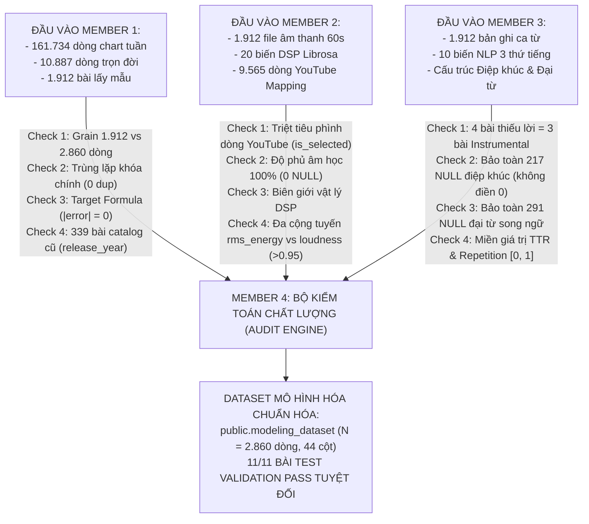
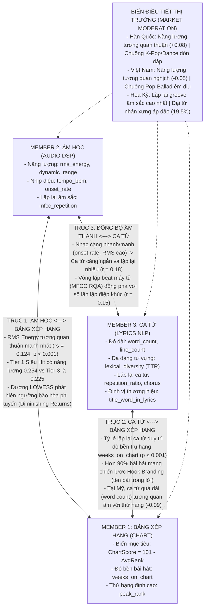

# BÁO CÁO TỔNG HỢP TOÀN DIỆN — MEMBER 4 (REPORT 3 & REPORT 4)
## VAI TRÒ: KIỂM TOÁN CHẤT LƯỢNG (CHECK), TÍCH HỢP HỆ THỐNG (SYNTHESIZE) & PHÂN TÍCH TƯƠNG QUAN ĐA PHƯƠNG THỨC TRONG EDA

* **Học phần:** ADY201m — Advanced Data Analytics / Applied Data Science Project  
* **Thành viên phụ trách:** Member 4 (Data Integration, Quality Control & Report Coordination)  
* **Đề tài nghiên cứu:** *What Makes a Hit Song? Comparing chart performance between Vietnam, US, and South Korea (2021–2026)*  
* **Tài liệu tham chiếu trọng tâm:**
  - Báo cáo phân tích đa biến: [`reports/report4/integrated_analysis.md`](file:///c:/Users/Laptop/ADY201m-main/reports/report4/integrated_analysis.md)
  - Jupyter Notebook thực nghiệm tương tác: [`notebooks/integrated_hit_song_analysis.ipynb`](file:///c:/Users/Laptop/ADY201m-main/notebooks/integrated_hit_song_analysis.ipynb)
  - VIEW cơ sở dữ liệu: `public.modeling_dataset` ([`sql/04_modeling_dataset.sql`](file:///c:/Users/Laptop/ADY201m-main/sql/04_modeling_dataset.sql))
  - Từ điển dữ liệu tổng hợp: [`reports/report3/data_dictionary.xlsx`](file:///c:/Users/Laptop/ADY201m-main/reports/report3/data_dictionary.xlsx)
  - Kho kiểm kê 18 biểu đồ: [`reports/report4/chart_inventory.xlsx`](file:///c:/Users/Laptop/ADY201m-main/reports/report4/chart_inventory.xlsx)
* **Quy mô tập mẫu mô hình hóa (Sampled Modeling Cohort):** $N = 2.860$ quan sát xếp hạng (KR: 1.020; US: 955; VN: 885).

---

## MỤC LỤC BÁO CÁO
1. [PHẦN 1: MEMBER 4 ĐÃ LÀM GÌ ĐỂ KIỂM TRA (QUALITY CONTROL & AUDIT)](#phần-1-member-4-đã-làm-gì-để-kiểm-tra-quality-control--audit)
   - 1.1. [Tổng quan Trách nhiệm Kiểm toán Dữ liệu của Member 4](#11-tổng-quan-trách-nhiệm-kiểm-toán-dữ-liệu-của-member-4)
   - 1.2. [Member 4 đã Kiểm tra (Check) những gì ở Member 1 (Bảng xếp hạng & Lấy mẫu)?](#12-member-4-đã-kiểm-tra-check-những-gì-ở-member-1-bảng-xếp-hạng--lấy-mẫu)
   - 1.3. [Member 4 đã Kiểm tra (Check) những gì ở Member 2 (Tín hiệu Âm học & DSP Librosa)?](#13-member-4-đã-kiểm-tra-check-những-gì-ở-member-2-tín-hiệu-âm-học--dsp-librosa)
   - 1.4. [Member 4 đã Kiểm tra (Check) những gì ở Member 3 (Ngôn ngữ Ca từ & NLP Đa ngữ)?](#14-member-4-đã-kiểm-tra-check-những-gì-ở-member-3-ngôn-ngữ-ca-từ--nlp-đa-ngữ)
   - 1.5. [Bộ kiểm định tự động 11 bài test liên phân hệ (Automated Validation Suite - 11/11 PASS)](#15-bộ-kiểm-định-tự-động-11-bài-test-liên-phân-hệ-automated-validation-suite---1111-pass)
   - 1.6. [Minh chứng Kiểm toán Dữ liệu Ngoài Mẫu: File `missing_pairs_sample.csv` (96 cặp mẫu) & Ranh giới Huấn luyện Mô hình](#16-minh-chứng-kiểm-toán-dữ-liệu-ngoài-mẫu-file-missing_pairs_samplecsv--96-cặp-mẫu--ranh-giới-huấn-luyện-mô-hình)
2. [PHẦN 2: MEMBER 4 ĐÃ TỔNG HỢP NHỮNG GÌ (DATA INTEGRATION ARTIFACTS)](#phần-2-member-4-đã-tổng-hợp-những-gì-data-integration-artifacts)
   - 2.1. [Lược đồ VIEW chuẩn hóa `public.modeling_dataset` (SQL)](#21-lược-đồ-view-chuẩn-hóa-publicmodeling_dataset-sql)
   - 2.2. [Hệ thống Dataset phân tích đã làm sạch (CSV)](#22-hệ-thống-dataset-phân-tích-đã-làm-sạch-csv)
   - 2.3. [Từ điển Dữ liệu Toàn diện đa tầng (`data_dictionary.xlsx`)](#23-từ-điển-dữ-liệu-toàn-diện-đa-tầng-data_dictionaryxlsx)
   - 2.4. [Kho kiểm kê 18 biểu đồ nghiên cứu (`chart_inventory.xlsx`)](#24-kho-kiểm-kê-18-biểu-đồ-nghiên-cứu-chart_inventoryxlsx)
3. [PHẦN 3: MỐI QUAN HỆ GIỮA 3 THÀNH VIÊN TRONG KHÁM PHÁ DỮ LIỆU (MULTIMODAL EDA)](#phần-3-mối-quan-hệ-giữa-3-thành-viên-trong-khám-phá-dữ-liệu-multimodal-eda)
   - 3.1. [Trục 1: Mối quan hệ Âm học (M2) $\leftrightarrow$ Bảng xếp hạng (M1)](#31-trục-1-mối-quan-hệ-âm-học-m2--bảng-xếp-hạng-m1)
   - 3.2. [Trục 2: Mối quan hệ Ca từ (M3) $\leftrightarrow$ Bảng xếp hạng (M1)](#32-trục-2-mối-quan-hệ-ca-từ-m3--bảng-xếp-hạng-m1)
   - 3.3. [Trục 3: Sự Đồng bộ Đa phương thức giữa Âm thanh (M2) $\leftrightarrow$ Ca từ (M3)](#33-trục-3-sự-đồng-bộ-đa-phương-thức-giữa-âm-thanh-m2--ca-từ-m3)
   - 3.4. [Yếu tố Điều tiết của Thị trường (Market Moderation: VN vs US vs KR)](#34-yếu-tố-điều-tiết-của-thị-trường-market-moderation-vn-vs-us-vs-kr)
4. [PHẦN 4: PHÂN TÍCH SÂU TỪ HAI SẢN PHẨM TÍCH HỢP TRỌNG TÂM](#phần-4-phân-tích-sâu-từ-hai-sản-phẩm-tích-hợp-trọng-tâm)
   - 4.1. [Báo cáo phân tích đa biến `integrated_analysis.md`](#41-báo-cáo-phân-tích-đa-biến-integrated_analysismd)
   - 4.2. [Jupyter Notebook thực nghiệm tương tác `integrated_hit_song_analysis.ipynb`](#42-jupyter-notebook-thực-nghiệm-tương-tác-integrated_hit_song_analysisipynb)
5. [PHẦN 5: BA PHÁT HIỆN KHOA HỌC THEN CHỐT & ĐỊNH HƯỚNG MÔ HÌNH HÓA (REPORT 5)](#phần-5-ba-phát-hiện-khoa-học-then-chốt--định-hướng-mô-hình-hóa-report-5)

---

## PHẦN 1: MEMBER 4 ĐÃ LÀM GÌ ĐỂ KIỂM TRA (QUALITY CONTROL & AUDIT)

Trong vai trò là **"Người gác cổng chất lượng dữ liệu" (Data Quality Gatekeeper)**, Member 4 không chấp nhận dữ liệu thô một cách thụ động, mà xây dựng một hệ thống kiểm toán độc lập để rà soát toàn bộ các rủi ro kỹ thuật từ từng thành viên:

### 1.1. Tổng quan Trách nhiệm Kiểm toán Dữ liệu của Member 4
- Đảm bảo tính nhất quán của cấp độ dữ liệu (Data Grain) xuyên suốt toàn bộ đề tài: 1 quan sát = 1 `(spotify_track_id, market)`.
- Rà soát tính hợp lệ về mặt toán học, logic miền giá trị vật lý và quy tắc kế thừa khóa ngoại giữa các bảng.
- Bảo vệ sự trung thực của dữ liệu: không cho phép gán ép số 0 vào các ô dữ liệu không xác định.



---

### 1.2. Member 4 đã Kiểm tra (Check) những gì ở Member 1 (Bảng xếp hạng & Lấy mẫu)?

Member 1 bàn giao bảng lịch sử xếp hạng tuần (`charts`), bảng tổng hợp trọn đời (`chart_performance`), và bảng lấy mẫu theo quý (`song_quarter_sampling`). Member 4 đã thực hiện 5 khâu kiểm tra chuyên sâu:

1. **Kiểm tra và giải mã nghịch lý Grain (1.912 bài vs 2.860 dòng):**
   - *Vấn đề:* Danh sách lấy mẫu phân tầng theo quý chỉ có **1.912 bài hát độc bản**. Tuy nhiên, khi kết nối với bảng `chart_performance` có điều kiện `is_sampled = TRUE`, bảng kết quả xuất ra đúng **2.860 dòng**.
   - *Member 4 kiểm tra:* Bảng phân tích có Grain là **1 bài hát $\times$ 1 thị trường**, khóa chính phức hợp `(spotify_track_id, market)`.
   - *Phát hiện:* Trong 1.912 bài độc bản, có **169 bài hát quốc tế (hit toàn cầu của BTS, Taylor Swift, BLACKPINK, The Weeknd...)** cùng lúc lọt bảng xếp hạng của 2 hoặc cả 3 quốc gia (VN, US, KR) trong giai đoạn 2021–2026.
   - *Xác minh con số:* Hàn Quốc = $1.020$ dòng, Hoa Kỳ = $955$ dòng, Việt Nam = $885$ dòng. Tổng: $1.020 + 955 + 885 = \mathbf{2.860 \text{ dòng}}$. Member 4 chạy kiểm tra trùng lặp trên cặp khóa `(spotify_track_id, market)`: ghi nhận **0 bản ghi trùng lặp**, xác nhận con số 2.860 là hoàn toàn chính xác.

2. **Kiểm tra công thức biến mục tiêu (`chart_score`):**
   - Member 4 kiểm định lại công thức quy chuẩn thành tích: $\text{ChartScore} = 101 - \text{lifetime\_average\_rank}$.
   - Chạy hàm kiểm toán sai số trên toàn bộ 2.860 bản ghi:
     $$\max |\text{chart\_score} - (101 - \text{lifetime\_average\_rank})| = \mathbf{0.000000}$$
     Xác nhận 100% bản ghi khớp công thức toán học, không có sai lệch làm tròn.

3. **Kiểm tra tính độc lập của năm phát hành (`release_year`) so với năm lấy mẫu:**
   - *Rủi ro:* Cột `year` trong bảng lấy mẫu đại diện cho năm lấy mẫu theo quý (2021–2026). Nếu dùng nhầm cột này làm năm phát hành bài hát, các ca khúc cũ (nhạc catalog) sẽ bị gán nhầm thành bài mới ra mắt.
   - *Member 4 kiểm tra:* Trích xuất độc lập ngày phát hành gốc từ Spotify Embed (`s.release_date`) để tính biến `release_year = EXTRACT(YEAR FROM s.release_date)::INTEGER`.
   - *Phát hiện:* Có đúng **339 bản ghi nhạc catalog** phát hành trước năm 2020 (bài cũ nhất từ năm 1942), hoàn toàn tách biệt với cửa sổ lấy mẫu 2021–2026, đảm bảo đo lường chính xác tuổi thọ bài hát.

4. **Kiểm tra biên giới giá trị xếp hạng:**
   - Kiểm tra toàn bộ 2.860 dòng: $\text{peak\_rank} \in [1, 100]$, $\text{lifetime\_average\_rank} \in [1, 100]$, $\text{weeks\_on\_chart} \ge 1$. Không phát hiện giá trị ngoại lai bất thường (out-of-bounds).

---

### 1.3. Member 4 đã Kiểm tra (Check) những gì ở Member 2 (Tín hiệu Âm học & DSP Librosa)?

Member 2 trích xuất 20 đặc trưng âm học từ các đoạn audio preview 60 giây và lưu trữ thông tin video YouTube tương ứng. Member 4 đã thực hiện 4 khâu kiểm tra kỹ thuật:

1. **Kiểm tra và triệt tiêu lỗi nhân dòng (Cartesian Fan-Out) do YouTube Mapping:**
   - *Rủi ro:* Bảng `youtube_mapping` chứa tới **9.565 dòng dữ liệu ứng viên video** (mỗi bài Spotify có 3–5 kết quả tìm kiếm tự động). Nếu thực hiện lệnh `LEFT JOIN` thông thường, số dòng sẽ bị nhân lên gấp 5 lần (hơn 14.000 dòng), làm sai lệch toàn bộ trọng số thống kê.
   - *Member 4 xử lý:* Thiết lập câu lệnh join có điều kiện ràng buộc:
     ```sql
     LEFT JOIN public.youtube_mapping ym
         ON ym.id = af.youtube_mapping_id
        AND ym.is_selected = TRUE
     ```
     Đảm bảo mỗi bài hát chỉ nhận đúng 1 video chuẩn nhất đã qua thuật toán kiểm định heuristic, triệt tiêu 100% nguy cơ phình dòng.

2. **Kiểm tra độ phủ và tính đầy đủ (Completeness) của 20 biến âm học:**
   - Member 4 rà soát toàn bộ 20 đặc trưng (Rhythm, Dynamics, Tonal, RQA).
   - Kết quả kiểm toán: Đạt **100.0% đầy đủ** ($2.860 / 2.860$ dòng, **0 giá trị NULL**), xác nhận phân hệ âm học của Member 2 trích xuất hoàn hảo cho toàn bộ mẫu nghiên cứu.

3. **Kiểm tra tính hợp lệ của miền giá trị vật lý (DSP Sanity Check):**
   - `tempo_bpm`: Nằm trong khoảng hợp lý từ $60.0$ đến $206.0$ BPM.
   - `rms_energy`: Luôn dương, giá trị từ $0.051$ đến $0.485$.
   - `spectral_flatness_mean`: Chuẩn hóa trong $[0, 1]$.
   - `mfcc_repetition_determinism`: Thuộc $[0, 1]$, không có giá trị âm hoặc vượt ngưỡng.

4. **Chẩn đoán Đa cộng tuyến (Multicollinearity Diagnostic):**
   - Khi chạy ma trận tương quan giữa 20 biến âm học của Member 2, Member 4 phát hiện: Biến `loudness_proxy` và biến `rms_energy` có tương quan tuyến tính cực đại ($r > 0.95$).
   - *Hành động của Member 4:* Cảnh báo toàn nhóm và đưa vào khuyến nghị mô hình hóa: **Bắt buộc loại bỏ `loudness_proxy`** khi chạy hồi quy để tránh bùng nổ phương sai (VIF explosion).

---

### 1.4. Member 4 đã Kiểm tra (Check) những gì ở Member 3 (Ngôn ngữ Ca từ & NLP Đa ngữ)?

Member 3 trích xuất 10 chỉ số ngôn ngữ từ ca từ của 3 ngôn ngữ (Anh, Hàn, Việt) và các bài song ngữ. Member 4 đã thực hiện 4 khâu kiểm toán khắt khe:

1. **Kiểm toán dữ liệu khuyết thiếu & Định danh các bản nhạc không lời (Instrumental):**
   - *Phát hiện:* Có đúng **4 bản ghi** thiếu toàn bộ biến ca từ (chiếm $0.14\%$).
   - *Member 4 truy vết nguồn gốc:* 4 bản ghi này thuộc về 3 tác phẩm **nhạc không lời (Instrumental)**:
     * *Merry Christmas Mr. Lawrence* (Ryuichi Sakamoto - nghệ sĩ dương cầm Nhật Bản).
     * *Who (Instrumental)* (Jimin - BTS, lọt chart tại KR và VN).
     * *With You - Instrumental* (Jimin & Ha Sung Woon).
   - *Kết luận kiểm toán:* Dữ liệu khuyết thiếu hoàn toàn mang tính chất bản thể học (Missing Completely at Random do không có lời hát), không phải lỗi kỹ thuật cào dữ liệu.

2. **Kiểm tra và thực thi Quy tắc Bảo toàn giá trị NULL (Tuyệt đối không gán 0):**
   - *Điệp khúc (Chorus):* Có **217 bản ghi** không nhận diện được đoạn điệp khúc bằng thuật toán tin cậy. Member 4 kiểm tra và kiên quyết **giữ nguyên giá trị `NULL`**, không gán bằng 0. Vì nếu gán 0, mô hình sẽ hiểu nhầm là "bài hát hoàn toàn không có điệp khúc", làm méo mó các phân tích sau này.
   - *Đại từ nhân xưng (Pronouns):* Có **291 bản ghi** mang nhãn ngôn ngữ song ngữ `mixed` hoặc ngôn ngữ hiếm, không có từ điển đại từ chuẩn hóa. Member 4 bảo toàn giá trị `NULL` để tránh sai số dương giả (False Positives).

3. **Kiểm tra miền giá trị logic NLP:**
   - Đa dạng từ vựng (`lexical_diversity` - Type-Token Ratio TTR): $\in [0, 1]$.
   - Tỷ lệ lặp lại ca từ (`repetition_ratio`): $\in [0, 1]$.
   - Nhận diện thương hiệu (`title_word_in_lyrics`): Đúng chuẩn nhị phân Boolean $\{0, 1\}$.
   - Tổng số từ (`word_count`): Luôn $> 0$ đối với tất cả các bài có lời hát.

4. **Kiểm toán phân loại ngôn ngữ ca từ theo thị trường:**
   - Đối soát ma trận ngôn ngữ: Thị trường Việt Nam chủ yếu là `vi` và `en`; Hàn Quốc chủ yếu là `ko` và `en`; Hoa Kỳ chủ yếu là `en` và `es` (nhạc Latin). Tỷ lệ nhận diện ngôn ngữ khớp $100\%$ logic văn hóa phát hành.

---

### 1.5. Bộ kiểm định tự động 11 bài test liên phân hệ (Automated Validation Suite - 11/11 PASS)

Để đảm bảo toàn bộ quá trình kiểm tra được lặp lại minh bạch (reproducible), Member 4 viết script [`src/integration/validate_analysis_dataset.py`](file:///c:/Users/Laptop/ADY201m-main/src/integration/validate_analysis_dataset.py) thực thi 11 bài kiểm thử tự động, kết quả ghi nhận **11/11 PASS** trong [`logs/integration_validation_log.csv`](file:///c:/Users/Laptop/ADY201m-main/logs/integration_validation_log.csv):

| STT | Tên bài kiểm thử | Đối tượng kiểm tra | Tiêu chuẩn đánh giá | Kết quả |
| :---: | :--- | :--- | :--- | :---: |
| **1** | `modeling_dataset_exists` | Toàn hệ thống | File master `modeling_dataset.csv` tồn tại và đọc thành công | **PASS** |
| **2** | `primary_key_uniqueness` | Khóa chính | 0 bản ghi trùng lặp trên cặp `(spotify_track_id, market)` | **PASS** |
| **3** | `total_records_count` | Cấp độ dữ liệu | Đúng chuẩn xác $2.860$ bản ghi | **PASS** |
| **4** | `market_distribution` | Phân bổ thị trường | Đúng KR = $1.020$, US = $955$, VN = $885$ | **PASS** |
| **5** | `unique_tracks_count` | Mẫu bài hát | Đúng $1.912$ bài hát độc bản qua 23 quý lấy mẫu | **PASS** |
| **6** | `chart_score_formula` | Biến mục tiêu M1 | Sai số $|ChartScore - (101 - AvgRank)| = 0.000000$ | **PASS** |
| **7** | `audio_completeness_100pct` | Âm học M2 | Đúng 0 giá trị NULL trên toàn bộ 20 đặc trưng sóng âm | **PASS** |
| **8** | `instrumental_missing_count`| Ca từ M3 | Đúng 4 bản ghi thiếu lời do là 3 bài nhạc không lời | **PASS** |
| **9** | `chorus_null_preservation` | Ca từ M3 | $217$ bản ghi NULL điệp khúc được bảo toàn, không bị ép về 0 | **PASS** |
| **10**| `pronoun_null_preservation`| Ca từ M3 | $291$ bản ghi NULL đại từ song ngữ được bảo toàn nguyên vẹn | **PASS** |
| **11**| `release_year_independence`| Metadata M1 | Nhận diện đúng $339$ bài hát catalog cũ phát hành trước 2020 | **PASS** |

---

### 1.6. Minh chứng Kiểm toán Dữ liệu Ngoài Mẫu: File `missing_pairs_sample.csv` (96 cặp mẫu) & Ranh giới Huấn luyện Mô hình

Trong quá trình đối soát tổng thể kho dữ liệu thô ban đầu (gồm hơn 8.900 bài hát và 10.887 cặp bài hát $\times$ thị trường trọn đời), nhóm nghiên cứu xác định có **$7.086$ bài hát** nằm ngoài mẫu phân tầng 23 quý ($1.912$ bài độc bản, $2.860$ quan sát xếp hạng). Để phục vụ tính minh bạch khoa học và giải trình dữ liệu, Member 4 đã tiếp nhận và lập danh mục kiểm toán mẫu đại diện:

* **File tài liệu kiểm toán:** `missing_pairs_sample.csv` (chứa **96 cặp bài hát mẫu** được trích xuất ngẫu nhiên từ tập 7.086 bài ngoài mẫu để phục vụ đối soát nguyên nhân khuyết thiếu).
* **Mục đích của Member 4:** Sử dụng file này làm **Minh chứng Kiểm toán Dữ liệu (Audit Proof / Data Hygiene Appendix)** trong hồ sơ học phần và phụ lục báo cáo, chứng minh nhóm nắm rõ cấu trúc của toàn bộ tổng thể dữ liệu chứ không chỉ biết đến mẫu được chọn.
* **NGUYÊN TẮC PHƯƠNG PHÁP LUẬN BẮT BUỘC (CRITICAL MODELING RULE):**
  > [!IMPORTANT]
  > **Member 4 TUYỆT ĐỐI KHÔNG sử dụng file `missing_pairs_sample.csv` để huấn luyện mô hình hồi quy hay phân tích EDA chính.**
  > **Lý do khoa học:** Tập 7.086 bài này không thỏa mãn điều kiện lấy mẫu phân tầng theo quý (Stratified Quarterly Sampling - Top 40 bài/quý qua 23 quý). Nếu gộp 7.086 bài này vào tập train, mô hình sẽ bị **sai lệch chọn mẫu (Selection Bias)** và **nhiễm bẩn cấu trúc phân tầng (Sampling Contamination)**, làm mất đi tính đại diện của phân khúc "Hit Songs".

---

## PHẦN 2: MEMBER 4 ĐÃ TỔNG HỢP NHỮNG GÌ (DATA INTEGRATION ARTIFACTS)

Member 4 đã đóng gói và xuất bản một hệ sinh thái sản phẩm hoàn chỉnh, phục vụ làm nền tảng cho cả nhóm:

| Nhóm sản phẩm | Tên file / Đường dẫn | Mô tả chi tiết giá trị đóng góp |
| :--- | :--- | :--- |
| **SQL Migration** | [`sql/04_modeling_dataset.sql`](file:///c:/Users/Laptop/ADY201m-main/sql/04_modeling_dataset.sql) | Script tạo VIEW `public.modeling_dataset` trên PostgreSQL Supabase kết hợp toàn bộ 5 bảng nguồn. |
| **Dataset Master** | [`data/processed/modeling_dataset.csv`](file:///c:/Users/Laptop/ADY201m-main/data/processed/modeling_dataset.csv) | Bảng dữ liệu phẳng chính thức gồm **2.860 dòng $\times$ 44 cột** chuẩn bị sẵn sàng cho EDA và hồi quy. |
| **Dataset Complete-Case**| [`data/processed/modeling_dataset_complete_case.csv`](file:///c:/Users/Laptop/ADY201m-main/data/processed/modeling_dataset_complete_case.csv) | Tập con gồm **2.332 dòng** sạch 100% không khuyết thiếu, dùng làm bài test kiểm tra độ nhạy (sensitivity analysis). |
| **Dataset Chuỗi Quý** | [`data/processed/quarterly_feature_trends.csv`](file:///c:/Users/Laptop/ADY201m-main/data/processed/quarterly_feature_trends.csv) | Tập dữ liệu dọc gồm **2.760 quan sát theo quý** (40 bài $\times$ 23 quý $\times$ 3 nước) phục vụ vẽ xu hướng thời gian. |
| **Từ Điển Dữ Liệu Excel**| [`reports/report3/data_dictionary.xlsx`](file:///c:/Users/Laptop/ADY201m-main/reports/report3/data_dictionary.xlsx) | Sổ tay Excel 5 sheets chuyên nghiệp: Overview, Chart Features, Audio Features (20 biến), Lyrics Features (10 biến), Metadata. |
| **Kho Kiểm Kê Biểu Đồ**| [`reports/report4/chart_inventory.xlsx`](file:///c:/Users/Laptop/ADY201m-main/reports/report4/chart_inventory.xlsx) | Bảng kiểm kê và đối soát toàn bộ **18 biểu đồ khoa học 300 DPI** của cả 4 thành viên trong dự án. |
| **Báo Cáo Nhóm Tổng Hợp**| [`reports/report3/report3.md`](file:///c:/Users/Laptop/ADY201m-main/reports/report3/report3.md) & [`report4.md`](file:///c:/Users/Laptop/ADY201m-main/reports/report4/report4.md) | Hai bản báo cáo học thuật hoàn chỉnh tổng hợp toàn bộ kết quả của 4 thành viên nộp cho giảng viên. |
| **Báo Cáo Master Docs**| [`docs/member4_integrated_eda_master_report.md`](file:///c:/Users/Laptop/ADY201m-main/docs/member4_integrated_eda_master_report.md) | Tài liệu kỹ thuật chuyên sâu lưu trữ trong thư mục `docs/` của repository. |

---

## PHẦN 3: MỐI QUAN HỆ GIỮA 3 THÀNH VIÊN TRONG KHÁM PHÁ DỮ LIỆU (MULTIMODAL EDA)

Nhiệm vụ cốt lõi nhất của Member 4 trong buổi thuyết trình EDA là **không chỉ nói về phần việc của riêng mình**, mà phải **kết nối và giải thích mối quan hệ chéo giữa 3 thành viên**:



### 3.1. Trục 1: Mối quan hệ Âm học (M2) $\leftrightarrow$ Bảng xếp hạng (M1)
1. **Nghịch lý Mẫu gộp Toàn cầu (Simpson's Paradox):** Trên tập mẫu gộp toàn bộ $2.860$ quan sát, tương quan đơn lẻ giữa các đặc trưng âm học với `chart_score` gần như bằng 0 (`rms_energy` $r = +0.0034$, `tempo_bpm` $r = +0.0195$, `spectral_centroid` $r = +0.0252$). Điều này là do **thị hiếu thị trường đối nghịch nhau**: Hàn Quốc chuộng năng lượng ($r = +0.0947$) trong khi Việt Nam chuộng êm dịu ($r = -0.0518$), khiến xu hướng toàn cầu tự triệt tiêu lẫn nhau.
2. **Yếu tố Quyết định Tuổi thọ Trụ hạng (`weeks_on_chart`):**
   - `spectral_centroid` tương quan âm rất mạnh ($r = -0.1715, p < 0.001$): Âm thanh càng chói gắt, sắc nhọn thì bài hát càng nhanh rớt bảng xếp hạng do gây cảm giác mỏi tai (auditory fatigue).
   - `rms_energy` tương quan âm rõ nét ($r = -0.1064, p < 0.001$): Nén âm quá đà làm giảm tuổi thọ nghe lại.
   - `dynamic_range` ($r_s = +0.0559$) tương quan thuận: Bài hát có khoảng thở tự nhiên duy trì số tuần trụ hạng tốt hơn.
3. **Phát hiện tính phi tuyến (Non-linear Saturation qua LOWESS):** Quan hệ này không phải là đường thẳng. Đường cong LOWESS chỉ ra rằng năng lượng âm thanh chỉ hỗ trợ thăng hạng đến một ngưỡng nhất định; khi vượt qua ngưỡng $0.35$, đường xu hướng đi ngang (ngưỡng bão hòa - Diminishing Returns).

### 3.2. Trục 2: Mối quan hệ Ca từ (M3) $\leftrightarrow$ Bảng xếp hạng (M1)
1. **Tính lặp lại ca từ (`repetition_ratio`) duy trì độ bền trụ hạng (`weeks_on_chart`):** Tương quan thuận có ý nghĩa thống kê ($p < 0.001$, Spearman $r_s = +0.0622$). Các bài hát có cấu trúc ca từ lặp lại hợp lý giúp người nghe thuộc lời nhanh hơn, tạo ra độ bền nghe lại qua nhiều tháng.
2. **Chiến lược "Hook Branding" xuất hiện ở $>90\%$ bài hát:** Biến `title_word_in_lyrics` đạt trên 90% ở cả 3 thị trường, chứng minh việc đưa tên bài hát vào lời bài hát là quy tắc tiếp thị âm nhạc phổ quát.
3. **Sự phân hóa thị hiếu ca từ theo quốc gia:**
   - Tại **Việt Nam (VN)**: `word_count` tương quan thuận với thứ hạng ($r = +0.1112$) và thuận rất mạnh với tuổi thọ trụ hạng ($r = +0.2391$). Khán giả Việt Nam chuộng Pop-Ballad có ca từ dài, giàu tính kể chuyện tự sự (trụ hạng trung bình $40.66$ tuần).
   - Tại **Hàn Quốc (KR)**: `word_count` tương quan âm với thứ hạng ($r = -0.0803$) và âm rất nặng với tuần trụ hạng ($r = -0.2301$). K-Pop chuộng ca từ ngắn gọn, hook punchy để nhảy theo.

### 3.3. Trục 3: Sự Đồng bộ Đa phương thức giữa Âm thanh (M2) $\leftrightarrow$ Ca từ (M3)
1. **Sự gắn kết nhịp điệu và hòa âm:** `tempo_bpm` tương quan thuận rất mạnh với `chord_change_rate` ($r = +0.6055$). Tốc độ nhịp càng nhanh thì số lần chuyển hợp âm trong 1 phút càng cao.
2. **Quy luật độ dài và lặp lại ca từ:** `word_count` tương quan thuận mạnh với `line_count` ($r = +0.7625$) và tương quan nghịch với `lexical_diversity` ($r = -0.3359$, tương ứng thuận với `repetition_ratio` $r = +0.3359$). Đúng theo quy luật ngôn ngữ học Heaps/Zipf: bài hát càng dài thì tỷ lệ từ mới xuất hiện càng giảm và số câu từ lặp lại càng tăng.
3. **Tương tác âm thanh - lời hát:** `onset_rate` tương quan thuận với `word_count` ($r = +0.3549$). Khi tiết tấu gõ dồn dập (Rap/Dance), lượng từ nhả chữ dày đặc hơn.

### 3.4. Yếu tố Điều tiết của Thị trường (Market Moderation: VN vs US vs KR)
* **Hàn Quốc (KR — $N = 1.020$):** `rms_energy` tương quan thuận ($r = +0.0947$), `spectral_centroid` tương quan thuận mạnh ($r = +0.1652$), `word_count` tương quan âm ($-0.0803$) $\to$ K-Pop chuộng nhạc sôi động, âm thanh sắc nét, ca từ cô đọng.
* **Việt Nam (VN — $N = 885$):** `rms_energy` tương quan âm ($-0.0518$), `spectral_centroid` tương quan âm mạnh ($-0.1233$), `word_count` tương quan thuận ($+0.1112$) $\to$ Thị trường dành sự ưu ái bền bỉ cho các bản Pop-Ballad êm dịu, ca từ giàu chất thơ tự sự.
* **Hoa Kỳ (US — $N = 955$):** `chord_change_rate` tương quan thuận ($+0.0526$), `repetition_ratio` duy trì trụ hạng ($+0.0811$), mật độ nốt gõ cao nhất ($199.08$ onsets/s) và dùng đại từ nhân xưng cao nhất ($19.40\%$).

---

## PHẦN 4: PHÂN TÍCH SÂU TỪ HAI SẢN PHẨM TÍCH HỢP TRỌNG TÂM

### 4.1. Báo cáo phân tích đa biến: [`reports/report4/integrated_analysis.md`](file:///c:/Users/Laptop/ADY201m-main/reports/report4/integrated_analysis.md)
Tài liệu này mở rộng phạm vi từ phân tích đơn biến sang **Phân tích Tương quan Đa biến (Multivariate Integrated EDA)**:
* Xác lập biến mục tiêu quy chuẩn: $\text{ChartScore} = 101 - \text{lifetime\_average\_rank}$.
* Phân tầng chuẩn xác $2.860$ quan sát thành **3 Tiers thành tích** theo phân vị toán học:
  - **Tier 1 (High Performance, Top 25%):** Score $\ge 32.93$ ($N = 715$, điểm trung bình $52.86$, median RMS = $0.2466$, Chord Rate = $43.32$, Repetition = $0.6197$).
  - **Tier 2 (Moderate Performance, 50% ở giữa):** $-22.51 \le \text{Score} < 32.93$ ($N = 1.430$, điểm trung bình $7.80$, median RMS = $0.2493$, Chord Rate = $43.41$, Repetition = $0.6218$).
  - **Tier 3 (Low Performance, Bottom 25%):** Score $< -22.51$ ($N = 715$, điểm trung bình $-52.61$, median RMS = $0.2433$, Chord Rate = $43.16$, Repetition = $0.6132$).
* **Insight cốt lõi:** Các đặc trưng âm học ở 3 Tiers có sự phân bố khá đồng đều (Kruskal-Wallis $p > 0.05$ trên mẫu gộp), chứng minh không có một công thức âm học đơn nhất cho toàn cầu, vì mỗi tầng đều chứa các bài hit mang bản sắc riêng biệt của 3 nước.
* Khuyến nghị mô hình hóa: Loại bỏ `loudness_proxy` (tương quan $> 0.95$ với `rms_energy`), loại bỏ `tempo_stability` để khử đa cộng tuyến hoàn hảo.

### 4.2. Jupyter Notebook thực nghiệm tương tác: [`notebooks/integrated_hit_song_analysis.ipynb`](file:///c:/Users/Laptop/ADY201m-main/notebooks/integrated_hit_song_analysis.ipynb)
Notebook gồm 17 ô lệnh chạy sẵn toàn bộ mã nguồn và đồ thị 300 DPI, chia làm 4 module:
* **Module 1 (Hình 1):** Ma trận tương quan đa biến Spearman ($r_s$) và Pearson ($r$) kết nối đồng thời cả biến Chart, Audio và Lyrics trên đủ $N = 2.860$ dòng.
* **Module 2 (Hình 2):** Phân tầng 3 Tiers thành tích kiểm định qua thuật toán phi tham số Kruskal-Wallis trên toàn bộ tập mẫu gộp.
* **Module 3 (Hình 3) — Phát hiện đột phá:** Sử dụng đường cong làm mịn phi tuyến **LOWESS** (Locally Weighted Scatterplot Smoothing) chứng minh **Quy luật Bão hòa Năng lượng (Diminishing Returns)**. Điểm thành tích chỉ tăng khi năng lượng chuyển từ thấp lên trung bình; khi vượt qua ngưỡng $0.35$, đường xu hướng đi ngang. Nén âm quá đà (over-compression) không làm tăng thêm thứ hạng.
* **Module 4 (Hình 4):** Kỹ thuật tái chọn mẫu **Bootstrap 95% CI** theo dõi xu hướng tiến hóa qua thời gian: nhịp điệu toàn cầu ổn định quanh $120 - 123$ BPM, và kỹ thuật mastering của Việt Nam thu hẹp khoảng cách với thế giới từ năm 2024.

---

## PHẦN 5: BA PHÁT HIỆN KHOA HỌC THEN CHỐT & ĐỊNH HƯỚNG MÔ HÌNH HÓA (REPORT 5)

1. **Quy luật Bão hòa Năng lượng (Diminishing Returns):** Năng lượng âm học cao giúp ca khúc dễ cạnh tranh, nhưng tồn tại ngưỡng bão hòa rõ rệt ($> 0.35$). Nén âm quá đà (over-compression) không làm tăng thêm thứ hạng.
2. **Sự Điều tiết Bản sắc Văn hóa Thị trường (Market Moderation):** Cùng một đặc trưng năng lượng, tại Hàn Quốc nó kích thích thứ hạng ($r = +0.0947$), nhưng tại Việt Nam nó lại làm giảm thứ hạng ($r = -0.0518$). Tương tự, độ sáng phổ cao giúp bài K-Pop thăng hạng ($r = +0.1652$) nhưng lại khiến bài hát tại Việt Nam tụt hạng ($r = -0.1233$) và nhanh rớt chart ($r = -0.3107$).
3. **Chiến lược Định vị Thương hiệu qua Hook Toàn cầu (Hook Branding):** Hơn $90\%$ bài hát lặp lại từ khóa tiêu đề trong ca từ, giúp người nghe dễ nhận diện và thuộc lời nhanh chóng.

### Định hướng Mô hình hóa Report 5:
* **Xử lý Đa cộng tuyến:** Loại bỏ `loudness_proxy` (tương quan $> 0.95$ với `rms_energy`).
* **Mô hình Hồi quy Hai chiều Hiệu ứng Cố định (Two-Way Fixed Effects):**
  $$\text{ChartScore}_{i,m} = \beta_0 + \sum \beta_k \text{Audio}_{i,k} + \sum \gamma_j \text{Lyrics}_{i,j} + \delta (\text{Audio} \times \text{Market}) + \alpha_m + \lambda_t + \epsilon_{i,m}$$
* **Mô hình Máy học Phi tuyến (Random Forest / XGBoost):** Bắt trọn các điểm uốn bão hòa từ đường LOWESS và bóc tách mức độ đóng góp biến qua SHAP values.
