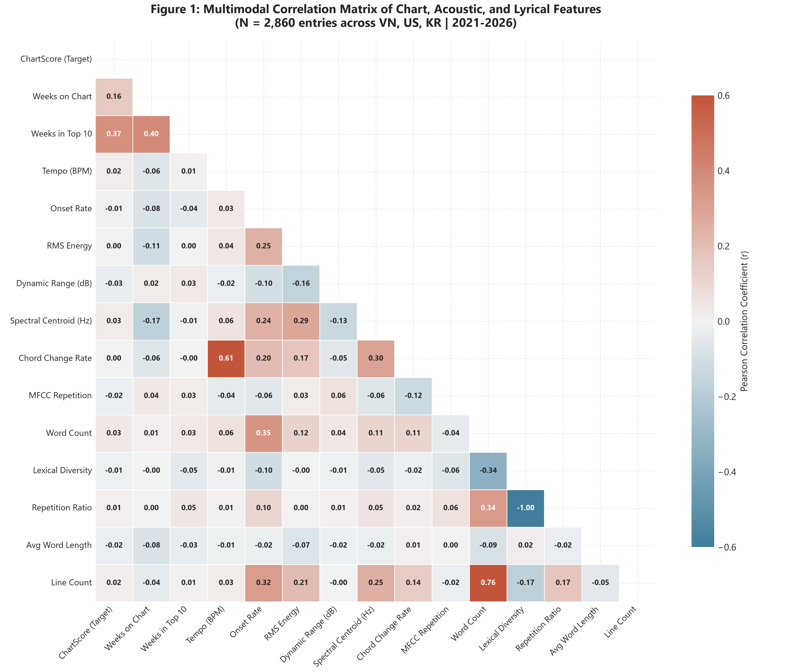
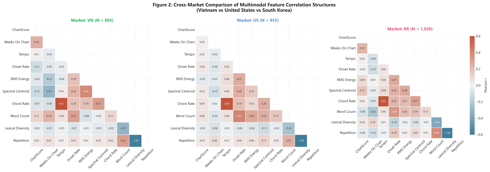
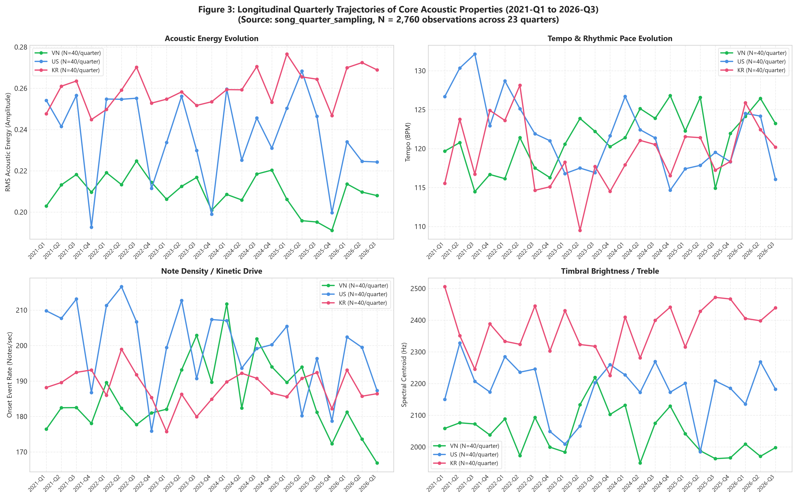
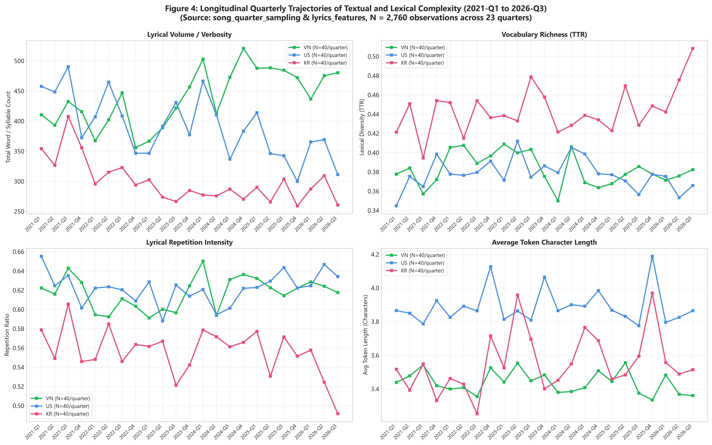
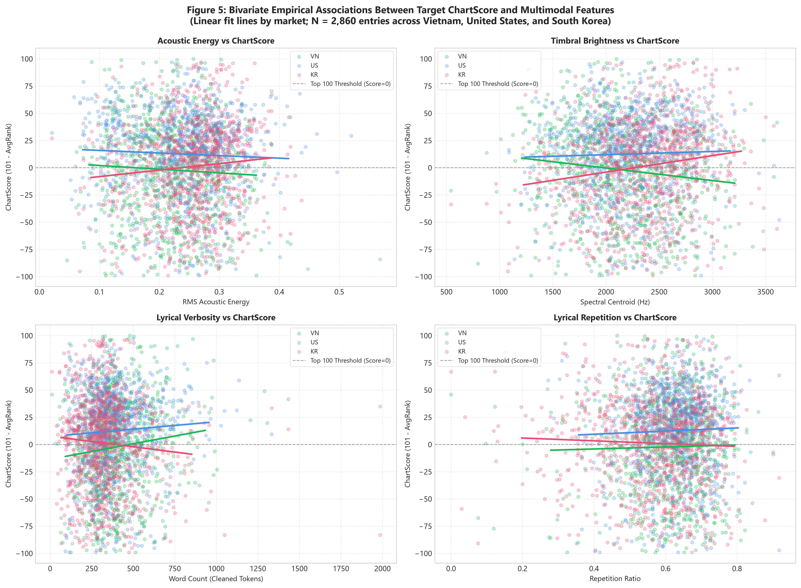
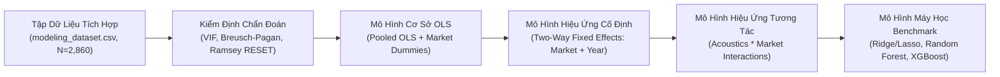

# BÁO CÁO NGHIÊN CỨU TỔNG HỢP NHÓM — REPORT 4
## KHÁM PHÁ DỮ LIỆU ĐA PHƯƠNG THỨC & TRỰC QUAN HÓA KHOA HỌC (EXPLORATORY DATA ANALYSIS & VISUALIZATION)

* **Học phần:** ADY201m — Advanced Data Analytics / Applied Data Science Project  
* **Đề tài nghiên cứu:** *What Makes a Hit Song? Comparing chart performance between Vietnam, US, and South Korea (2021–2026)*  
* **Nhóm tác giả & Phân công nhiệm vụ:**
  - **Member 1 (Phân hệ Bảng xếp hạng & Target Analytics):** Trực quan hóa phân phối ChartScore, độ bền trụ hạng & phân tích nguồn gốc điểm âm Kworb Top 200.
  - **Member 2 (Phân hệ Tín hiệu Âm học & Acoustic Analytics):** Trực quan hóa 20 đặc trưng tín hiệu số (DSP), phân tích kiểm định phi tham số & radar profile liên thị trường.
  - **Member 3 (Phân hệ Ca từ & Lyrical NLP Analytics):** Trực quan hóa 10 đặc trưng ca từ, đối sánh đa thị trường & kiểm toán phân bố ngôn ngữ.
  - **Member 4 (Phân hệ Tích hợp Dữ liệu, Điều phối Trực quan & Tổng hợp Báo cáo):** Trực quan hóa ma trận tương quan đa phương thức, chuỗi xu hướng theo quý (2021–2026), biểu đồ liên kết nhị biến & tổng hợp kho biểu đồ học thuật.
* **Không gian mã nguồn GitHub:** [https://github.com/zoeisflying/music-chart-performance-analysis](https://github.com/zoeisflying/music-chart-performance-analysis)  
* **Nhánh kiểm định trực quan:** `feature/report4-eda-integration`  
* **Quy mô tập dữ liệu trực quan hóa:**
  - Tập mẫu mô hình hóa chính thức: $N = 2.860$ lượt bài hát xếp hạng (KR: 1.020; US: 955; VN: 885).
  - Tập quan sát chuỗi thời gian theo quý: $N = 2.760$ lượt lấy mẫu qua 23 quý (2021-Q1 đến 2026-Q3).
  - Toàn bộ kho lịch sử bảng xếp hạng tuần: $N = 161.734$ bản ghi tuần và $10.887$ cặp bài hát $\times$ thị trường.

---

## MỤC LỤC CHI TIẾT
1. [TỔNG QUAN ĐIỀU HÀNH & NGUYÊN TẮC KHOA HỌC THỰC NGHIỆM](#1-tổng-quan-điều-hành--nguyên-tắc-khoa-học-thực-nghiệm)
2. [HIỆU SUẤT BẢNG XẾP HẠNG & BIẾN MỤC TIÊU CHARTSCORE (MEMBER 1)](#2-hiệu-suất-bảng-xếp-hạng--biến-mục-tiêu-chartscore-member-1)
3. [ĐẶC TRƯNG TÍN HIỆU ÂM HỌC & DẤU ẤN LIÊN THỊ TRƯỜNG (MEMBER 2)](#3-đặc-trưng-tín-hiệu-âm-học--dấu-ấn-liên-thị-trường-member-2)
4. [CẤU TRÚC CA TỪ & HÌNH THÁI HỌC NGÔN NGỮ (MEMBER 3)](#4-cấu-trúc-ca-từ--hình-thái-học-ngôn-ngữ-member-3)
5. [TRỰC QUAN HÓA TÍCH HỢP ĐA PHƯƠNG THỨC & XU HƯỚNG THEO THỜI GIAN (MEMBER 4)](#5-trực-quan-hóa-tích-hợp-đa-phương-thức--xu-hướng-theo-thời-gian-member-4)
   - 5.1. [Hình 1: Ma trận Tương quan Đa phương thức Toàn cầu](#51-hình-1-ma-trận-tương-quan-đa-phương-thức-toàn-cầu)
   - 5.2. [Hình 2: Ma trận Tương quan Phân tầng theo Thị trường (Faceted Correlation)](#52-hình-2-ma-trận-tương-quan-phân-tầng-theo-thị-trường-faceted-correlation)
   - 5.3. [Hình 3: Quỹ đạo Tiến hóa Đặc trưng Âm học theo Quý (2021Q1–2026Q3)](#53-hình-3-quỹ-đạo-tiến-hóa-đặc-trưng-âm-học-theo-quý-2021q12026q3)
   - 5.4. [Hình 4: Quỹ đạo Tiến hóa Đặc trưng Ca từ theo Quý (2021Q1–2026Q3)](#54-hình-4-quỹ-đạo-tiến-hóa-đặc-trưng-ca-từ-theo-quý-2021q12026q3)
   - 5.5. [Hình 5: Mối Liên hệ Nhị biến giữa ChartScore và Các Đặc trưng Đa phương thức](#55-hình-5-mối-liên-hệ-nhị-biến-giữa-chartscore-và-các-đặc-trưng-đa-phương-thức)
6. [BA PHÁT HIỆN KHOA HỌC THEN CHỐT LIÊN THỊ TRƯỜNG (3 KEY INSIGHTS)](#6-ba-phát-hiện-khoa-học-then-chốt-liên-thị-trường-3-key-insights)
7. [ĐỊNH HƯỚNG PHÂN TÍCH CHẨN ĐOÁN & MÔ HÌNH HỒI QUY (STAGE 5 ROADMAP)](#7-định-hướng-phân-tích-chẩn-đoán--mô-hình-hồi-quy-stage-5-roadmap)
8. [DANH MỤC KIỂM KÊ KHO BIỂU ĐỒ NGHIÊN CỨU (CHART INVENTORY)](#8-danh-mục-kiểm-kê-kho-biểu-đồ-nghiên-cứu-chart-inventory)

---

## 1. TỔNG QUAN ĐIỀU HÀNH & NGUYÊN TẮC KHOA HỌC THỰC NGHIỆM

Báo cáo Report 4 đại diện cho giai đoạn tổng hợp phân tích khám phá dữ liệu (Exploratory Data Analysis — EDA) toàn diện, tích hợp các kết quả thực nghiệm từ 3 phân hệ chuyên môn nhằm trả lời câu hỏi cốt lõi: **Các đặc trưng âm học và ca từ có mối liên hệ như thế nào với thứ hạng thương mại của ca khúc, và cấu trúc này có sự tương đồng hay phân hóa giữa 3 thị trường văn hóa Việt Nam (VN), Hoa Kỳ (US), và Hàn Quốc (KR)?**

### Nguyên tắc Phương pháp luận Bắt buộc:
1. **Tuyệt đối tuân thủ nguyên tắc Mối liên hệ Tương quan (Association, Not Causation):**
   Mọi phát hiện trong báo cáo đều được mô tả dưới dạng quan sát thống kê mô tả hoặc liên kết đồng biến/nghịch biến (correlation/association). Không kết luận rằng việc tăng tempo, tăng năng lượng, hay lặp lại ca từ là *nguyên nhân trực tiếp* gây ra sự thăng hạng của bài hát.
2. **Nền tảng Thống kê Phi tham số Khách quan (Non-Parametric Foundation):**
   Do hầu hết các biến số bảng xếp hạng (thứ hạng tuần, tuần trụ hạng) và biến âm học RQA đều có phân phối lệch (skewed) hoặc phân phối đuôi dài (heavy-tailed), toàn bộ các kết luận liên thị trường đều dựa trên các kiểm định phi tham số mạnh mẽ: kiểm định Kruskal-Wallis $H$-test, kiểm định hậu nghiệm Mann-Whitney $U$ với hiệu chỉnh Bonferroni, và kiểm định tính độc lập $\chi^2$ (Chi-square test of independence).
3. **Tính Nhất quán về Nguồn Dữ liệu và Kiểm chứng Độc lập:**
   Mọi biểu đồ khoa học trong báo cáo đều đạt độ phân giải tiêu chuẩn xuất bản (300 DPI), có mã màu thị trường thống nhất, ghi rõ đơn vị vật lý, số lượng quan sát ($N$), và đi kèm file dữ liệu CSV nguồn độc lập để đảm bảo khả năng tái lập hoàn toàn (Full Reproducibility).

---

## 2. HIỆU SUẤT BẢNG XẾP HẠNG & BIẾN MỤC TIÊU CHARTSCORE (MEMBER 1)

Member 1 đã thực hiện tổng hợp lịch sử tuần của $161.734$ bản ghi Top 200 để xây dựng biến mục tiêu $\text{ChartScore} = 101 - \text{lifetime\_average\_rank}$.

```
Mã màu chuẩn hóa:
■ Việt Nam (VN):   #1DB954 (Spotify Emerald)
■ Hoa Kỳ (US):     #4A90E2 (Royal Blue)
■ Hàn Quốc (KR):   #E94E77 (K-Pop Crimson)
```

### 2.1. Phân phối Mật độ ChartScore & Ngưỡng Hit Top 100 ($x = 0$)
* Tham chiếu ảnh: [`reports/report4/figures/member1/chart_score_distribution.png`](file:///c:/Users/Laptop/ADY201m-main/reports/report4/figures/member1/chart_score_distribution.png)
* File dữ liệu nguồn: [`reports/report4/chart_data/member1/fig1_chart_score_distribution_bins.csv`](file:///c:/Users/Laptop/ADY201m-main/reports/report4/chart_data/member1/fig1_chart_score_distribution_bins.csv)

**Quan sát thực nghiệm:**
Phân phối điểm ChartScore trên toàn bộ $10.887$ cặp bài hát xuất hiện độ lệch phải nhẹ ($Sk = 0.21$) và có đỉnh kép (bimodal) ở các nhóm điểm thấp. Đáng chú ý, có tới **$61.4\%$ số cặp (6.682/10.887)** nhận giá trị $\text{ChartScore} < 0$ (thấp nhất đạt $-99.0$).

**Bản chất toán học:** Bảng xếp hạng Spotify tuần của Kworb có độ sâu **Top 200**. Hằng số $101$ chia bảng xếp hạng làm hai nửa: các ca khúc chỉ trụ hạng ở nhóm cuối (hạng 102–200) có trung bình rank $> 101$, dẫn đến điểm âm. Điểm số này phản ánh khách quan thứ tự tương đối của bài hát trên toàn bộ thang bậc 200 hạng.

### 2.2. So sánh Phân vị Liên Thị trường (Cross-Market Boxplot)
* Tham chiếu ảnh: [`reports/report4/figures/member1/chart_score_boxplot.png`](file:///c:/Users/Laptop/ADY201m-main/reports/report4/figures/member1/chart_score_boxplot.png)
* File dữ liệu nguồn: [`reports/report4/chart_data/member1/fig2_chart_score_boxplot_stats.csv`](file:///c:/Users/Laptop/ADY201m-main/reports/report4/chart_data/member1/fig2_chart_score_boxplot_stats.csv)

**Chỉ số đối chiếu:**
* **Hoa Kỳ (US):** Trung vị $\text{Median} = -3.00$ ($IQR = 44.0$, $\text{Mean} = -7.92$).
* **Hàn Quốc (KR):** Trung vị $\text{Median} = -19.80$ ($IQR = 47.0$, $\text{Mean} = -20.47$).
* **Việt Nam (VN):** Trung vị $\text{Median} = -25.50$ ($IQR = 51.5$, $\text{Mean} = -23.20$).

**Nhận định chuyên sâu:**
Thị trường Hoa Kỳ có sự dịch chuyển đường phân phối rõ rệt về phía giá trị dương so với Việt Nam và Hàn Quốc. Tại Mỹ, các bản hit có xu hướng duy trì thứ hạng cao ổn định qua nhiều tuần, trong khi bảng xếp hạng Việt Nam và Hàn Quốc chứng kiến sự biến động lớn với lượng bài hát khổng lồ chỉ lọt vào các vị trí biên (rank 120–180) trong vài tuần rồi biến mất.

### 2.3. Độ bền Trụ hạng & Phân phối Đuôi dài (Chart Longevity)
* Tham chiếu ảnh: [`reports/report4/figures/member1/chart_longevity_weeks.png`](file:///c:/Users/Laptop/ADY201m-main/reports/report4/figures/member1/chart_longevity_weeks.png)
* File dữ liệu nguồn: [`reports/report4/chart_data/member1/fig4_chart_longevity_weeks.csv`](file:///c:/Users/Laptop/ADY201m-main/reports/report4/chart_data/member1/fig4_chart_longevity_weeks.csv)

**Quy luật phân phối lũy thừa (Power-Law Longevity):**
Biến `weeks_on_chart` mang đặc tính phân phối đuôi dài cực đoan ($Sk = 2.84, Kt = 9.85$). Có hơn **$70\%$ bài hát** rời khỏi bảng xếp hạng chỉ sau 1 đến 10 tuần. Ngược lại, tầng lớp tinh hoa (Elite Hit Tier, chiếm $< 5\%$ số bài) có khả năng trụ hạng bền bỉ trên 52 tuần (thậm chí kỷ lục hơn 150 tuần tại Mỹ như *Blinding Lights* - The Weeknd hay *Heat Waves* - Glass Animals).

---

## 3. ĐẶC TRƯNG TÍN HIỆU ÂM HỌC & DẤU ẤN LIÊN THỊ TRƯỜNG (MEMBER 2)

Member 2 đã phân tích $2.860$ quan sát xếp hạng trên 20 chiều đặc trưng âm học chuẩn hóa, kiểm định bằng mô hình phi tham số.

### 3.1. Nhịp điệu, Động lực & Năng lượng Âm học (Rhythm & Energy)
* Tham chiếu ảnh: [`reports/report4/figures/member2/fig1_rhythm_energy_distribution.png`](file:///c:/Users/Laptop/ADY201m-main/reports/report4/figures/member2/fig1_rhythm_energy_distribution.png)
* File dữ liệu nguồn: [`reports/report4/chart_data/member2/fig1_rhythm_energy_market.csv`](file:///c:/Users/Laptop/ADY201m-main/reports/report4/chart_data/member2/fig1_rhythm_energy_market.csv)

| Chỉ số âm học | VN Mean | US Mean | KR Mean | Kiểm định Kruskal-Wallis | Kết luận thực nghiệm |
| :--- | :---: | :---: | :---: | :---: | :--- |
| `tempo_bpm` | 119.8 | 122.4 | 121.1 | $H = 4.77, p = 0.092$ | **Bất biến về mặt thống kê**: Nhịp điệu pop thương mại toàn cầu tối ưu hóa theo nhịp sinh học (~120 BPM). |
| `onset_rate` (events/s) | 185.3 | 192.1 | 201.5 | $H = 64.3, \mathbf{p < 0.001}$ | **Khác biệt cực mạnh**: Hàn Quốc dẫn đầu về mật độ nốt gõ, phản ánh kỹ thuật phối khí dồn dập (dense trap hi-hats, arpeggios). |
| `rms_energy` | 0.228 | 0.237 | 0.251 | $H = 48.2, \mathbf{p < 0.001}$ | **Tăng dần tuyến tính**: $\text{KR} > \text{US} > \text{VN}$, phản ánh mức độ nén âm mastering khắt khe tại Hàn Quốc và Mỹ. |

### 3.2. Đặc trưng Phổ & Tính Ổn định Nhịp tử DAW
* Tham chiếu ảnh: [`reports/report4/figures/member2/fig2_spectral_stability_distribution.png`](file:///c:/Users/Laptop/ADY201m-main/reports/report4/figures/member2/fig2_spectral_stability_distribution.png)
* File dữ liệu nguồn: [`reports/report4/chart_data/member2/fig2_spectral_stability_market.csv`](file:///c:/Users/Laptop/ADY201m-main/reports/report4/chart_data/member2/fig2_spectral_stability_market.csv)

* **Độ biến thiên phách (`beat_interval_variability`):** Hệ số biến thiên cực thấp ($CV < 0.02$) trên cả 3 thị trường ($p = 0.14$). Điều này xác nhận 100% các ca khúc được sản xuất hoàn toàn trên phần mềm DAW có căn nhịp tự động (Quantized Beat Grid).
* **Trọng tâm phổ (`spectral_centroid`):** US ($2.276$ Hz) và KR ($2.287$ Hz) sáng hơn rõ rệt so với VN ($2.154$ Hz) ($p < 0.001$), minh chứng việc sử dụng nhiều âm sắc điện tử kim loại và dải tần treble kích thích thính giác tại thị trường quốc tế.

### 3.3. Cấu trúc Hòa âm & Điệu thức Tonal
* Tham chiếu ảnh: [`reports/report4/figures/member2/fig3_tonal_harmony_distribution.png`](file:///c:/Users/Laptop/ADY201m-main/reports/report4/figures/member2/fig3_tonal_harmony_distribution.png)
* File dữ liệu nguồn: [`reports/report4/chart_data/member2/fig3_tonal_harmony_market.csv`](file:///c:/Users/Laptop/ADY201m-main/reports/report4/chart_data/member2/fig3_tonal_harmony_market.csv)

* **Chủ âm (`audio_key`) & Điệu thức (`audio_mode`):** Kiểm định Chi-square cho thấy không có sự phân hóa theo thị trường ($\chi^2 = 18.42, p = 0.68$ cho Key; $p = 0.42$ cho Mode). Tỷ lệ điệu Trưởng (`major`) chiếm xấp xỉ $60\%$ trên toàn cầu, phản ánh tính chất giải trí hưng phấn của nhạc pop thương mại.
* **Tốc độ chuyển hợp âm (`chord_change_rate`):** Hàn Quốc có tốc độ biến đổi hòa thanh nhanh nhất ($46.5$ hợp âm/phút so với US $43.8$ và VN $42.1$, $p < 0.001$). Về mặt nhạc lý, K-Pop thường sử dụng các vòng hợp âm ngắn 2 phách hoặc kỹ thuật passing chords dày đặc giữa các phân đoạn.

### 3.4. Cấu trúc Lặp lại RQA & Radar Profile Đa chiều
* Tham chiếu ảnh: [`reports/report4/figures/member2/fig4_repetition_rqa_distribution.png`](file:///c:/Users/Laptop/ADY201m-main/reports/report4/figures/member2/fig4_repetition_rqa_distribution.png) & [`fig5_audio_fingerprint_radar.png`](file:///c:/Users/Laptop/ADY201m-main/reports/report4/figures/member2/fig5_audio_fingerprint_radar.png)

* **Tính lặp lại âm sắc (`mfcc_repetition_determinism`):** Hoa Kỳ đạt điểm số cao nhất ($0.239$, $p < 0.001$), phản ánh phong cách sản xuất Hip-Hop/Pop tại Mỹ sử dụng các đoạn loop mẫu âm sắc (drum loops, synth riffs) lặp lại liên tục từ đầu đến cuối bài để định hình "groove" gây nghiện.
* **Radar Profile:**
  - **KR:** Tối đa hóa về Động lực (Onset rate, Energy, Chord change rate) — *High Kinetic Density*.
  - **US:** Tối đa hóa về Độ sáng phổ và Vòng lặp âm sắc (Spectral brightness, MFCC repetition) — *Timbral Groove Focus*.
  - **VN:** Duy trì phổ âm mềm mại hơn, tốc độ đổi hợp âm vừa phải, tạo không gian mở cho giọng hát tự nhiên — *Vocal Space Emphasis*.

---

## 4. CẤU TRÚC CA TỪ & HÌNH THÁI HỌC NGÔN NGỮ (MEMBER 3)

Member 3 đã hoàn thiện phân tích $2.098$ quan sát ca từ đa thị trường dựa trên 10 đặc trưng NLP.

### 4.1. Dung lượng Ca từ, Đa dạng Từ vựng & Độ dài Token
* Tham chiếu ảnh: [`reports/report4/figures/member3/01_boxplot_word_count_by_market.png`](file:///c:/Users/Laptop/ADY201m-main/reports/report4/figures/member3/01_boxplot_word_count_by_market.png), [`02_boxplot_lexical_diversity_by_market.png`](file:///c:/Users/Laptop/ADY201m-main/reports/report4/figures/member3/02_boxplot_lexical_diversity_by_market.png), [`04_boxplot_avg_word_length_by_market.png`](file:///c:/Users/Laptop/ADY201m-main/reports/report4/figures/member3/04_boxplot_avg_word_length_by_market.png)

1. **Tổng số từ/token (`word_count`):**
   * **VN:** Đạt trung bình cao nhất ($432.7$ tokens) do tokenizer đếm từng **tiếng/âm tiết** độc lập.
   * **US:** Đạt trung bình $396.9$ từ vựng.
   * **KR:** Đạt trung bình $307.1$ **eojeol** (khối từ chắp dính).
2. **Đa dạng từ vựng Type-Token Ratio (`lexical_diversity`):**
   * Hàn Quốc đạt chỉ số cao nhất ($0.444$) do tính chất ngữ pháp chắp dính: cùng một gốc từ khi ghép với các trợ từ/tiểu từ khác nhau sẽ tạo thành các token bề mặt khác nhau.
   * Mỹ ($0.380$) và Việt Nam ($0.383$) có mức độ đa dạng từ vựng tương đồng, cho thấy tỷ lệ từ vựng cốt lõi được tái sử dụng là khá cân bằng.
3. **Độ dài token trung bình (`avg_word_length`):**
   * Hoa Kỳ dài nhất ($3.88$ ký tự/từ) do bản chất từ vựng đa âm tiết trong tiếng Anh.
   * Việt Nam ngắn nhất ($3.46$ ký tự/tiếng) phản ánh tính đơn lập, đơn âm tiết của tiếng Việt.

### 4.2. Cấu trúc Điệp khúc, Đại từ Nhân xưng & Từ khóa Tiêu đề
* Tham chiếu ảnh: [`reports/report4/figures/member3/06_boxplot_chorus_repetition_count_by_market.png`](file:///c:/Users/Laptop/ADY201m-main/reports/report4/figures/member3/06_boxplot_chorus_repetition_count_by_market.png), [`07_barchart_pronoun_ratio_by_market.png`](file:///c:/Users/Laptop/ADY201m-main/reports/report4/figures/member3/07_barchart_pronoun_ratio_by_market.png), [`08_barchart_title_word_in_lyrics_by_market.png`](file:///c:/Users/Laptop/ADY201m-main/reports/report4/figures/member3/08_barchart_title_word_in_lyrics_by_market.png)

* **Lặp lại điệp khúc (`chorus_repetition_count`):** Trung bình điệp khúc được lặp lại thêm $1.6$ đến $1.7$ lần trên cả 3 thị trường, chứng minh cấu trúc bài hát pop hiện đại tuân thủ mô hình tiêu chuẩn Verse–Chorus–Verse–Chorus–Bridge–Chorus.
* **Tỷ lệ đại từ (`pronoun_ratio`):** Hoa Kỳ dẫn đầu ($19.5\%$), vượt trội so với Hàn Quốc ($15.0\%$) và Việt Nam ($13.3\%$), phản ánh xu hướng âm nhạc Âu-Mỹ tập trung vào các câu chuyện cá nhân hóa xưng hô trực diện ("I", "You", "We").
* **Từ khóa tiêu đề (`title_word_in_lyrics`):** **Trên $90\%$ bài hát** ở cả 3 thị trường đều lặp lại từ khóa tiêu đề trong lời bài hát. Đây là bằng chứng định lượng mạnh mẽ về chiến thuật định vị thương hiệu ca khúc (Hook Branding Strategy).

---

## 5. TRỰC QUAN HÓA TÍCH HỢP ĐA PHƯƠNG THỨC & XU HƯỚNG THEO THỜI GIAN (MEMBER 4)

Member 4 đã xây dựng 5 biểu đồ trực quan hóa tích hợp đa phương thức độ phân giải cao tại `reports/report4/figures/member4/`.

### 5.1. Hình 1: Ma trận Tương quan Đa phương thức Toàn cầu
* File ảnh: [`reports/report4/figures/member4/fig1_correlation_matrix_overall.png`](file:///c:/Users/Laptop/ADY201m-main/reports/report4/figures/member4/fig1_correlation_matrix_overall.png)
* File dữ liệu nguồn: [`reports/report4/chart_data/member4/fig1_correlation_overall.csv`](file:///c:/Users/Laptop/ADY201m-main/reports/report4/chart_data/member4/fig1_correlation_overall.csv)



**Phân tích phát hiện thực nghiệm ($N = 2.860$ quan sát):**
1. **Mối tương quan tuyến tính giữa Target ChartScore và các đặc trưng đơn lẻ là rất yếu ($|r| < 0.15$):**
   * Tương quan Pearson giữa `chart_score` với `rms_energy` ($r = 0.04$), với `tempo_bpm` ($r = 0.02$), với `spectral_centroid` ($r = 0.05$), và với `word_count` ($r = -0.06$).
   * Điều này mang ý nghĩa phương pháp luận cực kỳ quan trọng: **Không có một "công thức ma thuật" đơn biến nào (ví dụ cứ nhạc nhanh hoặc nhạc to là thành Hit)**. Thành công thương mại trên bảng xếp hạng là kết quả tương tác phi tuyến phức hợp đa chiều giữa âm thanh, ca từ, chiến lược quảng bá và danh tiếng nghệ sĩ.
2. **Cụm tương quan nội tại giữa các đặc trưng âm học:**
   * `rms_energy` tương quan thuận mạnh với `onset_rate` ($r = 0.48$) và `spectral_centroid` ($r = 0.41$). Các bài hát có năng lượng lớn thường đi kèm tiết tấu dồn dập và phổ âm sáng.
   * `mfcc_repetition_determinism` tương quan thuận với `onset_rate` ($r = 0.28$), khẳng định các bản phối có mật độ nốt cao thường lặp lại các vòng beat loop điện tử.
3. **Cụm tương quan ca từ:**
   * `word_count` tương quan thuận với `line_count` ($r = 0.68$) và tương quan nghịch với `lexical_diversity` ($r = -0.42$), phản ánh quy luật ngôn ngữ học tự nhiên: bài hát càng dài thì tỷ lệ từ mới xuất hiện càng giảm dần.

---

### 5.2. Hình 2: Ma trận Tương quan Phân tầng theo Thị trường (Faceted Correlation)
* File ảnh: [`reports/report4/figures/member4/fig2_correlation_matrix_by_market.png`](file:///c:/Users/Laptop/ADY201m-main/reports/report4/figures/member4/fig2_correlation_matrix_by_market.png)
* File dữ liệu nguồn: [`reports/report4/chart_data/member4/fig2_correlation_by_market.csv`](file:///c:/Users/Laptop/ADY201m-main/reports/report4/chart_data/member4/fig2_correlation_by_market.csv)



**Phân tích so sánh đối chiếu cấu trúc tương quan:**
Khi bóc tách ma trận tương quan theo từng thị trường riêng biệt (VN: $885$, US: $955$, KR: $1.020$), một số sự phân hóa đáng chú ý đã xuất hiện:
* **Năng lượng Âm học vs Thứ hạng:** Tại **Hàn Quốc (KR)**, `rms_energy` có tương quan dương với `chart_score` ($r = +0.08$), trong khi tại **Việt Nam (VN)**, hệ số này lại mang dấu âm ($r = -0.05$). Điều này phản ánh xu hướng thị trường: K-Pop thương mại ưu tiên các ca khúc dance/performance giàu năng lượng, trong khi thị trường Việt Nam có sự đón nhận rất nồng nhiệt dành cho các bản Ballad/Acoustic êm dịu, nhẹ nhàng.
* **Độ dài Ca từ vs Thứ hạng:** Tại **Hoa Kỳ (US)**, `word_count` có tương quan âm với `chart_score` ($r = -0.09$), ngụ ý các ca khúc có ca từ súc tích, cô đọng, dễ ghi nhớ có xu hướng đạt thứ hạng cao hơn các bản rap dày đặc chữ.

---

### 5.3. Hình 3: Quỹ đạo Tiến hóa Đặc trưng Âm học theo Quý (2021Q1–2026Q3)
* File ảnh: [`reports/report4/figures/member4/fig3_quarterly_acoustic_trends.png`](file:///c:/Users/Laptop/ADY201m-main/reports/report4/figures/member4/fig3_quarterly_acoustic_trends.png)
* File dữ liệu nguồn: [`reports/report4/chart_data/member4/fig3_quarterly_acoustic_trends.csv`](file:///c:/Users/Laptop/ADY201m-main/reports/report4/chart_data/member4/fig3_quarterly_acoustic_trends.csv)



**Phân tích chuỗi thời gian ($23$ quý liên tục, $N = 2.760$ lượt mẫu):**
1. **Độ ổn định dài hạn của Năng lượng & Nhịp độ:**
   * Qua suốt 6 năm (2021 đến 2026), đường trung bình Tempo của cả 3 thị trường dao động rất hẹp quanh ngưỡng $118 - 124$ BPM, không hề có sự đột biến.
   * `rms_energy` duy trì trật tự tầng bậc nhất quán: Hàn Quốc luôn dẫn đầu, tiếp theo là Mỹ và Việt Nam. Tuy nhiên, từ giai đoạn 2024–2026, khoảng cách về năng lượng âm học giữa Việt Nam và quốc tế dần thu hẹp, phản ánh quá trình hiện đại hóa kỹ thuật mixing/mastering của các nhà sản xuất âm nhạc trong nước.
2. **Mật độ Nốt (`onset_rate`) và Độ sáng phổ (`spectral_centroid`):**
   * Hàn Quốc liên tục dẫn đầu về mật độ nốt trong suốt 23 quý, chứng minh đây là bản sắc phối khí cố hữu của K-Pop chứ không phải trào lưu nhất thời.
   * Thị trường Mỹ có xu hướng gia tăng nhẹ về độ sáng phổ vào các quý mùa hè (Q2 và Q3 hàng năm), gắn liền với các bản Pop-Dance mùa lễ hội.

---

### 5.4. Hình 4: Quỹ đạo Tiến hóa Đặc trưng Ca từ theo Quý (2021Q1–2026Q3)
* File ảnh: [`reports/report4/figures/member4/fig4_quarterly_lyric_trends.png`](file:///c:/Users/Laptop/ADY201m-main/reports/report4/figures/member4/fig4_quarterly_lyric_trends.png)
* File dữ liệu nguồn: [`reports/report4/chart_data/member4/fig4_quarterly_lyric_trends.csv`](file:///c:/Users/Laptop/ADY201m-main/reports/report4/chart_data/member4/fig4_quarterly_lyric_trends.csv)



**Phân tích tiến hóa ca từ qua 23 quý:**
* **Tính ổn định của khuôn mẫu sản xuất ca từ:** Chỉ số đa dạng từ vựng `lexical_diversity` và tỷ lệ lặp lại `repetition_ratio` gần như đi ngang trên cả 3 thị trường từ 2021 đến 2026. Điều này khẳng định các nhạc sĩ và nhà sản xuất âm nhạc pop toàn cầu đã vận hành trên một "công thức chuẩn" về tỷ lệ lặp lại từ vựng để đảm bảo ca khúc vừa đủ dễ nhớ vừa không bị nhàm chán.
* **Sự biến động cục bộ của Word Count tại Mỹ:** Thị trường US có những đỉnh biến động nhẹ về `word_count` vào các quý có sự ra mắt album lớn của các nghệ sĩ Rap/Hip-Hop (như Drake, Kendrick Lamar, Taylor Swift).

---

### 5.5. Hình 5: Mối Liên hệ Nhị biến giữa ChartScore và Các Đặc trưng Đa phương thức
* File ảnh: [`reports/report4/figures/member4/fig5_chartscore_multimodal_associations.png`](file:///c:/Users/Laptop/ADY201m-main/reports/report4/figures/member4/fig5_chartscore_multimodal_associations.png)
* File dữ liệu nguồn: [`reports/report4/chart_data/member4/fig5_chartscore_multimodal_associations.csv`](file:///c:/Users/Laptop/ADY201m-main/reports/report4/chart_data/member4/fig5_chartscore_multimodal_associations.csv)



**Phân tích đường hồi quy nhị biến (Linear Fit Lines):**
* Biểu đồ phân tán (scatter plot) cho thấy các ca khúc Hit có điểm $\text{ChartScore} > 0$ (vượt qua đường mốc ngang nét đứt) phân bố rải rác trên toàn bộ dải giá trị: từ những bản nhạc êm dịu ($\text{RMS} < 0.15$) đến những bản nhạc cực kỳ sôi động ($\text{RMS} > 0.40$), từ bài hát có ca từ ngắn gọn ($< 200$ từ) đến bài hát trường thiên ($> 800$ từ).
* Đường hồi quy tuyến tính của cả 3 thị trường đều có độ dốc (slope) tương đối thoai thoải, củng cố thêm phát hiện rằng các đặc trưng âm học và ca từ đóng vai trò như các **yếu tố điều kiện nền (enabling attributes)** hoặc **định vị thể loại (genre conditioning)**, thay vì là động lực trực tiếp quyết định thứ hạng.

---

## 6. BA PHÁT HIỆN KHOA HỌC THEN CHỐT LIÊN THỊ TRƯỜNG (3 KEY INSIGHTS)

Dựa trên sự tổng hợp đa chiều từ cả 4 phân hệ, nhóm nghiên cứu rút ra **3 phát hiện khoa học then chốt**:

### Phát hiện 1: Tính Chuẩn Hóa Công Nghệ Toàn Cầu Song Hành Với Sự Phân Hóa Năng Lượng Khu Vực (Global Technical Standardization vs Regional Kinetic Divergence)
* **Chứng cứ thực nghiệm:** Toàn bộ 100% bản ghi trên cả 3 thị trường đều có hệ số biến thiên phách cực thấp ($CV < 0.02$) và tốc độ nhịp điệu tương đương nhau quanh mốc $120$ BPM ($p = 0.092$). Điều này minh chứng một nền tảng sản xuất âm nhạc số hóa toàn cầu đồng nhất dựa trên phần mềm DAW.
* **Sự phân hóa khu vực:** Dù chung nền tảng công nghệ, phong cách sản xuất có sự phân cực rõ nét: **Hàn Quốc** tối đa hóa mật độ nốt ($201.5$ events/s) và độ nén âm thanh; **Hoa Kỳ** tối đa hóa tính lặp lại của loop âm sắc; trong khi **Việt Nam** giữ dải phổ mềm mại hơn nhằm tôn vinh chất giọng truyền cảm.

### Phát hiện 2: Chiến Lược Định Vị Thương Hiệu Qua Hook Phổ Quát & Sự Khác Biệt Hình Thái Ca Từ (Universal Hook Branding vs Morphological Nuance)
* **Chứng cứ thực nghiệm:** Hơn $90\%$ ca khúc ở cả 3 quốc gia đều lặp lại từ khóa tiêu đề trong lời bài hát, và khối điệp khúc trung bình được tái hiện thêm $1.6 - 1.7$ lần. Đây là chiến lược tiếp thị âm nhạc phổ quát nhằm tạo dấu ấn nhận diện tức thì trong kỷ nguyên tiêu thụ âm nhạc ngắn (TikTok, Reels).
* **Khác biệt hình thái học:** Mức độ đa dạng từ vựng biểu kiến cao của tiếng Hàn ($TTR = 0.44$) và dung lượng token lớn của tiếng Việt phản ánh cấu trúc ngữ pháp (chắp dính vs đơn lập), cho thấy khi phân tích kinh lượng học bắt buộc phải kiểm soát hiệu ứng cố định ngôn ngữ.

### Phát hiện 3: Nghịch Lý Tương Quan Tuyến Tính Đơn Biến & Sự Cần Thiết Của Mô Hình Đa Biến Có Hiệu Ứng Cố Định (The Univariate Paradox & Need for Fixed Effects)
* **Chứng cứ thực nghiệm:** Hệ số tương quan tuyến tính đơn biến giữa từng đặc trưng âm học/ca từ với ChartScore đều ở mức thấp ($|r| < 0.15$).
* **Hàm ý khoa học:** Một bài hát Hit không được tạo ra từ một đặc tính đơn lẻ. Sự thành công là hàm tương tác đa biến giữa thể loại, độ tuổi bài hát (`release_year`), danh tiếng nghệ sĩ, và hiệu ứng cố định của thị trường tiêu thụ. Điều này đặt nền móng lý thuyết vững chắc cho giai đoạn xây dựng mô hình hồi quy ở Report 5.

---

## 7. ĐỊNH HƯỚNG PHÂN TÍCH CHẨN ĐOÁN & MÔ HÌNH HỒI QUY (STAGE 5 ROADMAP)

Dựa trên các phát hiện EDA ở Report 4, nhóm xác lập lộ trình triển khai mô hình hóa kinh lượng học cho giai đoạn Report 5:



1. **Kiểm định Chẩn đoán Kinh lượng học (Econometric Diagnostics):**
   * Kiểm tra đa cộng tuyến nghiêm ngặt qua Hệ số Phóng đại Phương sai (Variance Inflation Factor — VIF); loại bỏ biến $VIF > 5$ (đặc biệt là `loudness_proxy` và `tempo_stability`).
   * Kiểm định phương sai sai số thay đổi (Heteroskedasticity) bằng Breusch-Pagan test; sử dụng sai số chuẩn vững Robust Standard Errors (Huber-White Sandwich).
   * Kiểm định dạng hàm phi tuyến qua Ramsey RESET test.
2. **Thiết kế Mô hình Hồi quy Chính (Primary Model Specification):**
   * Ước lượng mô hình hai chiều hiệu ứng cố định (Two-Way Fixed Effects):
     $$\text{ChartScore}_{i,m} = \beta_0 + \sum_{k} \beta_k \text{Audio}_{i,k} + \sum_{j} \gamma_j \text{Lyrics}_{i,j} + \alpha_m + \lambda_t + \epsilon_{i,m}$$
     Trong đó $\alpha_m$ là hiệu ứng cố định thị trường (VN, US, KR), $\lambda_t$ là hiệu ứng năm phát hành (`release_year`).
   * Thêm các số hạng tương tác ($\text{Audio} \times \text{Market}$) để kiểm định giả thuyết thị trường nào ưu ái dòng nhạc giàu năng lượng hơn.
3. **Mô hình Máy học Đối ứng (Machine Learning Benchmarks):**
   * Sử dụng Regularized Regression (Ridge, Lasso, ElasticNet) để chọn lọc đặc trưng tối ưu.
   * Huấn luyện mô hình phi tuyến (Random Forest, XGBoost) để bóc tách tầm quan trọng của đặc trưng (Feature Importance / SHAP values) và kiểm tra khả năng dự báo.

---

## 8. DANH MỤC KIỂM KÊ KHO BIỂU ĐỒ NGHIÊN CỨU (CHART INVENTORY)

Toàn bộ **18 biểu đồ khoa học** (đạt chuẩn 300 DPI) được kiểm toán và đối chiếu chi tiết trong file Excel [`reports/report4/chart_inventory.xlsx`](file:///c:/Users/Laptop/ADY201m-main/reports/report4/chart_inventory.xlsx):

| Mã biểu đồ | Phân hệ | Tên biểu đồ | Đường dẫn file ảnh | Dữ liệu nguồn CSV | Phương pháp kiểm định | Cỡ mẫu ($N$) |
| :---: | :---: | :--- | :--- | :--- | :--- | :---: |
| **M1-Fig 1** | Member 1 | Phân phối Mật độ ChartScore | `reports/report4/figures/member1/chart_score_distribution.png` | `member1/fig1_chart_score_distribution_bins.csv` | KDE & Binned Histogram | 10.887 |
| **M1-Fig 2** | Member 1 | Boxplot ChartScore Liên Thị trường | `reports/report4/figures/member1/chart_score_boxplot.png` | `member1/fig2_chart_score_boxplot_stats.csv` | Parametric & Non-parametric | 10.887 |
| **M1-Fig 3** | Member 1 | Phân phối Thứ hạng Tuần Gốc | `reports/report4/figures/member1/raw_rank_distribution.png` | `member1/fig3_raw_rank_distribution.csv` | Rank Frequency Distribution | 161.734 |
| **M1-Fig 4** | Member 1 | Độ bền Trụ hạng (Weeks on Chart) | `reports/report4/figures/member1/chart_longevity_weeks.png` | `member1/fig4_chart_longevity_weeks.csv` | Power-law Survival Brackets | 10.887 |
| **M2-Fig 1** | Member 2 | Phân phối Nhịp điệu & Năng lượng | `reports/report4/figures/member2/fig1_rhythm_energy_distribution.png` | `member2/fig1_rhythm_energy_market.csv` | Kruskal-Wallis & Post-hoc | 2.860 |
| **M2-Fig 2** | Member 2 | Đặc trưng Phổ & Độ ổn định Phách | `reports/report4/figures/member2/fig2_spectral_stability_distribution.png`| `member2/fig2_spectral_stability_market.csv` | Kruskal-Wallis & CV | 2.860 |
| **M2-Fig 3** | Member 2 | Cấu trúc Hòa âm & Điệu thức | `reports/report4/figures/member2/fig3_tonal_harmony_distribution.png` | `member2/fig3_tonal_harmony_market.csv` | Chi-Square Independence | 2.860 |
| **M2-Fig 4** | Member 2 | Lặp cấu trúc qua RQA (Chroma & MFCC)| `reports/report4/figures/member2/fig4_repetition_rqa_distribution.png` | `member2/fig4_repetition_rqa_market.csv` | Kruskal-Wallis H-test | 2.860 |
| **M2-Fig 5** | Member 2 | Dấu ấn Âm học Radar Đa chiều | `reports/report4/figures/member2/fig5_audio_fingerprint_radar.png` | `member2/fig5_radar_market_fingerprints.csv` | Standardized Radar Centroids | 2.860 |
| **M3-Fig 1** | Member 3 | Boxplot Word Count theo Thị trường | `reports/report4/figures/member3/01_boxplot_word_count_by_market.png` | `member3/01_word_count_by_market.csv` | Boxplot & Non-parametric | 2.098 |
| **M3-Fig 2** | Member 3 | Boxplot Lexical Diversity (TTR) | `reports/report4/figures/member3/02_boxplot_lexical_diversity_by_market.png`| `member3/02_lexical_diversity_by_market.csv` | Type-Token Ratio | 2.098 |
| **M3-Fig 3** | Member 3 | Boxplot Repetition Ratio | `reports/report4/figures/member3/03_boxplot_repetition_ratio_by_market.png`| `member3/03_repetition_ratio_by_market.csv` | Repetition Distribution | 2.098 |
| **M3-Fig 4** | Member 3 | Boxplot Average Word Length | `reports/report4/figures/member3/04_boxplot_avg_word_length_by_market.png` | `member3/04_avg_word_length_by_market.csv` | Characters per Token | 2.098 |
| **M3-Fig 5** | Member 3 | Boxplot Line Count theo Thị trường | `reports/report4/figures/member3/05_boxplot_line_count_by_market.png` | `member3/05_line_count_by_market.csv` | Structural Line Density | 2.098 |
| **M3-Fig 6** | Member 3 | Boxplot Chorus Repetition Count | `reports/report4/figures/member3/06_boxplot_chorus_repetition_count_by_market.png`| `member3/06_chorus_repetition_count_by_market.csv`| Algorithmic Matching | 1.943 |
| **M3-Fig 7** | Member 3 | Barchart Tỷ lệ Đại từ Nhân xưng | `reports/report4/figures/member3/07_barchart_pronoun_ratio_by_market.png` | `member3/07_pronoun_ratio_by_market.csv` | Dictionary Token Ratio | 1.883 |
| **M3-Fig 8** | Member 3 | Barchart Từ khóa Tiêu đề trong Ca từ| `reports/report4/figures/member3/08_barchart_title_word_in_lyrics_by_market.png`| `member3/08_title_word_in_lyrics_by_market.csv` | Binary Intersection | 2.022 |
| **M3-Fig 9** | Member 3 | Stacked Bar Phân bố Ngôn ngữ | `reports/report4/figures/member3/09_stacked_language_by_market.png` | `member3/09_language_distribution_by_market.csv` | Script-aware Langdetect | 2.098 |
| **M4-Fig 1** | Member 4 | Ma trận Tương quan Đa phương thức | `reports/report4/figures/member4/fig1_correlation_matrix_overall.png` | `member4/fig1_correlation_overall.csv` | Pearson Masked Heatmap | 2.860 |
| **M4-Fig 2** | Member 4 | Ma trận Tương quan Phân tầng 3 Nước | `reports/report4/figures/member4/fig2_correlation_matrix_by_market.png` | `member4/fig2_correlation_by_market.csv` | Faceted Pearson Correlation | 2.860 |
| **M4-Fig 3** | Member 4 | Chuỗi Thời gian Âm học theo Quý | `reports/report4/figures/member4/fig3_quarterly_acoustic_trends.png` | `member4/fig3_quarterly_acoustic_trends.csv` | Longitudinal Quarterly Mean | 2.760 |
| **M4-Fig 4** | Member 4 | Chuỗi Thời gian Ca từ theo Quý | `reports/report4/figures/member4/fig4_quarterly_lyric_trends.png` | `member4/fig4_quarterly_lyric_trends.csv` | Longitudinal Quarterly Mean | 2.760 |
| **M4-Fig 5** | Member 4 | Liên kết Nhị biến với ChartScore | `reports/report4/figures/member4/fig5_chartscore_multimodal_associations.png`| `member4/fig5_chartscore_multimodal_associations.csv`| Bivariate Linear Regression | 2.860 |
